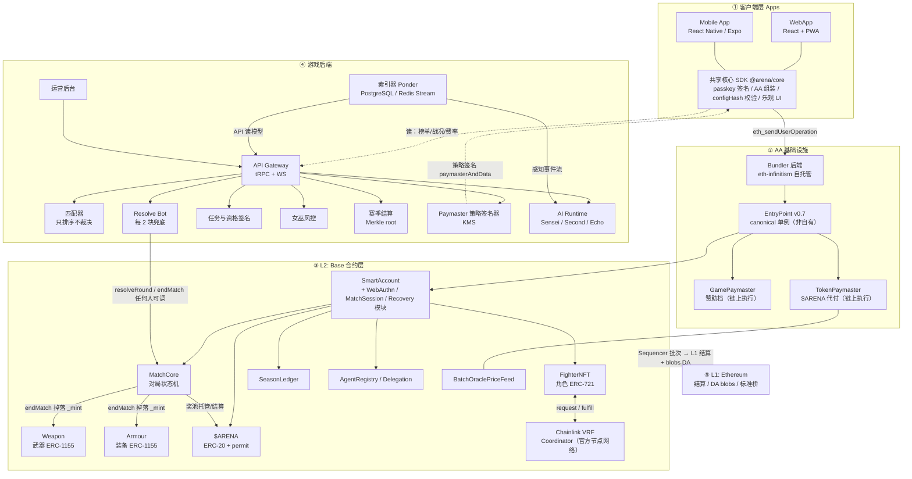
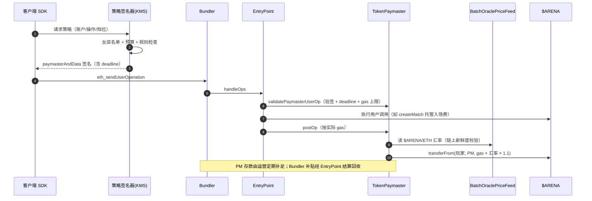
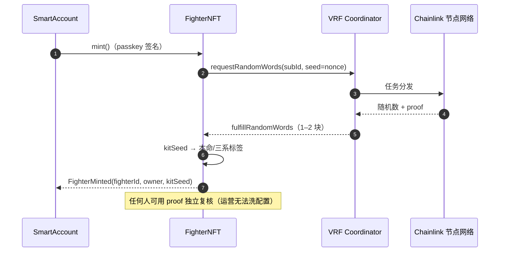
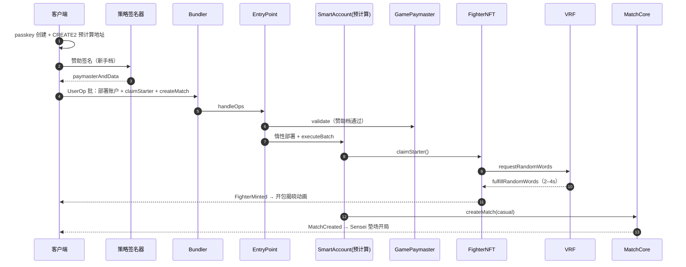
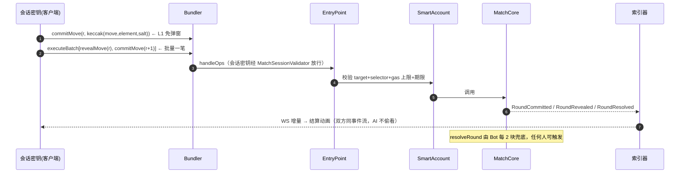
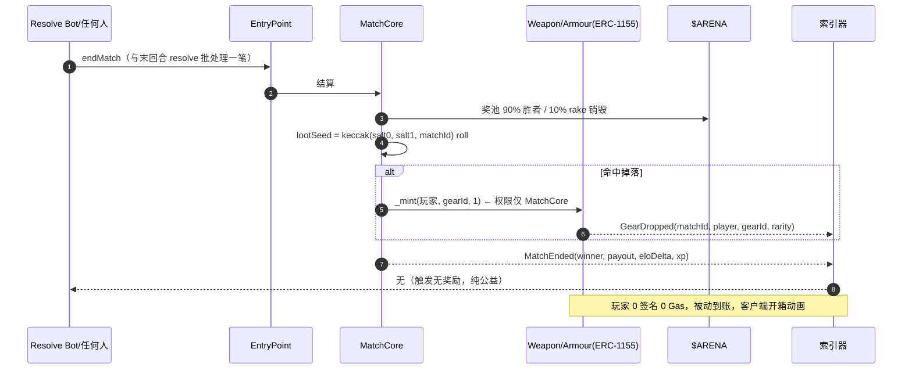

# 系统架构设计

> 版本：v0.4.0 ｜ 状态：待评审
> 上游文档：[产品设计](./product-design.md) ｜ [技术设计](./tech-design.md)（§1 为概览，本文为组件级细化） ｜ [代币经济](./tokenomics.md) ｜ [用例集](./usecases/README.md)
> 本文范围：客户端、游戏后端、Bundler 后端、Chainlink VRF、智能合约全景（EntryPoint / 账户 / 角色 / 武器 / 装备 / 游戏 Paymaster / Token Paymaster）、L2 与 L2 之上的完整拓扑、关键链路时序、部署与降级。

## 1. 总览



**设计原则**（承技术 §1.2）：

1. **事件即真相**：所有渲染/回放/AI 感知只读链上事件流，后端无私有状态
2. **人机同管道**：人与 AI 出招同一 Bundler / EntryPoint / Paymaster，无特权路径
3. **后端只排序不裁决**：匹配器崩溃 ≠ 比赛停摆；裁决是纯函数，任何人可触发
4. **最小权限签名**：passkey（价值）/ 会话密钥（出招）/ KMS（AI）/ 多签（金库）四级隔离

---

## 2. 客户端层（Mobile App + WebApp）

### 2.1 形态与共享结构

```
monorepo/
├── apps/web/        # Next.js：大厅/对局/观战/天梯/新手 60 秒路径（技术 §7.1）
├── apps/mobile/     # Expo (React Native)：复用全部游戏逻辑，增加原生能力
└── packages/core/   # @arena/core：两端共享（纯 TS，无 DOM/RN 依赖）
    ├── aa/          # UserOp 组装 / 批量 / nonceKey 隔离 / 重试（permissionless.js 封装）
    ├── signer/      # passkey（Web: WebAuthn；RN: expo-passkeys）+ 会话密钥生命周期
    ├── config/      # game-config.json 拉取 + configHash 链上校验
    ├── state/       # 乐观状态机：pending → confirmed / reverted；断线事件流重建
    └── api/         # tRPC client + WS hydration
```

### 2.2 组件职责

| 模块 | 职责 | 备注 |
|---|---|---|
| Passkey Signer | secp256r1 签名（L2 价值操作 + ERC-1271 登录） | Web: `navigator.credentials`；Mobile: 平台级生物识别（Face ID / 指纹） |
| 会话密钥管理器 | 开局授权 / 30min 缓冲 / 自动续局询问 | 整局 0 弹窗的关键（产品 §3.2） |
| AA SDK | UserOp 编码、executeBatch 打包、paymasterAndData 注入 | 批量 = 「reveal + 预 commit」「领奖+升级+再排」一笔 |
| config 校验 | 数值本地校验后才渲染（防喂假配置） | configHash 锚定（技术 §3.2） |
| 乐观 UI | 出招即锁按钮，事件回执驱动结算动画 | 技术产品 §3.3 |
| 推送 | 棋钟告急 / 掉落到账 / 委托到期 | Mobile 原生推送；Web PWA push |

### 2.3 Mobile 与 Web 差异

| 能力 | WebApp (PWA) | Mobile App |
|---|---|---|
| passkey | WebAuthn（现代浏览器全覆盖） | 原生生物识别，体验更佳、可作主推形态 |
| 推送 | PWA push（iOS 受限） | APNs / FCM 可靠 |
| 离线重建 | 缓存事件流 | 本地 SQLite 缓存，重连更快 |
| 分发 | 链接即达（裂变主入口） | 商店审核延迟，版本碎片需兼容矩阵 |

**零信任客户端**：客户端被攻破/魔改最多损失本账户会话密钥权益（= 一局入场费），无法伪造对局结果——所有裁决在链上。

---

## 3. 智能合约层（全部部署于 L2 Base）

### 3.0 合约总清单

| 合约 | 标准/角色 | 升级性 | 关键权限持有者 | 说明 |
|---|---|---|---|---|
| EntryPoint | ERC-4337 v0.7 **canonical 单例** | 非自有，全网共享 | 以太坊生态 | 不自行部署；入口唯一 |
| SmartAccount | Safe 变体代理账户 | 实现可升级（代理不动） | 账户 owner（passkey） | CREATE2 确定性地址，惰性部署 |
| WebAuthnValidator | 验签模块 | 随账户实现升级 | — | RIP-7212 precompile 0x100，~3.5k gas |
| MatchSessionValidator | 会话/委托模块 | 随账户实现升级 | — | selector 白名单 + gas 上限 + 期限（技术 §3.4） |
| RecoveryModule | 社交恢复 | 随账户实现升级 | guardians | 用例 03 |
| **FighterNFT（角色合约）** | ERC-721 + VRF consumer | **不可升级** | mint 价 setter（多签，事件透明） | 配置/XP/等级挂 tokenId（用例 04） |
| **Weapon（武器合约）** | ERC-1155 | **不可升级** | _mint 仅 MatchCore | 掉落/锻造铸发（用例 07） |
| **Armour（装备合约）** | ERC-1155 | **不可升级** | _mint 仅 MatchCore | 与 Weapon 共享 GearBase 实现 |
| MatchCore | 对局状态机 | **不可升级**（裁决核心资产） | configHash setter（多签） | create/commit/reveal/resolve/end + levelUp/craft |
| $ARENA | ERC-20 + EIP-2612 | **不可升级、无后继 mint** | 金库多签（仅转账） | 固定总量一次性铸造（tokenomics §2） |
| SeasonLedger | Elo/赛季/奖金 | root setter 多签 | 运营多签 | Merkle 混合模式（技术 §8.3） |
| AgentRegistry / Delegation | AI 注册/委托 | 参数多签 | 运营多签 | 质押罚没、雇佣账本 |
| **GamePaymaster（游戏代付合约）** | BasePaymaster（赞助档） | UUPS 多签+延时 | 策略签名器（KMS） | 新手/休闲/首胜赞助 |
| **TokenPaymaster（代付合约）** | BasePaymaster（$ARENA 代付档） | UUPS 多签+延时 | 策略签名器（KMS） | postOp 扣 $ARENA |
| BatchOraclePriceFeed | 汇率喂价 | UUPS 多签 | 喂价运营（新鲜度链上校验） | $ARENA→ETH 换算，10% 缓冲 |

> **武器/装备拆分说明**：产品语义的「Gear 装备池」在合约层拆为 Weapon.sol 与 Armour.sol 两个 ERC-1155，共享 GearBase（ERC-1155 核心 + mint 仅 MatchCore 的锁）。拆分动机：① 类目独立的市场/橱窗索引；② 未来武器与护甲的扩展节奏不同（槽位、合成）互不牵连；③ 单合约风险敞口隔离。对上层用例（06 锻造 / 07 掉落）透明——gearId 空间按类目前缀划分（0x01xx 武器 / 0x02xx 护甲）。

### 3.1 EntryPoint（不自建）

- 使用 Base 上 canonical EntryPoint v0.7 地址；Bundler / SDK / Paymaster 三方对齐同一地址
- 唯一入口：`handleOps` → `validateUserOp`（账户模块验签）→ 执行调用 → `validatePaymasterUserOp` / `postOp`
- 升级由生态治理，本项目仅做适配层测试跟随

### 3.2 账户合约：SmartAccount + 三模块

```
SmartAccount (Safe 变体, CREATE2 预计算地址)
├── owner: WebAuthnValidator        ← passkey（价值操作：铸造/转账/领奖/授权/恢复）
├── module: MatchSessionValidator   ← 会话密钥（出招/认输/裁决/levelUp）与 AI operator
└── module: RecoveryModule          ← guardians + 备用 passkey（用例 03）
```

- **账户地址 = 选手身份 = 段位主体 = 奖金归属**（技术 §4.1）
- 验签链路：出招 → 会话密钥签名（L1 免弹窗）；铸造/领奖 → passkey（L2）；AI 代打 → operator key + Delegation 校验（同一 MatchSessionValidator，`agentId > 0` 分支）

### 3.3 角色合约 FighterNFT（ERC-721）

- `mint()/claimStarter()` → 请求 VRF → `fulfillRandomWords` 定配置 → `FighterMinted` 事件（用例 04）
- tokenURI：动态元数据（等级/XP/战绩），数值以 configHash 事件为准，客户端校验后渲染
- 数据挂 tokenId：配置不可改；XP/等级由 MatchCore.levelUp 写入；段位不随 NFT（挂账户）

### 3.4 武器/装备合约（GearBase → Weapon / Armour）

- ERC-1155（同件可堆叠）；`_mint` 权限**仅 MatchCore**（掉落与 craft 都经 MatchCore 入口，杜绝增发后门）
- 掉落：`endMatch` 批内 `rollDrop(lootSeed)` 命中 → `_mint(玩家, gearId, 1)`（用例 07）
- 锻造：`craft(gearId)` 扣 $ARENA（销毁+金库分成）→ `_mint`（用例 06 ③）
- 数值全部 game-config（configHash），赛季调参不动合约

### 3.5 GamePaymaster vs TokenPaymaster（为什么拆两个合约）

| 维度 | GamePaymaster（赞助档） | TokenPaymaster（代付档） |
|---|---|---|
| 谁付 gas | 生态池 ETH（运营预算） | 玩家的 $ARENA（postOp transferFrom） |
| 服务对象 | 新手前 50 局 / 休闲限量 / 每日首胜半价 / Agent 档 | 排位玩家（入场费内含 Gas） |
| 风险面 | 预算被薅 → 日熔断 | 汇率操纵 → 预言机新鲜度校验 + 10% 缓冲 |
| 熔断影响 | 只影响赞助，代付不受累 | 只影响代付，赞助兜底可切 |
| 升级策略 | UUPS（策略热修） | UUPS（喂价逻辑热修） |

两合约均为 VerifyingPaymaster 模式：**策略在链下（KMS 签名器）、执行在链上（无状态验签）**（技术 §3.5）。拆分的核心动机是**预算域与故障域隔离**：赞助池熔断/被薅时，代付通道不受牵连；反之汇率异常时代付可独立暂停而新手赞助继续。

### 3.6 TokenPaymaster 扣款时序（postOp）



---

## 4. AA 基础设施：Bundler 后端

| 项 | 决策 | 理由 |
|---|---|---|
| 实现 | **eth-infinitism bundler 自托管**（docker，多实例 + LB）；预留第三方（Pimlico/Alchemy）逃生切换 | 主流量自控（~18 UserOps/局/人）；成本与可观测性；避免单点 |
| 提交策略 | 每 2s 块跟随、priority fee 自动竞价（观战高峰退让，技术待定项） | 回合节奏 10–20s 目标 |
| reputation | 标准ERC-4337 reputation + 队列分级（新手/老手/AI） | 防 DoS |
| 隐私 | commit 哈希本身零信息 → 无需私有 mempool | commit-reveal 设计红利 |
| 验证 | send 前 eth_call 模拟（AA2x/3x 预检） | 客户端与服务端双侧护栏 |
| 监控 | pending 队列深度 / 上块率 / AA 错误码分布 → 运营后台 | §9 运维 |

> Bundler 是**无状态管道**：宕机只延迟不裁决；多实例无共识问题（nonceKey 隔离 + EntryPoint 串行保证）。

## 5. Chainlink：VRF 节点网络（不自建节点）

**决策：使用 Base 官方 Chainlink VRF Coordinator v2.5 + Subscription，不自建 Chainlink 节点。** 理由：VRF 的价值在去中心化预言机网络（多节点、链上可验证 proof）；自建单节点反而引入单点与「运营可操纵」嫌疑，违背用例 04 的成功保证。

| 项 | 决策 |
|---|---|
| Coordinator | Base 官方 VRF v2.5，LINK 预充 Subscription |
| Consumer | FighterNFT（唯一 MVP consumer；掉落用 commit-reveal 熵不耗 VRF） |
| Gas lane / confirmations | 中档 gas lane；3 confirmations（配置决定强度，宁稳勿快） |
| 回调超时 | 两段式：请求费可退 + claim 退款（用例 04 §5） |
| 自建替代位 | resolve bot 兜底可被 **Chainlink Automation** 替代（V2 评估）：去中心化触发 resolveRound/endMatch，消除自建 bot 单点 |



---

## 6. 游戏后端

### 6.1 组件清单（技术 §8 细化）

| 组件 | 职责 | 关键约束 |
|---|---|---|
| API Gateway（Node + tRPC + WS） | 榜单/战况/配置/登录(ERC-1271)/解说代理 | 无状态，可水平扩展 |
| 匹配器 | 排位按 Elo 区间排序推送；休闲即撮即打（真人优先，Sensei 垫场） | **只排序不裁决**；无资金权限 |
| Resolve Bot | 每 2 块扫描超时/可结算局 → `resolveRound`/`endMatch` | 纯公益角色，任何人可替代 |
| 索引器（Ponder） | 订阅全部合约事件 → PostgreSQL + Redis Stream | **读模型唯一来源**；观战/回放/AI 感知同源 |
| 任务与资格签名 | 每日首胜/任务资格签名（技术 §8.2） | 链下签名 + 链上发放，防刷参数 |
| 女巫风控 | 账户年龄/行为分/设备指纹 → Paymaster 拒绝名单 + Merkle 名单剔除 | 与 Paymaster 签名器联动 |
| 赛季结算 | 索引器出榜 → 运营多签批准 → Merkle root 上链 | 判定链下锚定、发放链上非托管 |
| Paymaster 策略签名器 | 签发 paymasterAndData（双档规则执行） | KMS 密钥，泄露上限 = 单档预算 |
| AI Runtime | Sensei 出招 / Second 代打 / Echo 解说（感知→LLM→规划→护栏→KMS 签名） | 技术设计 §6；AI 也走 Bundler |
| 运营后台 | 双池监控熔断/Agent 管理/调参/透明报告 | 全部敏感动作为多签提案 |

### 6.2 密钥与权限一览（信任边界）

| 密钥 | 持有 | 能签什么 | 泄露损失上限 |
|---|---|---|---|
| 玩家 passkey | 用户设备（TEE） | 价值操作（铸造/转账/领奖/授权） | 该账户全部资产（可恢复夺回） |
| 会话密钥 | 客户端内存 | 出招/认输/裁决/levelUp | 一局入场费 |
| Second operator key | AI Runtime KMS | 受委托玩家账户的出招类操作 | 该委托期出招权限 |
| Sensei 账户热钥 | AI Runtime KMS | Sensei 自有账户出招 | Sensei 自身资产（无玩家资金） |
| Paymaster 策略签名钥 | 后端 KMS | paymasterAndData | 单档预算（熔断可止血） |
| 运营多签 | 多签人 | 参数 setter / Merkle root / 金库转账 | 受延时与阈值约束，链上可审计 |
| 金库五池多签 | tokenomics §3 | 激励/生态池发放 | 池内余额，限额+延时 |

**信任边界**：客户端不可信（零信任重建）→ 后端半可信（只排序、只签名资格，错误可被链上拒绝）→ 合约层可信（裁决不可干预，纯函数）→ L2/L1 平台信任假设（OP Stack + Ethereum 结算）。

## 7. 链平台层

### 7.1 L2：Base（OP Stack）

| 能力 | 用法 |
|---|---|
| 软确认 2s | 出招回执、回合节奏 10–20s（对局信软确认） |
| L1 finality（epoch 结算） | 赛季奖金/大额金库操作等终局后发放（产品 §3.3 分级信任） |
| RIP-7212 precompile 0x100 | passkey 验签 ~3.5k gas（fallback solidity ~300k） |
| Predeploys（GasPriceOracle 等） | SDK 费率估算 |
| 事件流 | 索引器/AI 感知/观战的唯一数据源 |
| 块高棋钟 | commit/reveal 各 30 块（技术 §3.2），无需链下裁判 |

### 7.2 L1：Ethereum

| 职责 | 说明 |
|---|---|
| 结算 + DA（blobs） | Base 批次上 L1，全节点可验证——「停服也可重建」的最终保障 |
| ETH 标准桥 | 玩家出入金（2–5min 入 / 7 天挑战期出，UI 进度条） |
| 奖金金库周归集 | 生态池 ETH 每周桥回 L1 多签（技术 §5.4） |
| $ARENA 不跨链 | MVP 内部闭环，无 L1 合约（tokenomics §9） |

---

## 8. 关键链路时序

### 8.1 注册 60 秒（用例 01）



### 8.2 一个回合（最高频路径，整局仅开局 1 次 L2）



### 8.3 终局结算 + 幸运掉落（用例 05 ⑤ / 07）



---

## 9. 部署视图

### 9.1 环境与地址

| 环境 | 链 | 说明 |
|---|---|---|
| dev/staging | Base Sepolia | 全量合约 + 测试链 VRF + 桩后端 |
| prod | Base mainnet | canonical EntryPoint；VRF 主网 Subscription |

合约地址注册表（链上 `AddressRegistry` + 文档双源），客户端启动校验防钓鱼域名/假地址注入。

### 9.2 上线顺序（依赖 DAG）

```
$ARENA(一次性全额铸造入五池金库)
  → SmartAccount 实现 + 三模块（工厂注册）
  → FighterNFT（VRF consumer 接入 Subscription）
  → Weapon / Armour（GearBase，_mint 权限预授 MatchCore）
  → MatchCore（授权：掉落铸发 / 入场费 $ARENA / XP 写入 FighterNFT）
  → SeasonLedger + AgentRegistry + Delegation
  → GamePaymaster + TokenPaymaster（策略签名器切流）
  → 索引器/匹配器/Resolve Bot/AI Runtime 上线
```

### 9.3 升级性矩阵

| 不可升级（信任最小化） | 可升级（多签+延时，参数/策略域） |
|---|---|
| MatchCore、FighterNFT、Weapon、Armour、$ARENA | 两个 Paymaster（UUPS）、BatchOraclePriceFeed、SeasonLedger root setter、各参数 setter |

### 9.4 可用性与降级矩阵

| 故障 | 影响 | 降级行为 |
|---|---|---|
| 游戏后端全宕 | 无新匹配/无观战推送 | **已有对局照常打完**（resolve 任何人触发）；链上状态零损失 |
| Bundler 宕 | 出招延迟 | 多实例；切换第三方 Bundler（同一 EntryPoint） |
| Paymaster 策略器宕 | 新 UserOp 无赞助 | 客户端 fallback 本地 ETH / 排位代付不受影响（独立合约） |
| VRF 停摆 | 铸造不可用 | 休闲局/已有 Fighter 照常；两段式退款（用例 04） |
| 汇率喂价过期 | TokenPaymaster 拒签 | 新手赞助档兜底或暂停代付（故障域隔离，§3.5） |
| Sequencer 停 | 全链暂停 | OP Stack 逃生舱（L1 提交）；棋钟以块高计天然抗停 |
| L1 拥堵 | DA 成本上升 | blobs 批处理；不影响玩法 |

## 10. 规格待定项

1. Bundler 自托管与第三方的流量切分比例与自动切换阈值
2. resolve bot → Chainlink Automation 的替代评估（成本 vs 去中心化）
3. Mobile 端 passkey 库选型定型与 iOS/Android 兼容矩阵
4. TokenPaymaster 存款补充自动化（金库机器人 vs 人工多签）
5. AddressRegistry 的客户端防钓鱼校验细节
6. Weapon/Armour gearId 空间与 GearBase 接口冻结版本

## 11. 关联文档

[技术设计](./tech-design.md)（§1 概览 / §3 合约 / §4 AA / §6 AI / §8 后端） ｜ [产品设计](./product-design.md) ｜ [代币经济](./tokenomics.md) ｜ [分期开发与发布计划](./development-phases.md) ｜ [用例集](./usecases/README.md)（01 注册 / 03 恢复 / 04 角色 / 05 对局 / 06 锻造 / 07 掉落）
