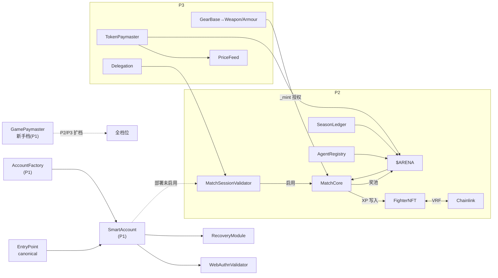
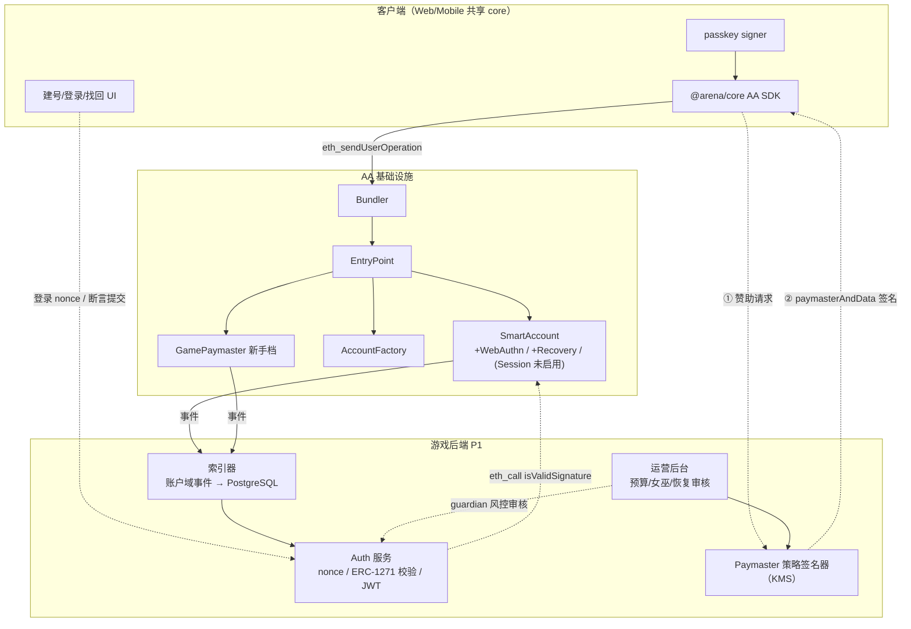
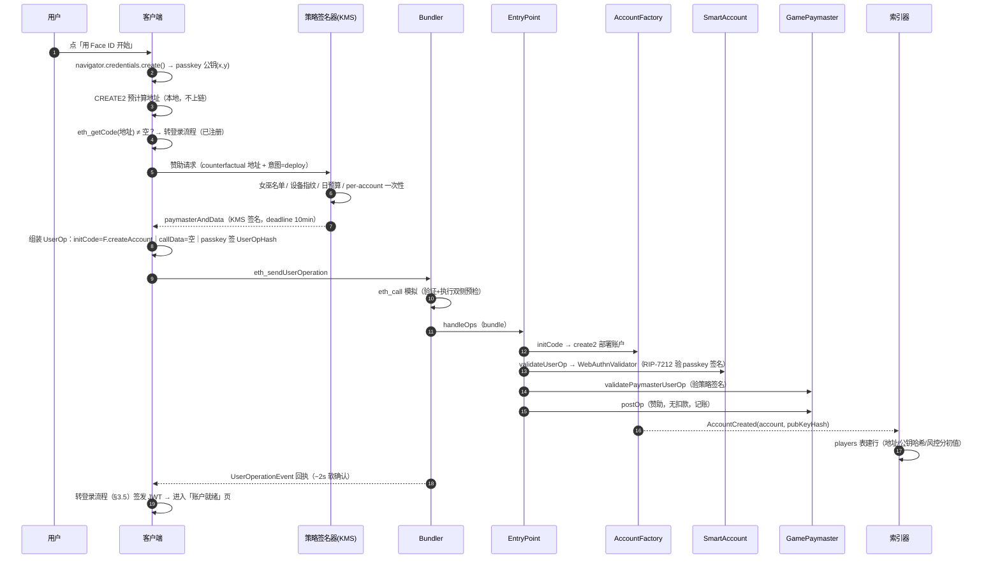
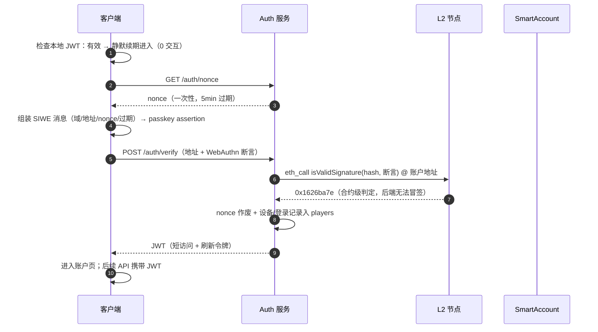
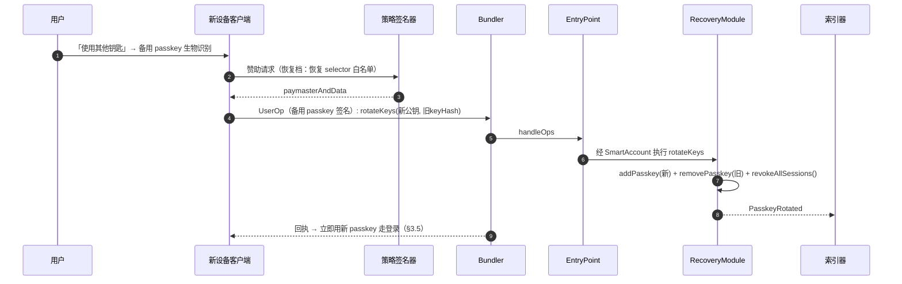
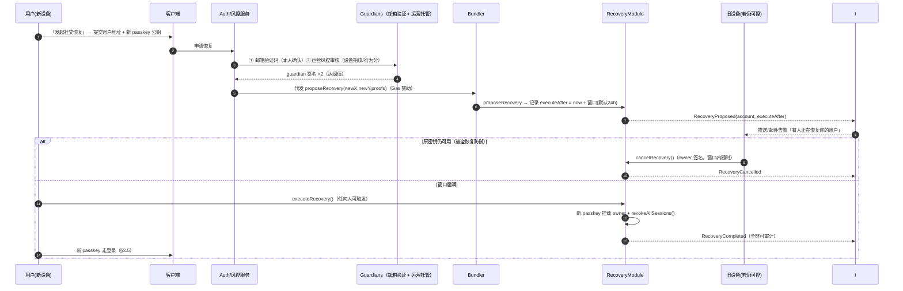

# 合约分阶段开发与发布计划（Development Phases）

> 版本：v0.4.0 ｜ 状态：待评审
> 上游文档：[架构设计](./architecture.md) ｜ [技术设计](./tech-design.md) ｜ [用例集](./usecases/README.md)
> 本文范围：合约按 phase 拆分开发/发布的顺序与验收；**Phase 1 = 注册（signup）/ 登录（signin）/ 找回（recover）三个 story 的全系统交互详设**。

## 1. 分期总览

| Phase | 主题 | Story（用例） | 新增合约 | 后端 | 客户端 | 出口标准（摘要） |
|---|---|---|---|---|---|---|
| **P0** | 环境基线 | — | 无（canonical EntryPoint 接入） | 部署管线 CI | 骨架 monorepo | Base Sepolia 全链路跑通一笔空 UserOp |
| **P1** | **账户基座** | **01 注册 / 02 登录 / 03 找回**（本文 §3 详设） | AccountFactory、SmartAccount、WebAuthnValidator、RecoveryModule、MatchSessionValidator（部署未启用）、GamePaymaster（新手档） | Auth 服务、策略签名器、索引器（账户域） | 建号/登录/找回三页 | §3.9 验收矩阵 |
| **P2** | 角色与对局 | 04 角色 / 05 对局 | $ARENA、FighterNFT（VRF）、MatchCore、SeasonLedger、AgentRegistry；启用 MatchSessionValidator | 匹配器、Resolve Bot、AI Runtime（Sensei）、索引器扩展 | 大厅/对局/观战 | 用例 01 完整 60 秒路径闭环 |
| **P3** | 装备与经济闭环 | 06 锻造 / 07 掉落 / Second 代打 | GearBase + Weapon + Armour、TokenPaymaster、BatchOraclePriceFeed、Delegation | 任务签名、女巫扩展、赛季结算试运行 | 锻造/背包/掉落动画 | 掉落与锻造链上闭环 |
| **P4** | 赛季与运营规模化 | 赛季奖金 / Echo / 桥归集 | 无新合约（参数域） | Merkle 结算流、Automation 替代评估 | 榜单/领奖 | 首个完整赛季结算 |

**分期原则**：

1. **每期可独立上主网**：P1 上线即开放「预约建号」（早于游戏收集真实账户，兼作 AA 栈压测）
2. **账户实现 P1 冻结**：后续 phase 只通过「启用已部署模块 / 新增外部合约」扩展，**不升级账户实现**——玩家地址终身稳定
3. **裁决合约（MatchCore）最晚一次成型**：P2 审计重点，之后不可升级
4. **依赖前向兼容**：P1 的首笔 UserOp 批结构 = P2 完整 60 秒路径的子集，P2 上线无需迁移

## 2. 合约发布矩阵与依赖

### 2.1 发布矩阵

| 合约 | P0 | P1 | P2 | P3 | 升级性 |
|---|---|---|---|---|---|
| EntryPoint（canonical） | 接入 | — | — | — | 生态治理 |
| AccountFactory / SmartAccount / 三模块 | — | ✅ | 启用 MatchSession | — | 实现冻结 |
| GamePaymaster | — | ✅ 新手档 | +休闲/首胜档 | +Agent 档 | UUPS |
| TokenPaymaster / PriceFeed | — | — | — | ✅ | UUPS |
| $ARENA | — | — | ✅ 一次性全额铸造入五池 | — | 不可升级 |
| FighterNFT / MatchCore / SeasonLedger / AgentRegistry | — | — | ✅ | — | 不可升级（参数 setter 多签） |
| GearBase / Weapon / Armour / Delegation | — | — | — | ✅ | 不可升级 |

### 2.2 依赖 DAG



---

## 3. Phase 1 详设：注册 / 登录 / 找回

> 实现级技术设计已拆分为三份独立文档（含 API 契约、数据结构、状态机、错误码与测试矩阵）：[tech/01-signup.md](./tech/01-signup.md) · [tech/02-signin.md](./tech/02-signin.md) · [tech/03-recover.md](./tech/03-recover.md)。本章保留概要级视图。

### 3.1 范围与裁剪说明

| 项 | P1 落地 | 与用例的差异 |
|---|---|---|
| Signup | 建号 = 部署账户（1 次 passkey 弹窗 + 1 笔赞助 UserOp） | 用例 01 的原子批后两段（`claimStarter`/`createMatch`）**P2 上线后自动补齐**——批结构不变，仅 append 调用 |
| Signin | ERC-1271 登录 + JWT（纯链下验签） | 与用例 02 一致；「会话密钥复用登录」路径 P2 才存在（P1 无对局会话） |
| Recover | 备用 passkey 轮换 + 社交恢复（延时窗口） | 与用例 03 一致；`revokeAllSessions` 在 P1 作用域为空但接口冻结 |

**非目标**： Fighter、$ARENA、对局、代打、掉落；TokenPaymaster（P1 无代付需求）。

### 3.2 P1 合约接口（关键签名）

```solidity
// ---- AccountFactory（CREATE2 确定性地址）----
function createAccount(bytes32 pubKeyX, bytes32 pubKeyY, uint256 salt) returns (address);
function getAddress(bytes32 pubKeyX, bytes32 pubKeyY, uint256 salt) view returns (address);
event AccountCreated(address indexed account, bytes32 pubKeyHash);

// ---- SmartAccount（Safe 变体，实现冻结）----
function executeBatch(address[] calldata targets, bytes[] calldata data);  // 仅 owner(passkey)
function isValidSignature(bytes32 hash, bytes calldata sig) view returns (bytes4); // ERC-1271 → 路由验证模块
function enableModule(address m) / disableModule(address m);               // 仅 owner

// ---- WebAuthnValidator（owner 验签模块）----
// isValidSignature: 解析 WebAuthn 断言 → authenticatorData+clientDataHash →
//                   RIP-7212 precompile 0x100（fallback solidity ~300k）

// ---- RecoveryModule ----
function addPasskey(bytes32 x, bytes32 y);                 // owner（L2 passkey）
function rotateKeys(bytes32 newX, bytes32 newY, bytes32 oldKeyHash); // 场景A：加新+吊旧+revokeAllSessions
function revokeAllSessions();
function addGuardian(address g) / removeGuardian(address g);              // owner
function proposeRecovery(bytes32 newX, bytes32 newY, bytes calldata guardianProofs) external; // 场景B
function cancelRecovery() external;                       // owner，延时窗口内（紧急叫停）
function executeRecovery() external;                      // 窗口后任何人可触发
event PasskeyRotated(bytes32 indexed newKeyHash, bytes32 indexed oldKeyHash);
event RecoveryProposed(address indexed account, uint64 executeAfter);
event RecoveryCancelled(address indexed account);
event RecoveryCompleted(address indexed account, bytes32 newKeyHash);
event GuardiansChanged(address indexed account, address[] guardians);

// ---- GamePaymaster（P1 仅新手赞助档）----
// validatePaymasterUserOp: 验策略签名(KMS) + deadline + per-account 一次性部署赞助 + selector 白名单
//                          白名单(P1) = 工厂部署 / RecoveryModule.rotateKeys|proposeRecovery
// postOp: 赞助档无扣款；累计消耗记账供熔断
```

### 3.3 P1 组件交互总图



### 3.4 Story A：注册（signup）主流程



**体验目标**：1 次系统生物识别弹窗、0 Gas、≤ 15s 到登录态。

**Signup 异常与边界**：

| 情形 | 处理 |
|---|---|
| 设备不支持 passkey | fallback 邮箱验证器（用例 01 §5；P1 排期覆盖矩阵测试） |
| 中途关页/放弃 | 无损失：地址是 CREATE2 确定值，下次打开原 passkey → 同地址继续 |
| 同地址已部署（重复注册） | `eth_getCode` 预检命中 → 客户端自动转登录；若仍发 UserOp，initCode 失败 AA13 → 同样引导转登录 |
| 双设备同 passkey+salt 并发 | 后上链者 initCode 冲突失败；无资金、无状态损失 |
| 策略签名器熔断（预算耗尽） | 返回 403+熔断提示（AA4x）；新手档次日刷新 |
| RIP-7212 不可用链（非 Base） | WebAuthnValidator 内置 solidity fallback（~300k gas，仅测试网用） |

### 3.5 Story B：登录（signin）主流程



- **0 链上写入、0 Gas、0 钱包弹窗**（仅一次系统级生物识别）
- JWT 与链上权限完全解耦（用例 02 §6）：只授读/预约 API 能力
- 账户未部署（注册中途放弃）：Auth 按 CREATE2 预测地址走「state-override 模拟验签」或直接引导回注册

**Signin 异常与边界**：

| 情形 | 处理 |
|---|---|
| 断言来自另一账户的 passkey | `isValidSignature` 返回≠magic → 拒绝并提示「切换账户」 |
| nonce 重放 | 一次性 nonce + 服务端作废记录 |
| Auth 服务作恶 | 验签在合约/节点模拟完成，后端无法冒签（只发放给真签名者） |
| JWT 过期且 passkey 丢失 | 转用例 03 找回 |
| 多设备并行登录 | 允许；`players.devices` 记录全设备，可单设备登出 |

### 3.6 Story C：找回（recover）

#### 场景 A：持有备用 passkey（~1 分钟，1 次签名）



#### 场景 B：passkey 全丢 → 社交恢复（guardians 2/3 + 延时窗口）



**Recover 异常与边界**（对齐用例 03 §5）：

| 情形 | 处理 |
|---|---|
| 攻击者发起虚假恢复 | 三重防线：邮箱验证 + 运营风控 + 窗口内原密钥 `cancelRecovery` 叫停 |
| guardians 串通 | 运营托管 guardian 独立风控渠道；恢复事件全上链可审计 |
| 邮箱也丢 | 运营托管 guardian 人工申诉（KYC 级慢路径） |
| 窗口内用户主动轮换（非被盗） | 走场景 A 即时完成，无需窗口 |
| 恢复 Gas 承担 | 建议 P1 即定「运营赞助恢复」（用户不能卡死门外），进 selector 白名单 |
| 主动轮换防泄露 | 场景 A `rotateKeys` 即刻吊销全部旧钥（含未来 P2 的会话/代打密钥） |

### 3.7 事件与索引器（P1 账户域）

| 事件 | 来源 | 索引器动作 |
|---|---|---|
| AccountCreated | AccountFactory | `players` 建行、风控分初值、地址标签 |
| UserOperationEvent / opRevert | EntryPoint | UserOp 成败审计、赞助成本归集 |
| PasskeyRotated / GuardiansChanged | RecoveryModule | `players.passkeys/devices` 更新、登录态全端登出 |
| RecoveryProposed / Cancelled / Completed | RecoveryModule | `recovery_events` 表 + 推送告警 + 窗口倒计时任务 |

### 3.8 P1 GamePaymaster 策略（新手档）

| 规则 | 参数（待定） |
|---|---|
| 赞助范围 | 工厂部署 + RecoveryModule 全 selector（白名单硬编码） |
| per-account | 部署赞助 1 次/账户；恢复赞助 1 次/账户/90 天 |
| 日预算 | 熔断线（运营后台可调，事件透明） |
| 女巫 | 设备指纹 + IP 聚类 + 账户年龄 → 拒签名单 |
| 签名时效 | deadline 10min，一次性（nonce 绑定 UserOpHash） |

### 3.9 P1 验收矩阵

| 维度 | 标准 |
|---|---|
| Signup | p95 ≤ 15s；1 次弹窗；0 Gas；中断续跑率 100%（地址确定性） |
| Signin | 静默路径 < 1s；nonce 路径 2–3s；重放/冒签攻击用例全拒 |
| Recover | 场景 A ≤ 1 分钟；场景 B = 窗口参数（默认 24h）；虚假恢复叫停演练通过；恢复后旧钥全废（含旁路重放测试） |
| 赞助滥用 | testnet 压测 1k 账户，批量注册识别率 ≥ 95%，熔断可自动恢复 |
| 审计 | P1 审计范围 = 账户栈三模块 + GamePaymaster（Critical/High 零遗留） |
| 兼容 | P2 预演：同账户启用 MatchSessionValidator、append claimStarter/createMatch 到首笔批（测试网走通即验收） |

## 4. Phase 2–4 概要（入口条件 → 范围）

| Phase | 入口条件 | 关键交付 |
|---|---|---|
| P2 | P1 验收全过 + MatchCore 审计完成 | 完整 60 秒路径（用例 01 原形）；VRF 铸 Fighter；休闲/排位；Sensei 垫场；Elo/XP；会话密钥上线（整局 0 弹窗） |
| P3 | P2 稳定运行 1 个迭代周期 | $ARENA 代付闭环；Weapon/Armour 掉落+锻造；任务系统；Second 代打（Delegation） |
| P4 | 首个赛季数据齐 | Merkle 赛季结算；金库周归集；Automation 替代 resolve bot 评估；V2 预研（DEX/提现，tokenomics §9 条件） |

## 5. 规格待定项

1. P1 账户实现冻结前的模块接口评审清单（含 P3 Delegation 对 MatchSessionValidator 的前向兼容）
2. 社交恢复参数定值：guardian 阈值（建议 2/3）、延时窗口（建议 24h）、恢复赞助配额
3. 邮箱 fallback 验证器的 P1 排期（设备矩阵测试先行 or P2 补）
4. state-override 模拟验签的节点能力依赖（自建节点 vs 公共 RPC）
5. P1 是否同步开放「预约建号」产品入口（主网预热）的运营决策

## 6. 关联文档

[架构设计](./architecture.md) ｜ [技术设计](./tech-design.md) §3 / §4 ｜ [用例 01 注册](./usecases/01-signup.md) ｜ [用例 02 登录](./usecases/02-signin.md) ｜ [用例 03 找回](./usecases/03-recover.md)
