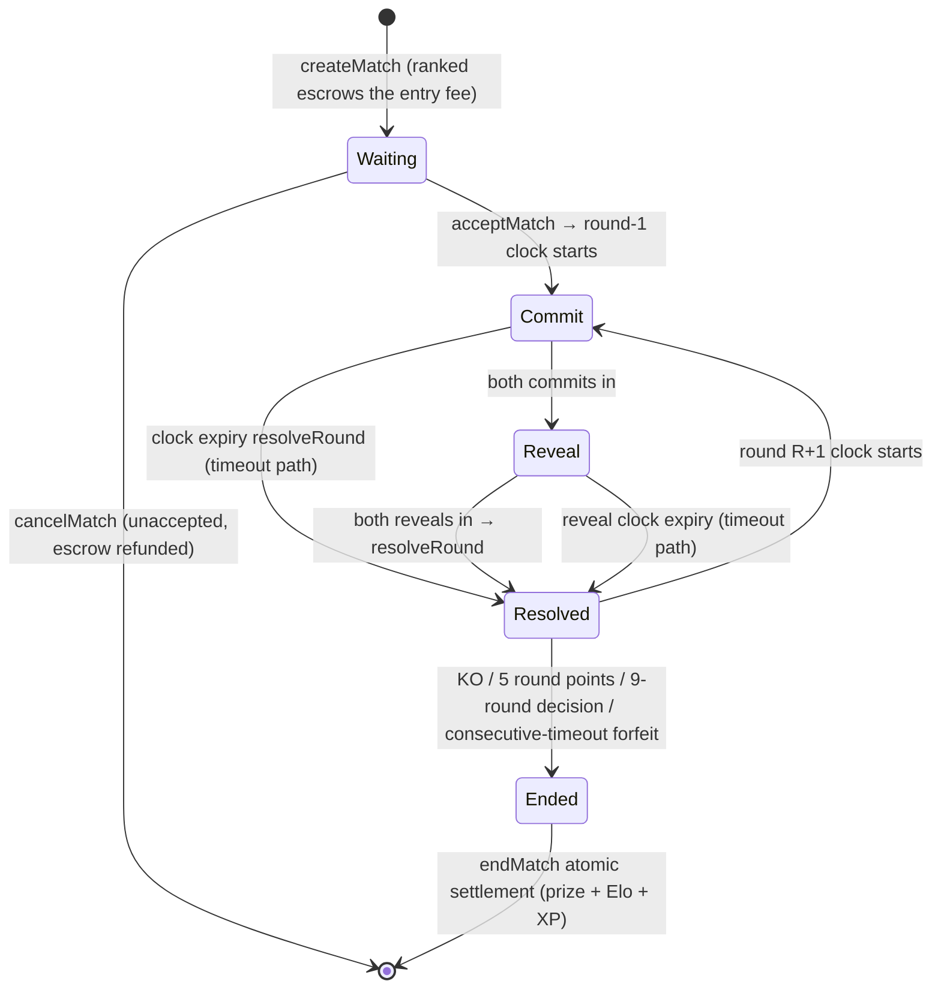

# ChainArena — Product Design Document

> Version: v0.4.0-en (English edition of `product-design.md` v0.4.0; split from the "MVP Design" doc v0.3.3)
> Location: `chainarena/docs/product-design.en.md`
> Status: Pending review
> Companion documents: Tech Design (`tech-design.md` / `tech-design.en.md`)
> Language: [中文](./product-design.md) | English
>
> **Change log (this document)**
> - v0.4.0: Document split. This volume covers: overview & positioning (§1), gameplay design (§2), player experience design (§3, absorbing the original §7.3 optimistic UI, §9.2 newcomer path, §9.3 popup policy, §14.2 fee perception), product positioning of AI roles (§4, formerly §8.1/8.4/8.5/8.6), release plan overview (§5), product risks (§6, items R3/R4/R7/Q3 of the former §15), V2 outlook (§7). Full history is preserved in `mvp-design.md` (archived). Also fixed: a token typo in the AI stand-in hiring flow ($GEM → $ARENA, consistent with the economy design in §2.6). The Chinese edition is authoritative if the two diverge.

---

## Table of Contents

1. [Overview: Why This Game Must Live On-Chain](#1-overview-why-this-game-must-live-on-chain)
2. [Gameplay Design](#2-gameplay-design)
3. [Player Experience Design](#3-player-experience-design)
4. [Product Positioning of AI Roles](#4-product-positioning-of-ai-roles)
5. [Release Plan Overview](#5-release-plan-overview)
6. [Product Risks & Open Questions](#6-product-risks--open-questions)
7. [V2 Outlook](#7-v2-outlook)

---

## 1. Overview: Why This Game Must Live On-Chain

### 1.1 One-Sentence Positioning

**ChainArena** is a **fully on-chain, asynchronous fighting arena** deployed on an L2: you own a VRF-generated Fighter (NFT) and trade blows move by move with humans or AI inside a public contract — **every move you make is an on-chain transaction, and anyone can verify the adjudication of every round**. No black-box servers, no death-by-shutdown; even the operator cannot rig match outcomes.

### 1.2 Four Fundamental Problems of Server-Based Competitive Games (and Why ChainArena Exists)

| Problem with server games | ChainArena's answer | Features relied upon |
|---|---|---|
| **Adjudication black box**: matchmaking, RNG and rulings live inside the server where the operator can secretly tweak them | Moves use commit-reveal; adjudication is a pure function; all rules are open source and verifiable | Cheap L2 + commit-reveal |
| **Shutdown = death**: when the servers go dark, the game and your investment vanish | Core gameplay = on-chain contracts; anyone can build a client and join (the protocol is a public good) | Fully on-chain state + events-as-data |
| **Progress & assets aren't yours**: a ban or shutdown wipes everything | Fighters are NFTs, ratings hang on your smart account, prizes are non-custodial | ERC-4337 accounts + NFT |
| **PvP cold-start death spiral**: no players → no matches → no players | **AI opponents online 24/7 keep matchmaking alive** (behaving on-chain exactly like human players); there is someone to fight from day one | AI Agent + cheap L2 |
| (new) **The trust problem of the AI era**: bots posing as humans, cheats, gray-market piloting | **Humans and AI compete in the same arena with publicly auditable behavior**: AI is a registered, official contestant that never pretends to be human; piloting is player-authorized and visible on-chain | AgentRegistry + AgentOperator |

> In one sentence: **ChainArena is not "putting a game on-chain" — it turns the fairness of the arena itself into an on-chain public good**, and turns AI from a black market into official contestants.

### 1.3 Design Principles: Make Full Use of ERC-4337, L2, and AI Agents

| Principle | Meaning |
|---|---|
| **Account = contestant** | A player's identity is an ERC-4337 smart account: rating, record and prizes all attach to the account |
| **On-chain = adjudication** | Moves, rulings and settlement are all contract logic; servers only accelerate, never decide |
| **Agent = contestant** | AI and humans share the same account/transaction/censorship pipeline; AI never impersonates a human |
| **Zero tolerance for popups** | A match is a dozen-plus moves; session keys make an entire match popup-free |
| **Zero gas friction** | Paymaster sponsors newcomer matches; ranked entry fees include gas (token payment) |
| **Events = broadcast** | The match event stream is the single data source for spectating, replays, commentary and analytics |
| **LLM never touches money** | LLMs only produce intents/suggestions/commentary; on-chain actions always pass through a deterministic planner and guardrails |

### 1.4 MVP Goals

**Core MVP (W1–W8):**

- ✅ New players go from "opening a link" to "finishing their first match" in **60 seconds** (passkey onboarding + free Fighter + free matchmaking + zero gas throughout)
- ✅ The core match loop (matchmaking → moves → adjudication → settlement → rating) is **100% on-chain**
- ✅ Full on-chain cost per match **< $0.10**; per move **< $0.005**
- ✅ A 9-round match with **0 wallet popups** (except one authorization at the start)
- ✅ Spectate/replay pages built from the pure event stream (validating "clients can be rebuilt even if the servers die")

**AI Phase (W9–W11):**

- ✅ AI opponents in three difficulty tiers online 24/7; **> 60% of matches AI-backed** during cold start
- ✅ AI stand-in: authorize an Agent to play ranked while you are offline — behavior auditable, rewards discounted
- ✅ AI commentary & review: per-round commentary and opponent-habit analysis auto-generated from the event stream

### 1.5 Alternative Concepts (Evaluated and Rejected)

| Alternative | Reason for rejection |
|---|---|
| On-chain Werewolf / diplomatic negotiation | Needs many simultaneous players — even harder cold start; social deduction depends heavily on speed, and L2 latency is marginal |
| zk space conquest (Dark Forest style) | zk circuit development far exceeds the MVP budget (≥ 6 months) |
| Fully on-chain trading card game (TCG) | High art-asset production cost, and "card packs on-chain" is still asset-on-chain, not gameplay-on-chain |
| **Asynchronous fighting arena (chosen)** | Extremely light on content (no art levels), extremely deep on strategy (simultaneous-move mind games), **every single move must be on-chain to be fair**, AI opponents fit naturally, and every L2 feature becomes load-bearing |

---

## 2. Gameplay Design

### 2.1 Core Loop

```
Claim/mint a Fighter (VRF decides the move kit) → Matchmake (ranked/casual, opponent = human or AI)
→ Match: simultaneous secret moves each round (commit-reveal) → Contract adjudication (pure function) → Score advances
→ Endgame: prize settlement + rating (Elo) + XP → Level up to unlock specials/gear → Climb the seasonal ladder
```

### 2.2 Game Roles

#### 2.2.1 Participant Roles at a Glance (humans and machines in the same arena, each in its place)

| Role | Position | Identity carrier | Permission boundary |
|---|---|---|---|
| **Human player** | Official contestant: owns Fighters, climbs the ladder, wins prizes | ERC-4337 smart account (passkey) | Full authority; value operations (mint/claim/bridge) always passkey |
| **AI opponent Sensei** | Registered filler contestant (Bronze/Silver/Master tiers), online 24/7, cold-start guarantee | Its own Safe account (AgentRegistry flags it as AI, address public) | Move-type operations only; prize money won is burned outright (§4.2) |
| **AI stand-in Second** | A hired "cornerman": fights in the authorized style while the player is offline | Player's account + AgentOperator restricted key | Moves only (narrower selector + match cap); transparently flagged on-chain before the match (§4.3) |
| **AI commentator Echo** | Observer: per-round commentary, post-match reviews, content production | No on-chain account; pure event-stream reader | L0 read-only — the cleanest demonstration of "LLM never touches money" (§4.4) |
| **Spectator** | Watch/replay/analytics without an account | None (login optional) | L0 read-only |

> Iron rule of positioning: **AI is an official contestant, not a cheat** — Sensei fights openly under its own account, Second acts under the player's public mandate, Echo talks but never acts; all three are registered/flagged on-chain. "AI posing as human" does not exist in this design.

#### 2.2.2 The Five Fighter Archetypes (build positioning)

Fighter build diversity is decided entirely by VRF minting (verifiable fairness), with the mapping rule: **innate element → archetype**. All Fighters share the same 5-move framework (§2.3); archetypes only change three things — **base stat tweaks, SPECIAL signature effects, and passive traits** — so the decision tree is unchanged, fully enumerable in tests, and regression-testable in simulation (Tech Design §10).

| Archetype | Innate | One-line identity | Passive (always on) | SPECIAL signature effect (3 energy, unlocked at Lv.5) |
|---|---|---|---|---|
| Blade | Metal | Burst executioner, guard-buster | HEAVY damage 30→33 | "Armor Buster": ignores GUARD mitigation, full 80 damage |
| Verdant | Wood | Sustain & attrition, grows tougher over time | Heals 5 extra HP when GUARDing | "Rejuvenation Strike": 40 damage + self-heal 15 HP (capped at 100) |
| Flow | Water | Resource tempo, energy suppression | CHARGE energy +2→+3 | "Tide Strike": 40 damage + steals 1 energy from the opponent (added to self, capped) |
| Blaze | Fire | Raw damage pressure, highest firepower | STRIKE damage 15→17 | "Sky-Scorcher": 48 damage (highest single hit in the game) |
| Bastion | Earth | Iron wall, punishes charging | GUARD mitigation 60%→70% | "Mountain Strike": 40 damage + erases the opponent's extra energy gain this round (GUARD/CHARGE energy bonuses voided) |

- **All effects are pure functions within a round** (no cross-round state, no extra storage slots); `resolveRound` is fully enumerable; all numbers live in `game-config.json` (anchored by configHash, Tech Design §3.2), so seasons can retune without touching contracts.
- **Counter gaps are the archetype's personality**: the three move tags (3 of 5 elements) decide which elements STRIKE/HEAVY can carry, and SPECIAL is always the innate element — Blade's "countered blind spots" and "countering strengths" are equally part of the build.
- **Balancing valve**: the match simulator runs 5×5 archetype round-robin win-rate regression (±3% gate, Tech Design §10); archetype imbalance is fixed by configHash tuning, not contract changes.

### 2.3 Match Rules (complete MVP ruleset, deliberately minimal)

**Match structure**: BO9 (up to 9 rounds), asynchronous; each round both players commit secret moves **simultaneously**. Win conditions for the whole match (by priority):

1. **KO win**: after any round's resolution the opponent's HP ≤ 0 (HP accumulates continuously through the match and **never resets**) → match ends immediately;
2. **Round-point win**: first to **5 round points** wins — the round point goes to whoever dealt **more total damage that round** (heals/lifesteal excluded from the comparison; an exact tie is a tied round and both sides get 0 points);
3. **Decision win**: if 9 full rounds pass with no KO and no 5 points, decide by **(round points → remaining HP) lexicographic order**; a full tie is a **draw** (ranked: both sides get 90% of the entry fee back, the 10% rake is still burned; casual: nothing happens).

> Design intent: the KO path rewards damage efficiency, the round-point path rewards exchange dominance, and the decision path is a floor against "turtle-and-stall" — the three win paths constrain one another, and GUARD/CHARGE dealing "0 damage this round" naturally costs round points.

**Three on-chain phases per round:**

1. `commitMove(round, keccak(move, element, salt))` — both sides submit commitments (move content hidden by the hash)
2. `revealMove(round, move, element, salt)` — both sides reveal (anyone can verify commitment consistency)
3. `resolveRound(matchId)` — anyone can trigger; the contract settles the round by pure-function rules (damage/energy/round points/timeout, all in one pass)

**Move table (shared framework for all Fighters; individual differences come only from the archetype, §2.2.2):**

| Move | Energy | Effect | Notes |
|---|---|---|---|
| STRIKE (light) | 1 | 15 damage | Element tag: any of your three tags |
| HEAVY (heavy) | 2 | 30 damage | Breaks GUARD (60% penetration); element tag as above |
| GUARD (block) | 0 | Damage taken −60%, restore +1 energy | Penetrated by HEAVY; non-attacking move, no element |
| CHARGE | 0 | +2 energy, damage taken +50% this round | Any attack into CHARGE profits |
| SPECIAL (ultimate) | 3 | 40 damage + archetype effect (unlocked at Lv.5) | Element fixed = innate element |

- **Parameterized moves**: one move = (move, element tag, salt). STRIKE/HEAVY tags must come from that Fighter's three tags (VRF-decided); GUARD/CHARGE carry no element; SPECIAL is fixed to the innate element — **the element choice itself is a strategic input every round**.
- **Element wheel (Five Elements / Wuxing)**: **Metal > Wood > Earth > Water > Fire > Metal** (countering cycle). When both sides play attacking moves, compare element tags: **counter** — the countering side's damage ×1.25, the countered side's ×0.75; **generating** pairs (Metal generates Water · Water generates Wood · Wood generates Fire · Fire generates Earth · Earth generates Metal) and **same-element** pairs are neutral ×1.0. The 10 element pairs are partitioned exactly into "5 countering + 5 generating" — every elemental encounter has exactly three readings: **counter / countered / neutral**; in neutral pairings the element game collapses to zero and play returns to pure energy and mind games.
- **Energy**: auto +1 per round (cap 5); GUARD/CHARGE restore extra — resource management becomes the tempo core.
- **Individual differences**: at VRF minting each Fighter receives ① an **innate element → archetype** (stat tweaks + special effect + passive, see §2.2.2) ② **three move element tags** (3 of Metal/Wood/Water/Fire/Earth; C(5,3)=10 configurations, naturally leaving two "counter gaps" — countering strengths and countered blind spots alike; build strategy rests on verifiably fair minting).
- **Timeout loss**: commit/reveal each have a 30-L2-block (≈60s) window; timing out loses the round (opponent +1 round point); timing out two rounds in a row loses the match; full edge paths (double timeout/double KO/forfeit) are in §2.4 — **the L2's 2-second blocks make an on-chain round clock possible**.

**Match economy**: ranked entry fee is 10 $ARENA (the loser's loss); the prize pool pays 90% to the winner / 10% burned (the rake is the sink); on a draw both sides get 90% back. Casual matches are free (Paymaster-sponsored, rate-limited).

### 2.4 Match Flow & State Machine

**Match state machine (maps 1:1 to `Match.status` in Tech Design §3.2):**



**Phase windows and timeout consequences:**

| Phase | Trigger | Window | Timeout / edge handling |
|---|---|---|---|
| Waiting (open challenge) | createMatch | No hard limit | If unaccepted, `cancelMatch` withdraws the escrow; the matchmaker only ranks, never adjudicates (Tech Design §8.2) |
| Commit | Round start (accept or previous resolve) | 30 blocks ≈ 60s | One-sided timeout: opponent +1 round point, damage skipped, next round; the same side timing out 2 rounds in a row → match forfeit |
| Reveal | Both commits in | 30 blocks ≈ 60s | Committed but didn't reveal: lose the round (opponent +1 round point) |
| Resolve | Both reveals in | Immediate | Anyone can trigger; a backend bot sweeps every 2 blocks as backstop — **no dependency on an off-chain referee** |
| Endgame settlement | End condition met | Immediate | `endMatch` is batched with the final round's resolve into one transaction (atomic) |

**Full set of edge paths (contract tests must cover them — see Tech Design §10):**

- **Double commit timeout**: the round is treated as a tied round (both sides 0 points, no damage resolved); 2 consecutive double-timeout rounds → the match is voided as a draw (draw-refund rules apply).
- **Double KO**: both sides' HP ≤ 0 in the same round → match draw (same refund rules).
- **Forfeit**: can be initiated by the player at any phase (a session-key signature suffices); immediate match loss — saves time and prevents stalling.
- **Disconnect & reconnect**: client state is fully rebuildable from the event stream (Tech Design §5.3); the match session key stays valid with a 30-minute buffer, so play resumes without re-signing.
- **Batching for tempo**: `reveal(R) + commit(R+1)` packed into one op (Tech Design §4.6) — a full exchange completes in as little as 3 blocks (≈6s); overall feel is 10–20s per round (mitigation listed under risk R3, see §6).

### 2.5 MVP Feature List

| Module | Feature | On-chain action (contract method) | Frequency | Phase |
|---|---|---|---|---|
| Fighter | VRF mint/claim (newcomer gift), view config | `mint / claimStarter` | 1×/player | Core |
| Matchmaking | Casual (no entry fee) / ranked (escrowed fee) | `createMatch / acceptMatch / cancelMatch` | 5–15 matches/day | Core |
| Match | Per-round commit/reveal/resolve | `commitMove / revealMove` | **~18 UserOps/match/player** | Core |
| Settlement | Prize, Elo, XP settled atomically at once | `endMatch` (batched with the final round's resolve) | 1×/match | Core |
| Season | 4-week seasons, rank ladder, prize claims | `claimSeasonReward` (hybrid mode, Tech Design §8.3) | 1×/season | Core |
| Training | XP leveling, special unlock, gear crafting | `levelUp / craft` | 1–3×/day | Core |
| Spectating | Live matches, replays, profile pages | Pure reads (event stream) | High-frequency reads | Core |
| **AI opponent** | Three-tier filler, cold-start guarantee | Same move functions as humans | On demand | AI |
| **AI stand-in** | Authorize an Agent to play ranked while offline | Same as humans + `grantOperator` | On demand | AI |
| **AI commentary** | Per-round commentary, post-match reviews | Pure reads (event stream) + off-chain generation | Every match | AI |

### 2.6 Economy Design (minimal MVP version)

- **$ARENA (ERC-20)**: the only currency. Sources = newcomer grant / daily first win / quests / season prizes; sinks = ranked entry fees / minting / crafting. Rake and crafting fees are burned.
- **Fighter (ERC-721)**: tradeable. Configuration decided by VRF (MVP ships the simple version: fixed-price mint + 1 free Fighter for newcomers).
- **Gear (ERC-1155, W10+)**: adds moves/passives; MVP ships just 6 fixed-stat items.
- **AI-related cash flows**: the AI stand-in weekly fee is paid in $ARENA (50% burned / 50% treasury); prizes won by AI opponents are burned outright (preventing operator self-dealing, and giving players the positive-sum experience of "beat the official AI and take the injected pool" — the entry fees the AI loses are injected from the ops budget, a controllable and transparent cost).
- In the MVP, $ARENA is **not withdrawable** — a closed loop; ETH moves via the standard bridge (Tech Design §5.4).

---

## 3. Player Experience Design

### 3.1 The 60-Second Newcomer Path

```
Open link → [Start with Face ID] → WebAuthn creates a passkey (1 system prompt)
→ CREATE2 computes the account address
→ 1 UserOp (passkey): deploy account + claim starter Fighter + create a casual match (vs Sensei-Bronze)
→ Paymaster sponsorship (0 gas) → 2s confirmation → one "match session authorization" prompt at match start (passkey)
→ Finish the first match: 2 signatures in total (onboarding + session), 0 popups for moves
```

### 3.2 Signing & Popup Policy

| Operation type | Signing method | Popups |
|---|---|---|
| In-match moves / forfeit / trigger resolution | MatchSession key (automatic) | 0 per match |
| AI stand-in's moves | AgentOperator key (automatic, AI side) | 0 |
| Match-start session grant, hire/dismiss stand-in, mint, claim season rewards | Passkey | 1 per event |
| Backend login | ERC-1271 | 0 |
| Bridge / transfer / recovery | Passkey | Every time |

### 3.3 Move Feedback & Match Tempo (Optimistic UI)

1. Tap a move → the button locks locally and instantly shows a "move sent (hidden)" state;
2. On-chain receipt arrives within ~2–4s; once the commit lands, the UI shows "waiting for opponent";
3. After the reveal, the `RoundResolved` event drives the settlement animation;
4. Batching (reveal + pre-commit) completes an exchange in as little as ≈6s; overall tempo is 10–20s per round (risk R3, see §6);
5. Tiered trust: in-match actions trust soft confirmation (2s); season prizes are paid after L1 finality.

### 3.4 Spectating, Replays & Commentary Experience

- **Spectate without an account**: live matches, replays and leaderboards are open to guests (login optional).
- **Events are the broadcast**: spectating and replays are built entirely from the on-chain event stream — "clients can be rebuilt even if the servers die" is one of the MVP validation goals (§1.4).
- **Commentary slot**: the spectate page's live ticker is filled by Echo's per-round commentary (§4.4); post-match reviews and highlight copy are generated automatically.

### 3.5 Fees & Gas Perception

- Newcomers: $0 (first 50 matches sponsored)
- Ranked players: the entry fee is priced in $ARENA and includes gas — "when you win, even the gas came out of the prize"
- At no point does a player need to understand ETH/gas

---

## 4. Product Positioning of AI Roles

### 4.1 The Three AI Contestants & Scope Decisions

| AI | Position | Account form | MVP decision |
|---|---|---|---|
| **A. AI opponent "Sensei series"** | Three-tier filler opponent (Bronze/Silver/Master), cold-start guarantee + newcomer tutorial | Its own Safe account (Registry flags it as AI) | ✅ W10 — **the PvP cold-start deadlock is dissolved by AI; the most product-meaningful Agent use in this design** |
| **B. AI stand-in "Second"** | Plays ranked in the player's authorized style while they are offline (conservative/aggressive/learn your habits) | **Operates the player's account** (AgentOperator restricted key) | ✅ W10 — the "no rating loss" insurance of async competition |
| **C. AI commentator "Echo"** | Per-round commentary, post-match reviews, opponent-habit analysis | Pure event-stream reader, no on-chain permissions | ✅ W11 — content & spectating layer; automated material for live streams/short videos |

> Three paradigms: **official contestant (own account, competitive)**, **entrusted stand-in (operates the player's account)**, **observer** — covering the full spectrum of Agent integration into competitive games. Technical implementation: Tech Design §6.

### 4.2 AI Opponent: the "Sensei Series"

- Three tiers: Bronze (uniform random + basic counter-play), Silver (balanced mixed strategy + energy management), Master (LLM move-reading + per-opponent profiling).
- **Fairness**: the AI plays the exact same commit-reveal as humans (commit first, reveal later — verifiable on-chain that it cannot peek); the Registry address is publicly flagged as AI.
- **Economics**: Master-tier entry fees are higher and the pool includes ops injection; **prizes the AI wins are burned** — beating the AI means taking the injected pool for free, while the frustration of an "unbeatable" opponent is absorbed by difficulty tiering.
- **Cold-start metric**: > 60% AI-backed matches in the first two weeks, automatically yielding as human density rises (the matchmaker prefers humans).

### 4.3 AI Stand-In: "Second"

**Hiring flow (fully on-chain):**

```
Player: "Hire a stand-in (7 days, X $ARENA, style=aggressive)"
→ 1 UserOp (passkey): Delegation.hire + $ARENA transfer (50% burned / 50% treasury)
   + bind operatorId/duration + grantSession(SecondKey, narrowRule)
→ While offline, Second auto-plays (rules: ranked only / daily match cap / style params visible on-chain)
→ Auto-invalidates on expiry/recall; stand-in earnings count at 70% (against "pure-autopilot freeloading")
```

- **Transparency**: the opponent can see before the match that "this match is AI-piloted" (Registry event) — **AI never impersonates a human**; this is the essential difference from traditional gray-market piloting, and where this design's values land.
- Style parameters (aggressive/conservative/mimic) are written into Delegation; move statistics can verify "did it actually play as agreed".

### 4.4 AI Commentator: "Echo"

- Input: the match event stream (both sides' moves, damage, score, energy, match history, move statistics).
- Output: per-round commentary (live ticker on the spectate page), post-match reviews ("your round-4 CHARGE got read — the opponent punished your CHARGE 80% of the time over the last 3 matches"), highlight copy.
- **Zero on-chain permissions**: pure read, pure text output — the cleanest demonstration of the "LLM never touches money" principle.

---

## 5. Release Plan Overview

| Phase | Weeks | Product goals | Tech milestones |
|---|---|---|---|
| Core MVP | W1–W8 | 60-second first match; core match loop 100% on-chain; whole match 0 popups; spectate/replay built on pure event streams; Beta | Tech Design §11 |
| AI Phase | W9–W11 | Sensei three-tier filler (cold start > 60% AI matches); Second stand-in loop closed; Echo commentary & reviews | Tech Design §11 |

> Detailed weekly plan, deliverables and staffing: Tech Design §11.

---

## 6. Product Risks & Open Questions

| # | Risk / question | Status |
|---|---|---|
| R3 | **Is the match tempo too "chain-heavy"?** (10–20s per round) | W1 paper-prototype timing validation; fallbacks: round-sync compression (reveal immediately once both commits are in) + optimistic UI mitigation (§3.3) |
| R4 | **Insufficient strategic depth** (an optimal strategy gets solved) | The simulator continuously regresses element/move win rates and neutral-pair baselines (Tech Design §10); seasonal numeric rotation (configHash upgrade) + gear to diversify builds |
| R7 | Players see the AI stand-in as an "official cheat" | Mandatory "AI match" transparency flag + discounted earnings + usable only in the ladder safety band; values written into the product |
| Q3 | Spectating social layer (follows/danmaku/streamer tools) | V2; Echo commentary validates content demand first |

> Technical risks (EntryPoint version churn, bundler lock-in, Sybils, LLM costs, …) are in Tech Design §13.

---

## 7. V2 Outlook

- **Deeper gear building**: ERC-1155 gear + move slots (a build dimension layered on top of the five archetypes) and a marketplace
- **2v2 / tournaments**: team battles and multi-party matches (commit-reveal naturally supports N parties)
- **Open agent league**: community-built AI contestants join the ladder (Registry staking threshold), a human-AI mixed ladder, and a "Turing Cup" AI-only season
- **Spectator economy**: match prediction markets (L2-native), streamer tooling, personalized Echo commentary subscriptions
- **ERC-6551**: Fighters become accounts carrying match history and gear across seasons/games
- **Superchain Interop**: cross-OP-chain seasons and assets
- **TEE-based agents**: verifiably "this exact model is playing"
- **Self-hosted Orbit chain**: the scaling option beyond 100k DAU
- **BLS aggregation**: op aggregation at spectating peaks
