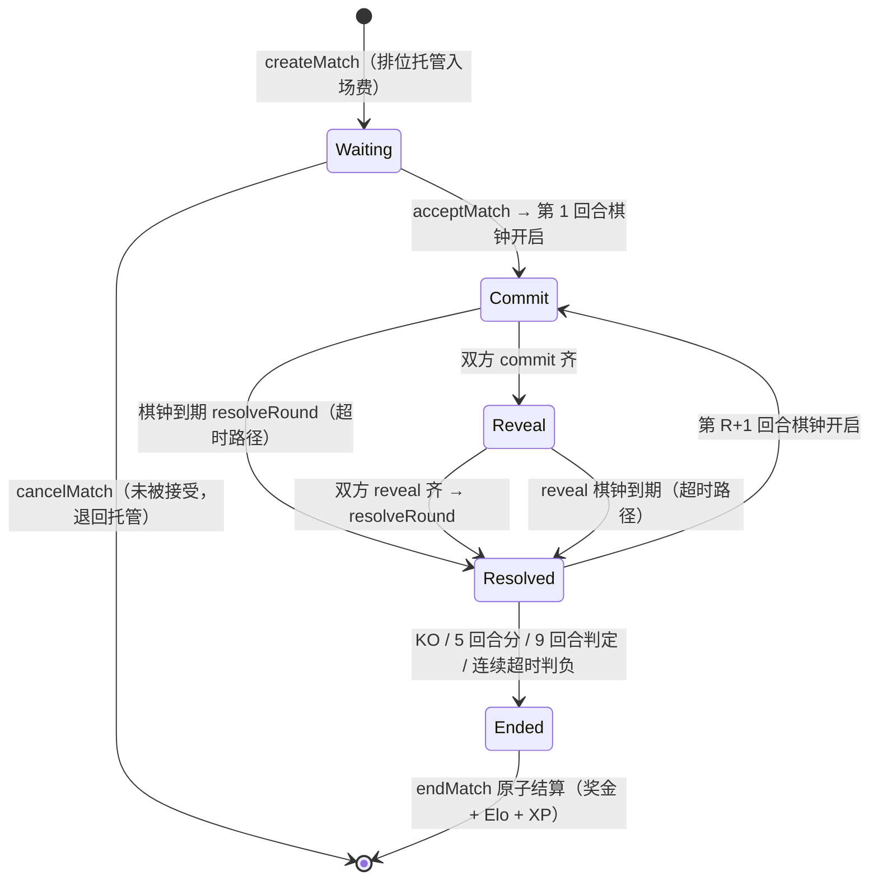

# ChainArena「链斗」产品设计文档

> 版本：v0.4.0（拆分自《MVP 设计方案》v0.3.3）
> 位置：`chainarena/docs/product-design.md`
> 状态：待评审
> 语言：中文 ｜ [English](./product-design.en.md)
> 配套文档：技术设计文档（`chainarena/docs/tech-design.md`）
>
> **本文档变更记录**
> - v0.4.0：文档拆分。本文档收录：概述与定位（§1）、玩法设计（§2）、玩家体验设计（§3，并入原 §7.3 乐观 UI、§9.2 新手路径、§9.3 弹窗策略、§14.2 费用感知）、AI 角色的产品定位（§4，原 §8.1/8.4/8.5/8.6）、发布计划概览（§5）、产品风险（§6，原 §15 之 R3/R4/R7/Q3）、V2 展望（§7）。历史变更记录见 `mvp-design.md`（归档）。顺带修正：AI 代打雇佣流程中的代币笔误（$GEM → $ARENA，与 §2.6 经济设计一致）。

---

## 目录

1. [概述：为什么这个游戏必须上链](#1-概述为什么这个游戏必须上链)
2. [玩法设计](#2-玩法设计)
3. [玩家体验设计](#3-玩家体验设计)
4. [AI 角色的产品定位](#4-ai-角色的产品定位)
5. [发布计划概览](#5-发布计划概览)
6. [产品风险与开放问题](#6-产品风险与开放问题)
7. [V2 展望](#7-v2-展望)

---

## 1. 概述：为什么这个游戏必须上链

### 1.1 一句话定位

**ChainArena** 是一个部署在 L2 上的**全链异步格斗竞技场**：你拥有一个由 VRF 生成的 Fighter（NFT），与真人或 AI 在公开合约里进行逐招博弈——**每一次出招都是一笔链上交易，每一回合的裁决任何人都能验证**。没有黑箱服务器，没有停服死亡，运营方自己也无法操纵比赛结果。

### 1.2 传统服务器竞技游戏的四个根本问题（链斗的"意义"所在）

| 服务器游戏的问题 | 链斗的解法 | 依赖的特性 |
|---|---|---|
| **裁决黑箱**：匹配机制、随机数、判定结果全在服务器里，运营可以暗改 | 出招用 commit-reveal，裁决是纯函数，全部规则开源可验证 | L2 低费 + commit-reveal |
| **停服即死亡**：服务器一关，游戏和你的投入归零 | 核心玩法 = 链上合约；任何人可自建客户端接入（协议是公共物品） | 全链状态 + 事件即数据 |
| **进度与资产不属于你**：账号封禁/关服即清零 | Fighter 是 NFT、段位挂在你的智能账户上、奖金非托管 | ERC-4337 账户 + NFT |
| **PvP 冷启动死循环**：没玩家就匹配不到人，匹配不到就没玩家 | **AI 对手 7×24 在线垫场**（链上行为同人类玩家），开服第一天就有得打 | AI Agent + L2 低费 |
| （新增）**AI 时代的信任问题**：bot 装人、外挂、代打黑产 | **人机同场、行为公开可审计**：AI 是注册在案的正式选手，不装人；代打是玩家主动授权、链上可见 | AgentRegistry + AgentOperator |

> 一句话：**链斗不是"把游戏搬上链"，而是把"竞技场的公平性"本身做成链上公共物品**——同时把 AI 从黑产变成正式选手。

### 1.3 设计原则：用满 ERC-4337、L2 与 AI Agent

| 原则 | 含义 |
|---|---|
| **账户即选手** | 选手身份 = ERC-4337 智能账户：段位、战绩、奖金全部挂在账户上 |
| **链上即裁决** | 出招、判定、结算全是合约逻辑，服务器只做加速不作决定 |
| **Agent 即选手** | AI 与人共用同一套账户/交易/审查管道；AI 永不冒充人类 |
| **弹窗零容忍** | 一局比赛十几招，靠会话密钥做到全场比赛 0 次弹窗 |
| **Gas 零感知** | Paymaster 赞助新手局；排位费内含 Gas（Token 代付） |
| **事件即直播** | 比赛事件流 = 观战、回放、解说、数据分析的唯一数据源 |
| **LLM 不碰钱** | LLM 只产出"意图/建议/解说"，链上动作全部经确定性规划器与护栏 |

### 1.4 MVP 目标

**核心 MVP（W1–W8）：**

- ✅ 新玩家 **60 秒**从"点开链接"到"打完第一局"（passkey 建号 + 赠 Fighter + 免费匹配 + 全程无 Gas）
- ✅ 对局核心循环（匹配→出招→裁决→结算→段位）**100% 上链**
- ✅ 单局全流程链上成本 **< $0.10**，单笔出招 **< $0.005**
- ✅ 一局 9 回合比赛 **0 次钱包弹窗**（除开局一次授权）
- ✅ 观战/回放页面从纯事件流构建（验证"停服也可重建客户端"）

**AI 阶段（W9–W11）：**

- ✅ AI 对手三档难度 7×24 在线，冷启动期 > 60% 对局有 AI 垫场
- ✅ AI 代打：离线授权 Agent 打天梯，行为可审计、奖励打折
- ✅ AI 解说与复盘：从事件流自动生成逐回合解说与对手习惯分析

### 1.5 备选创意（已评估并否决）

| 备选 | 否决理由 |
|---|---|
| 链上狼人杀/外交谈判 | 需要同时在线人数多，冷启动更难；社交推理的体验高度依赖速度，L2 延迟勉强 |
| zk 空间征服（Dark Forest 类） | zk 电路开发量远超 MVP 预算（≥6 个月） |
| 全链集换式卡牌（TCG） | 美术资产生产成本高，且"卡包上链"仍是资产上链而非玩法上链 |
| **异步格斗竞技场（选择）** | 内容极轻（无美术关卡）、博弈极深（同时出招的心理战）、**每一招都必须上链才有公平**、AI 对手天然融入、L2 特性全部成为承重墙 |

---

## 2. 玩法设计

### 2.1 核心循环

```
领取/铸造 Fighter(VRF 决定招式配置) → 匹配(排位/休闲, 对手=人或AI)
→ 对局: 逐回合同时出招(commit-reveal) → 合约裁决(纯函数) → 比分推进
→ 终局: 结算奖金 + 段位(Elo) + XP → 升级解锁必杀技/装备 → 赛季冲榜
```

### 2.2 游戏角色定位

#### 2.2.1 参与者角色总览（人机同场，各安其位）

| 角色 | 定位 | 身份载体 | 权限边界 |
|---|---|---|---|
| **人类玩家** | 正式选手：拥有 Fighter、打天梯、赢奖金 | ERC-4337 智能账户（passkey） | 全权；价值操作（铸造/领奖/桥）永远 passkey |
| **AI 对手 Sensei** | 注册在案的垫场选手（青铜/白银/大师三档），7×24 在线，冷启动保证 | 自有 Safe 账户（AgentRegistry 标记 AI，地址公开） | 只能出招类操作；获胜奖金直接销毁（§4.2） |
| **AI 代打 Second** | 玩家雇佣的"副手"：离线期按授权风格应战 | 玩家账户 + AgentOperator 受限密钥 | 只能出招（更窄 selector + 局数上限）；赛前链上透明标注（§4.3） |
| **AI 解说 Echo** | 观察者：逐回合解说、赛后复盘、内容生产 | 无链上账户，纯读事件流 | L0 只读，"LLM 不碰钱"的示范（§4.4） |
| **观众** | 观战/回放/数据分析，无需账户即可观看 | 无（可选登录） | L0 只读 |

> 定位铁律：**AI 是正式选手，不是外挂**——Sensei 用自己的账户堂堂正正出战，Second 受玩家公开委托，Echo 只动嘴不动手；三者都注册/标注在链上，"AI 装人"在本设计中不存在。

#### 2.2.2 Fighter 五大流派（角色构筑定位）

Fighter 的构筑差异全部由 VRF 铸造决定（可验证公平），映射规则：**本命属性 → 流派**。所有 Fighter 共用同一套 5 招框架（§2.3），流派只改三件事——**基础数值微调、必杀 SPECIAL 特效、被动特性**——决策树不变，可全枚举测试、可仿真回归（技术设计 §10）。

| 流派 | 本命 | 一句话定位 | 被动（常驻） | 必杀 SPECIAL 特效（3 能量，Lv.5 解锁） |
|---|---|---|---|---|
| 锋刃 Blade | 金 | 爆发斩杀，格挡克星 | HEAVY 伤害 30→33 | 「破甲斩」：对 GUARD 无视减伤，全额 80 伤害 |
| 生息 Verdant | 木 | 续航消耗，越打越厚 | GUARD 时额外回复 5 HP | 「回春击」：40 伤害 + 自身回复 15 HP（上限 100） |
| 流转 Flow | 水 | 资源节奏，能量压制 | CHARGE 回能 +2→+3 | 「潮汐击」：40 伤害 + 偷取对手 1 能量（转入自身，受上限约束） |
| 烈焰 Blaze | 火 | 裸伤压制，火力最高 | STRIKE 伤害 15→17 | 「焚天击」：48 伤害（全场最高单发） |
| 磐岩 Bastion | 土 | 铁壁防守，反制蓄力 | GUARD 减伤 60%→70% | 「山岳击」：40 伤害 + 抹除对手本回合额外回能（GUARD/CHARGE 的回能加成失效） |

- **全部特效都是回合内纯函数**（无跨回合状态、不加存储槽），`resolveRound` 可全枚举验证；数值全部进 `game-config.json`（configHash 锚定，技术设计 §3.2），赛季可轮换调参而不动合约。
- **克制空档即流派个性**：三系招式标签（五系选三）决定 STRIKE/HEAVY 的可选属性，SPECIAL 固定本命属性——锋刃的"被克盲区"与"克制强项"同样是构筑的一部分。
- **平衡阀门**：对局仿真器对 5 流派 × 5 流派两两对打做胜率回归（±3% 门，技术设计 §10），流派失衡走 configHash 调参而非改合约。

### 2.3 对局规则（MVP 完整规则集，刻意保持极简）

**对局结构**：BO9（最多 9 回合），异步制，每回合双方**同时**秘密出招。整局胜利条件（按优先级）：

1. **KO 胜**：任意回合结算后对手 HP ≤ 0（HP 全场连续累计、**不重置**），当场终局；
2. **回合分胜**：先拿下 **5 个回合分** 者胜——回合分归**当回合造成总伤害更高**的一方（回复/吸血不计入比较；双方相等为平回合，双方 0 分）；
3. **判定胜**：9 回合打满仍无人 KO、无人到 5 分，按 **（回合分 → 剩余 HP）字典序** 判定；全部相等为**平局**（排位双方各退 90% 入场费，10% 照常销毁；休闲局无事发生）。

> 设计意图：KO 路径奖励伤害效率，回合分路径奖励交换压制，判定路径保底防"龟缩拖满"——三条胜利路径互相牵制，GUARD/CHARGE 的"本回合 0 伤害"天然以回合分为代价。

**每回合三阶段（链上）：**

1. `commitMove(round, keccak(move, element, salt))` — 双方提交承诺（出招内容被哈希隐藏）
2. `revealMove(round, move, element, salt)` — 双方揭示（任何人可校验承诺一致）
3. `resolveRound(matchId)` — 任何人可触发，合约按纯函数规则结算本回合（伤害/能量/回合分/棋钟超时一次算清）

**招式表（全 Fighter 通用框架，个体差异只来自流派 §2.2.2）：**

| 招式 | 能量 | 效果 | 备注 |
|---|---|---|---|
| 轻击 STRIKE | 1 | 15 伤害 | 属性标签从自己的三系标签中任选其一 |
| 重击 HEAVY | 2 | 30 伤害 | 破 GUARD（穿透 60%）；属性标签同上 |
| 格挡 GUARD | 0 | 受伤 -60%，回复 +1 能量 | 被 HEAVY 穿透；非攻击招，无属性 |
| 蓄力 CHARGE | 0 | +2 能量，本回合受伤 +50% | 任何攻击打 CHARGE 都赚 |
| 必杀 SPECIAL | 3 | 40 伤害 + 流派特效（Lv.5 解锁） | 属性固定 = 本命属性 |

- **出招参数化**：一次出招 = （招式， 属性标签， salt）。STRIKE/HEAVY 的属性标签只能从该 Fighter 的三系标签（VRF 决定）中选；GUARD/CHARGE 无属性；SPECIAL 固定本命——**属性选择本身就是每回合的博弈输入**。
- **属性轮（五行）**：**金 > 木 > 土 > 水 > 火 > 金**（金克木 · 木克土 · 土克水 · 水克火 · 火克金）。双方都出攻击类招式时，按双方招式属性标签判定：**相克**——克制方伤害 ×1.25、被克方 ×0.75；**相生**（金生水 · 水生木 · 木生火 · 火生土 · 土生金）与**同属性**为中性 ×1.0。五行两两共 10 种属性对，恰好被"相克 5 对 + 相生 5 对"完全划分——每一次属性相遇只有三种读法：**克 / 被克 / 中性**；中性对局属性博弈归零，回到纯能量与心理战。
- **能量**：每回合自动 +1（上限 5），GUARD/CHARGE 额外回能——资源管理成为节奏核心。
- **个体差异**：每个 Fighter 由 VRF 铸造时决定 ① **本命属性 → 流派**（数值微调 + 必杀特效 + 被动，见 §2.2.2）② **三系招式属性标签**（从金/木/水/火/土五系中抽三系，C(5,3)=10 种配置，天然留出两个"克制空档"——既有克制强项也有被克盲区，构筑博弈由可验证的铸造公平决定）。
- **超时判负**：commit/reveal 各有 30 个 L2 块（≈60s）期限，超时判负当回合（对方 +1 回合分），连续两回合超时判负整局；双超时/双 KO/弃权等完整边界路径见 §2.4——**L2 的 2 秒出块让链上棋钟成为可能**。

**对局经济**：排位局入场费 10 $ARENA（败者损失），奖池 90% 归胜者 / 10% 销毁（rake 即 sink）；平局双方各退 90%。休闲局免费（Paymaster 限量赞助）。

### 2.4 对局流程与状态机

**对局状态机（与技术设计 §3.2 的 `Match.status` 字段一一对应）：**



**阶段窗口与超时后果：**

| 阶段 | 触发 | 窗口 | 超时/边界处理 |
|---|---|---|---|
| Waiting 挂单 | createMatch | 无硬限 | 未被接受可 `cancelMatch` 撤回托管；撮合器只排序不裁决（技术设计 §8.2） |
| Commit | 回合开始（accept 或上一回合 resolve） | 30 块 ≈ 60s | 单方超时：对方 +1 回合分，跳过伤害结算进入下一回合；同一方连续 2 回合超时 → 判负整局 |
| Reveal | 双方 commit 齐 | 30 块 ≈ 60s | 已 commit 未 reveal：当回合判负（对方 +1 回合分） |
| Resolve | 双方 reveal 齐 | 即时 | 任何人可触发；后台 bot 每 2 块兜底扫描——**无链下裁判依赖** |
| 终局结算 | 终局条件达成 | 即时 | `endMatch` 与末回合 resolve 批处理为一笔（原子） |

**边界路径全集（合约测试必须覆盖，见技术设计 §10）：**

- **双方 commit 双超时**：当回合按平回合处理（双方 0 分、无伤害结算）；连续 2 回合双超时 → 整局作废平局（走平局退款规则）。
- **双 KO**：同回合双方 HP 同时 ≤ 0 → 整局平局（退款规则同上）。
- **弃权 forfeit**：任意阶段可由本人发起（会话密钥即可签名），立即判负整局——省时间且防拖延。
- **掉线重连**：客户端状态完全可从事件流重建（技术设计 §5.3）；比赛会话密钥有效期含 30 分钟缓冲，重连后继续出招，无需再签名。
- **批量节奏优化**：`reveal(R) + commit(R+1)` 打包一笔（技术设计 §4.6），最快 3 块（≈6s）完成一次交换；整局体感节奏 10–20s/回合（风险 R3 已列缓解，见 §6）。

> 📖 玩家生命周期用例集（注册/登录/找回/建角/对局/升级）：[`usecases/`](./usecases/README.md)；带完整数值推演的单回合用例（含属性轮、流派被动、能量流水、变体对比）：[`usecases/round-walkthrough.md`](./usecases/round-walkthrough.md)

### 2.5 MVP 功能清单

| 模块 | 功能 | 上链动作（合约方法） | 频率 | 阶段 |
|---|---|---|---|---|
| Fighter | VRF 铸造/领取（新手赠送）、查看配置 | `mint / claimStarter` | 1 次/玩家 | 核心 |
| 匹配 | 休闲（免入场费）/ 排位（入场费托管） | `createMatch / acceptMatch / cancelMatch` | 5–15 局/天 | 核心 |
| 对局 | 逐回合 commit/reveal/resolve | `commitMove / revealMove` | **~18 UserOps/局/人** | 核心 |
| 结算 | 奖金、Elo、XP 一次性原子结算 | `endMatch`（含在末回合 resolve 批处理） | 1 次/局 | 核心 |
| 赛季 | 4 周赛季、段位榜、奖金申领 | `claimSeasonReward`（混合模式，技术设计 §8.3） | 1 次/赛季 | 核心 |
| 修炼 | XP 升级、必杀解锁、装备锻造 | `levelUp / craft` | 1–3 次/天 | 核心 |
| 观战 | 实时战况、回放、战绩页 | 纯读（事件流） | 高频读 | 核心 |
| **AI 对手** | 三档难度垫场，冷启动保证 | 与人相同的出招函数 | 按需 | AI |
| **AI 代打** | 离线授权 Agent 打天梯 | 与人相同 + `grantOperator` | 按需 | AI |
| **AI 解说** | 逐回合解说词、赛后复盘 | 纯读（事件流）+ 链下生成 | 每局 | AI |

### 2.6 经济设计（MVP 极简版）

> 本节为速览；供给/分配/释放/预算模型的完整设计见《[$ARENA 代币经济设计](./tokenomics.md)》。

- **$ARENA（ERC-20）**：唯一货币。产出=新手赠币/每日首胜/任务/赛季奖金；消耗=排位入场费/铸造/锻造。rake 与锻造费销毁。
- **Fighter（ERC-721）**：可交易。配置由 VRF 决定（MVP 内置简版：固定价铸造 + 新手免费领 1 个）。
- **装备（ERC-1155，W10+）**：加招式/被动，MVP 仅 6 件套固定属性。
- **AI 相关现金流**：AI 代打周费 $ARENA（50% 销毁/50% 金库）；AI 对手获胜的奖金直接销毁（防运营自肥，且给玩家"打爆官方 AI 能白拿奖池"的正和体验——AI 输掉的入场费从运营预算注入，成本可控且透明）。
- MVP 阶段 $ARENA **不可提现**，内部闭环；ETH 走标准桥出入金（技术设计 §5.4）。

---

## 3. 玩家体验设计

### 3.1 新玩家 60 秒路径

```
打开链接 → [用 Face ID 开始] → WebAuthn 创建 passkey(1 次系统弹窗)
→ CREATE2 算出账户地址
→ 1 笔 UserOp(passkey): 部署账户 + 领取新手 Fighter + 创建休闲局(vs Sensei-青铜)
→ Paymaster 赞助(0 Gas) → 2s 确认 → 开局弹一次"比赛会话授权"(passkey)
→ 打完首局: 全程共 2 次签名(建号+会话), 出招 0 弹窗
```

### 3.2 签名与弹窗策略

| 操作类型 | 签名方式 | 弹窗 |
|---|---|---|
| 比赛内出招/认输/触发裁决 | MatchSession key（自动） | 0 次/局 |
| AI 代打的出招 | AgentOperator key（AI 侧自动） | 0 次 |
| 开局会话授权、雇佣/召回代打、铸造、领赛季奖 | Passkey | 1 次/事件 |
| 登录后端 | ERC-1271 | 0 次 |
| 桥/转账/恢复 | Passkey | 每次必弹 |

### 3.3 出招反馈与对局节奏（乐观 UI）

1. 出招点击 → 本地立即锁定按钮、显示"已出招（隐藏）"状态；
2. 提交后 ~2–4s 收到链上回执；commit 上链 → UI 显示"等待对手"；
3. reveal 后由 `RoundResolved` 事件驱动结算动画；
4. 批量打包（揭示 + 预提交）让一次交换最快 ≈6s，整局体感节奏 10–20s/回合（风险 R3，见 §6）；
5. 分级信任：对局信软确认（2s）；赛季奖金等 L1 finality 后发放。

### 3.4 观战、回放与解说体验

- **无需账户即可观战**：实时战况、回放、榜单全部对游客开放（可选登录）。
- **事件即直播**：观战与回放全部从链上事件流构建——"停服也可重建客户端"是 MVP 的验证目标之一（§1.4）。
- **解说位**：观战页实时弹幕位由 Echo 逐回合解说填充（§4.4）；赛后自动生成复盘与高光文案。

### 3.5 费用与 Gas 感知

- 新手：$0（前 50 局赞助）
- 排位玩家：入场费以 $ARENA 计价，内含 Gas——"赢一局连 Gas 都是奖金里出的"
- 任何时候不需要理解 ETH/Gas 概念

---

## 4. AI 角色的产品定位

### 4.1 三类 AI 选手与范围决策

| AI | 定位 | 账户形态 | MVP 取舍 |
|---|---|---|---|
| **A. AI 对手「Sensei 系列」** | 三档难度垫场对手（青铜/白银/大师），冷启动保证 + 新手教学 | 自己的 Safe 账户（Registry 标记 AI） | ✅ W10——**PvP 游戏冷启动的死结由 AI 解开，这是本方案最有产品意义的 Agent 用法** |
| **B. AI 代打「Second」** | 玩家离线时按其授权风格打天梯（保守/激进/学习本人习惯） | **操作玩家账户**（AgentOperator 受限密钥） | ✅ W10——异步竞技的"不掉分"保险 |
| **C. AI 解说「Echo」** | 逐回合解说、赛后复盘、对手习惯分析 | 纯读事件流，无链上权限 | ✅ W11——内容与观赛层，直播/短视频素材自动生产 |

> 三种范式：**正式选手（own account, competitive）**、**受托代打（operate player's account）**、**观察者**——覆盖 Agent 接入竞技游戏的全谱系。技术实现见技术设计 §6。

### 4.2 AI 对手「Sensei 系列」

- 三档：青铜（均匀随机+基础克制）、白银（均衡混合策略+能量管理）、大师（LLM 读招+针对画像）。
- **公平性**：AI 走与人完全相同的 commit-reveal（先 commit 后 reveal，链上可验证它没偷看）；Registry 地址公开标注 AI。
- **经济**：大师局入场费更高、奖池含运营注入；**AI 获胜的奖金销毁**——玩家赢 AI = 白拿注入奖池，输 AI = 对手"不可战胜"的挫败感由难度分层消化。
- **冷启动指标**：开服前两周 AI 局占比 > 60%，随真人密度上升自动让位（匹配器优先真人）。

### 4.3 AI 代打「Second」

**雇佣流程（全链上）：**

```
玩家: "雇佣代打(7天, X $ARENA, 风格=激进)"
→ 1 笔 UserOp(passkey): Delegation.hire + $ARENA 转入(50%销毁/50%金库)
   + 绑定 operatorId/期限 + grantSession(SecondKey, narrowRule)
→ 离线期 Second 自动应战(规则: 只打排位/每日局数上限/风格参数链上可见)
→ 到期/召回自动失效; 代打收益按 70% 计入(防"纯托管躺赢")
```

- **透明性**：对手赛前可见"此局为 AI 代打"（Registry 事件），**AI 永不冒充人类**——这是与传统外挂代打的本质区别，也是本方案价值观的落点。
- 风格参数（激进/保守/拟人）写进 Delegation，出招统计可复核"是否按约执行"。

### 4.4 AI 解说「Echo」

- 输入：比赛事件流（双方招式、伤害、比分、能量、历史战绩、出招统计）。
- 输出：逐回合解说（观战页实时弹幕位）、赛后复盘（"你第 4 回合的 CHARGE 被读穿了，对手近 3 局对你 CHARGE 的惩罚率 80%"）、高光集锦文案。
- **零链上权限**：纯读纯写文本，是"LLM 不碰钱"原则的最干净示范。

---

## 5. 发布计划概览

| 阶段 | 周期 | 产品目标 | 技术里程碑 |
|---|---|---|---|
| 核心 MVP | W1–W8 | 60 秒首局；对局核心循环 100% 上链；整局 0 弹窗；观战/回放纯事件流构建；Beta | 技术设计 §11 |
| AI 阶段 | W9–W11 | Sensei 三档垫场（冷启动 > 60% AI 局）；Second 代打闭环；Echo 解说与复盘 | 技术设计 §11 |

> 详细周计划、交付物与人员配置见技术设计文档 §11。

---

## 6. 产品风险与开放问题

| # | 风险/问题 | 状态 |
|---|---|---|
| R3 | **对局节奏是否"链感"太重**（每回合 10–20s） | W1 做纸面原型计时验证；备选：回合同步压缩（双方 commit 齐后立即揭示）+ 乐观 UI 弥补（§3.3） |
| R4 | **博弈深度不足（被解出最优策略）** | 对局仿真器持续回归五行/招式胜率与中性对局基线（技术设计 §10）；赛季性数值轮换（configHash 升级）+ 装备引入构造多样性 |
| R7 | AI 代打被玩家视为"官方外挂" | 强制"AI 局透明标注"+ 收益打折 + 只在天梯保分段可用，价值观写进产品 |
| Q3 | 观赛社交层（关注/弹幕/主播工具） | V2，Echo 解说先行验证内容需求 |

> 技术类风险（EntryPoint 版本、bundler 锁定、女巫、LLM 成本等）见技术设计文档 §13。

---

## 7. V2 展望

- **装备构筑深化**：ERC-1155 装备 + 招式槽位（在 MVP 五大流派之上叠加构筑维度）与交易市场
- **2v2 / 锦标赛**：团队战与多方对局（commit-reveal 天然支持 N 方）
- **开放 Agent 联赛**：社区自建 AI 选手入榜（Registry 质押门槛），人机混合天梯、"图灵杯"AI 专属赛季
- **观赛经济**：赛事预测市场（L2 原生）、主播工具、Echo 个性化解说订阅
- **ERC-6551**：Fighter 成为账户，携带战绩史与装备跨赛季/跨游戏
- **Superchain Interop**：跨 OP 链赛季与资产
- **TEE 化 Agent**：可验证"确实是这套模型在打"
- **自建 Orbit 链**：DAU>10w 后的规模化选项
- **BLS 聚合**：观赛高峰期操作聚合
