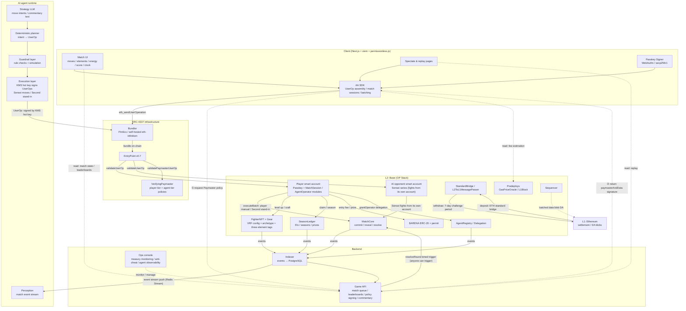
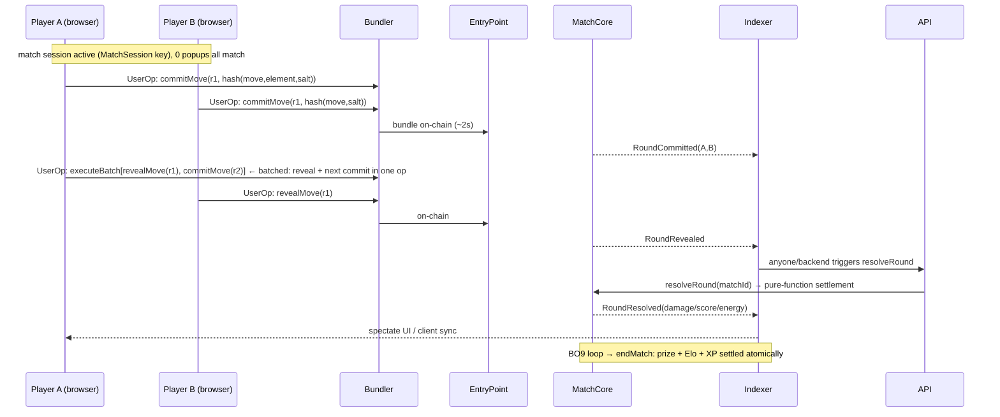

# ChainArena — Technical Design Document

> Version: v0.4.0-en (English edition of `tech-design.md` v0.4.0; split from the "MVP Design" doc v0.3.3)
> Location: `chainarena/docs/tech-design.en.md`
> Status: Pending review
> Companion documents: Product Design (`product-design.md` / `product-design.en.md`) — positioning, gameplay rules, economy design, player experience and the product semantics of AI roles are defined in the Product Design document
> Language: [中文](./tech-design.md) | English
>
> **Change log (this document)**
> - v0.4.0: Document split. This volume covers: overall architecture (§1), technology selection (§2), smart contracts (§3), ERC-4337 implementation (§4), L2 implementation (§5), AI agent subsystem technical design (§6, formerly §8.2/8.3/8.7–8.9), client technical design (§7), indexer & backend (§8), security & risk control (§9), testing & CI (§10), milestone plan (§11), running costs (§12), technical risks (§13), appendix (§14). The original §7.3 optimistic UI, §9.2/9.3 and §14.2 moved to Product Design §3. Full history is preserved in `mvp-design.md` (archived). The Chinese edition is authoritative if the two diverge.

---

## Table of Contents

1. [Overall Architecture](#1-overall-architecture)
2. [Technology Selection Decisions](#2-technology-selection-decisions)
3. [Smart Contract Design](#3-smart-contract-design)
4. [ERC-4337 Feature Implementation](#4-erc-4337-feature-implementation)
5. [L2 Feature Implementation](#5-l2-feature-implementation)
6. [AI Agent Subsystem: Technical Design](#6-ai-agent-subsystem-technical-design)
7. [Client Technical Design](#7-client-technical-design)
8. [Indexer & Backend](#8-indexer--backend)
9. [Security & Risk Control](#9-security--risk-control)
10. [Testing & CI](#10-testing--ci)
11. [Milestone Plan](#11-milestone-plan)
12. [Cost Estimates](#12-cost-estimates)
13. [Technical Risks & Open Questions](#13-technical-risks--open-questions)
14. [Appendix](#14-appendix)

---

## 1. Overall Architecture

### 1.1 Architecture Diagram



> Key point: AI contestants and human players **travel the exact same channel** — both submit UserOps through the Bundler, both are validated by EntryPoint, both are constrained by Paymaster policy, and both play commit-reveal under the same move rules. **The AI has no back door** — this is the verifiable proof that "AI is an official contestant, not a cheat".
>
> Distinguishing the two move channels: **Sensei (AI opponent) fights from its own smart account** (Appendix A-3); **Second (AI stand-in) signs with an operator key while using the player's account as sender** (Appendix A-2) — both channels pass through Bundler/EntryPoint/Paymaster, with no privileged path.

### 1.2 On-Chain Lifecycle of One Round (human vs human)



> For the player-side experience (optimistic UI, receipt waits, 0 popups) see Product Design §3.

### 1.3 One Round for an AI Contestant (agent's view)

```mermaid
sequenceDiagram
    participant I as Indexer/event stream
    participant RT as Agent Runtime
    participant L as LLM strategy layer
    participant PL as Planner + guardrails
    participant BK as Bundler
    participant E as EntryPoint
    participant AC as AI contestant account
    participant M as MatchCore

    I->>RT: opponent committed (r3) / my turn to reveal
    RT->>L: match state (score/energy/both move histories/opponent profile)
    L-->>RT: intent JSON {move:"HEAVY", reason:"opponent blocked twice in a row"}
    RT->>PL: intent → call sequence (batched: reveal+commit)
    PL->>PL: guardrails: legal moves / energy constraints / per-match quota → bundler pre-simulation
    PL->>BK: UserOp(executeBatch[revealMove, commitMove], signed by AI key)
    BK->>E: on-chain
    E->>AC: validateUserOp (MatchSession/AgentOperator rules)
    AC->>M: the exact same move function as humans
    M-->>I: events → next perception round
    Note over PL,BK: guardrail/simulation failure → discard & replan; a fallback default move always exists before timeout
```

---

## 2. Technology Selection Decisions

### 2.1 L2 Choice: **Base (OP Stack)**

| Candidate | Pros | Cons | Verdict |
|---|---|---|---|
| **Base (OP Stack)** | Lowest fee tier; mature bundler/paymaster ecosystem (Pimlico/Alchemy); **RIP-7212 secp256r1 precompile enabled**; EIP-4844 blob DA; 2s blocks (**a prerequisite for the round clock**) | Centralized sequencer; 7-day withdrawals | ✅ **MVP choice** |
| Arbitrum One | Large ecosystem | Block cadence / precompile support less direct than OP | Backup |
| OP Mainnet | Same OP Stack | Smaller gaming audience than Base | Backup |
| zkSync Era | Native AA, but not the ERC-4337 standard EntryPoint | Fragmented toolchain | ❌ |
| Self-hosted OP Stack Orbit | Controllable; custom gas token | High ops cost | V2 evaluation |

**Development environments**: `anvil` local chain + EntryPoint deployment; integration on **Base Sepolia**; a self-hosted OP devnet to validate bridging and predeploys.

### 2.2 Account Stack: **Safe (4337 modules) + Passkey module + MatchSession/AgentOperator module**

| Option | Description | Trade-offs |
|---|---|---|
| **A. Safe + modules (chosen)** | Safe smart account mounting ① WebAuthn passkey verification (RIP-7212) ② a MatchSession/AgentOperator module (match session key + AI delegation key, one contract) ③ social recovery | Audit-mature, full module ecosystem, v0.7 EntryPoint; **humans and AI are isomorphic, natively supporting "agent = contestant"** |
| B. SimpleAccount + custodial EOA | Fastest to build | The passkey only guards a cloud EOA; doesn't exploit 4337 |
| C. ERC-7579 MSA | Most cutting-edge | Ecosystem still early |

> EntryPoint is **v0.7** (0x0000000071727De22E5E9d8BAf0edAc6f37da032); we abstract the `IEntryPoint` interface so a v0.8 upgrade only touches deployment scripts.

### 2.3 AI Agent Technology Choices

| Component | Choice | Rationale |
|---|---|---|
| Agent runtime | **Node.js (TypeScript), in-house** main loop | Perceive → decide → plan → guardrails → execute; simple, controllable, auditable; no heavy framework |
| LLM access | **Vercel AI SDK** (provider-agnostic: Claude/GPT/DeepSeek hot-swap) | Same language as the full stack; switching models doesn't affect downstream |
| Strategy layering | **LLM emits intents + rules engine as fallback** | Routine moves for opponents/stand-ins run on the rules version (zero LLM, zero latency, reproducible); the LLM handles high-level move-reading; only commentary text is pure LLM |
| AI signing | Cloud **KMS** hot keys (one per AI contestant, rotatable) | Fast and auditable; TEE evaluated for V2 |
| Memory | PostgreSQL (opponent move statistics / profiles) | Rebuildable from the event stream |

### 2.4 Other Choices

| Component | Choice | Rationale |
|---|---|---|
| Bundler/Paymaster | Start with **Pimlico**, interface-compatible with self-hosted eth-infinitism | Paymaster contract is in-house (VerifyingPaymaster pattern) |
| AA SDK | **permissionless.js + viem** | No vendor lock-in |
| Contract framework | **Foundry** | Mature invariant testing (critical for the adjudication function) |
| Indexer | **Ponder** + PostgreSQL | Event-driven; **doubles as the spectating live stream and the AI perception source** |
| Frontend | Next.js 14 + wagmi/viem + permissionless.js | SSR leaderboards / SEO |
| Randomness | **VRF** for Fighter minting (Chainlink on Base) + in-match **commit-reveal** | Mint fairness + in-match unpredictability, two scenarios |
| Wallet compatibility | MetaMask EOAs supported as owners mounted into Safe | No exclusion of existing users |

---

## 3. Smart Contract Design

### 3.1 Contract Inventory

```
contracts/
├── account/                  # account layer
│   ├── WebAuthnValidator.sol     # secp256r1 passkey verification (RIP-7212 precompile 0x100, solidity fallback)
│   ├── MatchSessionValidator.sol # match session / agent delegation module (core in-house; one rule set, two signer types)
│   └── RecoveryModule.sol        # social recovery
├── arena/
│   ├── MatchCore.sol            # match state machine: create/commit/reveal/resolve/end
│   ├── FighterNFT.sol           # ERC-721 + VRF move kit
│   ├── Gear.sol                 # ERC-1155 gear (W10+)
│   └── SeasonLedger.sol         # Elo/season snapshots/prize claims (hybrid mode)
├── agent/                    # AI contestant layer
│   ├── AgentRegistry.sol        # AI contestant registry (tier/stake/active slot/flag)
│   └── Delegation.sol           # player↔AI stand-in delegation ledger (weekly fee/recall/discounted earnings)
├── infra/
│   ├── VerifyingPaymaster.sol   # player-tier/agent-tier policy enforcement
│   └── BatchOraclePriceFeed.sol # token-paymaster exchange rate (V2)
└── test/ ...
```

### 3.2 MatchCore State Layout (gas-optimized; the adjudication function is the core asset)

```solidity
struct Match {                  // packed: 3 slots / match
    address p0; address p1;     // both accounts
    uint64  stake;              // escrowed entry fee ($ARENA, 0 = casual)
    uint32  score0; uint32  score1;
    uint32  hp0; uint32  hp1;         // start at 100
    uint32  energy0; uint32 energy1;  // start at 3
    uint16  round; uint8  status;     // Commit/Reveal/Resolved/Ended
    uint64  roundDeadline;            // block-height clock
    uint16  f0; uint16 f1;            // both Fighter ids
}
mapping(uint256 => Match) matches;
mapping(uint256 => mapping(uint8 player => mapping(uint16 round => bytes32))) commits;  // commitment hashes
mapping(uint256 => mapping(uint16 round => uint8[2] movesRevealed));                    // reveal cache (move|element packed)

// Elo / record live in SeasonLedger (1 slot per player):
struct Rating { uint32 elo; uint32 wins; uint32 losses; uint32 seasonId; uint64 updatedAt; }
```

- **Pure-function adjudication**: `resolveRound` reads only `Match` + both Fighters' configs + the revealed moves → updates state + emits events. No external calls, no private data, formally verifiable — **the single most heavily tested/audited object in the game** (§10).
- **Round clock**: `roundDeadline` is denominated in L2 block height (2s/block), 30 blocks each for commit/reveal; `resolveRound` checks timeouts and awards forfeits — no off-chain referee needed.
- Move and archetype numbers (damage/counter coefficients/archetype passives and special effects) live in `game-config.json` + an on-chain `configHash` (client and AI decision inputs share one source, preventing fake-config feeding).

### 3.3 Key Functions & Events

```solidity
contract MatchCore {
    // ---- match ----
    function createMatch(uint8 mode, uint64 stake, uint16 fighterId) external returns (uint256 matchId); // escrows the entry fee
    function acceptMatch(uint256 matchId, uint16 fighterId) external;   // ranked: second player joins and locks the match
    function cancelMatch(uint256 matchId) external;      // listing unaccepted, withdraw escrow
    function commitMove(uint256 matchId, uint16 round, bytes32 commitHash) external;   // move+element hidden with salt hash
    function revealMove(uint256 matchId, uint16 round, uint8 move, uint8 element, bytes32 salt) external;
    function resolveRound(uint256 matchId) external;    // anyone can trigger (backend/player/bot): pure-function adjudication + timeout forfeit
    function forfeit(uint256 matchId) external;         // concede (optional, saves time)

    // ---- training ----
    function levelUp(uint16 fighterId) external;         // XP → level; Lv5 unlocks the special
    function craft(uint16 gearId) external;              // craft gear

    // ---- events (the single data source for spectating/replays/commentary/AI perception) ----
    event MatchCreated(uint256 indexed matchId, address indexed p0, uint8 mode, uint64 stake);
    event MatchAccepted(uint256 indexed matchId, address indexed p1);
    event RoundCommitted(uint256 indexed matchId, uint16 round, address indexed player);
    event RoundRevealed(uint256 indexed matchId, uint16 round, address indexed player, uint8 move, uint8 element);
    event RoundResolved(uint256 indexed matchId, uint16 round,
        uint8[2] moves, uint32 dmg0, uint32 dmg1, uint32 hp0, uint32 hp1, uint32 score0, uint32 score1);
    event MatchEnded(uint256 indexed matchId, address winner, uint64 payout, uint32 eloDelta0, uint32 eloDelta1);
    event FighterMinted(uint16 indexed fighterId, address indexed owner, uint8 kitSeed);
}
```

> The `RoundResolved` event redundantly carries the full settlement result — spectate and replay clients render with zero simulation; **the AI perception layer reads the same event stream** (humans and AI are information-symmetric; the AI cannot peek).

### 3.4 MatchSessionValidator (core in-house module: match session + AI delegation)

One rule set serves two signer types: **the player's local match session key** and **the operator key of a hired AI stand-in**.

```solidity
struct SessionRule {
    uint48  expiresAt;         // match session: single match + buffer; AI delegation: weekly hiring period
    uint32  maxOps;            // max UserOps per session/delegation
    uint128 maxGasPerOp;       // per-op gas cap (~200k is plenty for moves)
    address target;            // only MatchCore / SeasonLedger / FighterNFT
    bytes4  selectorMask;      // allowlist: commit/reveal/resolve/forfeit/levelUp...
    uint16  agentId;           // 0 = player session; >0 = AgentRegistry-registered AI stand-in
}
mapping(bytes20 sessionKey => SessionRule) rules;

function validateUserOp(UserOperation calldata op, ...) returns (uint256) {
    // 1. signer matches the rule key
    // 2. target + selector match the bitmap
    // 3. extra checks for AI delegation:
    //    a. AgentRegistry.isActive(agentId)
    //    b. Delegation.isActive(player→agentId) and not expired
    //    c. the target match involves that player (cannot move for someone else)
    // 4. expiry / count / gas cap → 0 passes / everything else rejected
}
```

**Product semantics**:

- Player: one passkey signature at match start grants a "match session (this match + 30-minute buffer / 60-move cap)" → **0 popups for the whole match**.
- AI stand-in: `Delegation.hire` auto-generates a narrower rule (move-type selectors only, lower gas, weekly term), recallable by passkey at any time.
- Sensitive operations (minting a Fighter, claiming season rewards, transfers, bridging) **always require a passkey**, human or machine.

### 3.5 VerifyingPaymaster (policy off-chain, enforcement on-chain)

```solidity
contract VerifyingPaymaster is BasePaymaster {
    address public signer;   // backend policy service

    function validatePaymasterUserOp(UserOperation calldata op, ...)
        external returns (bytes memory context, uint256 deadline) {
        // verify the policy signature: player tier (§4.4) / agent tier (§6.3); on-chain does stateless verification only
    }
    function postOp(...) { /* $ARENA token-pay mode: deduct here; sponsorship mode: no-op */ }
}
```

---

## 4. ERC-4337 Feature Implementation

### 4.1 Feature → Scenario Mapping

| ERC-4337 feature | Human player scenario | AI contestant scenario | Value |
|---|---|---|---|
| Smart account | Contestant identity: rating/record/prizes attach to the account | **The AI's own account**: its entire move history is publicly auditable | "My account is my competitive career"; "whether an AI is faking being human is one lookup away" |
| Passkey | Register/mint/claim with Face ID | — (AI uses KMS hot keys) | Seed-phrase-free onboarding |
| Bundler | All moves go through UserOps | AI moves use the same channel — same fees, same censorship | No AI back door |
| **Paymaster sponsorship** | First 50 matches free (including move gas) | Separate AI-opponent-tier budget (cost of the filler service) | Zero-gas onboarding |
| **Token payment** | Ranked entry fee includes gas: postOp deducts $ARENA | Same | Never need to buy ETH |
| **Session key / AgentOperator** | Match session: a dozen-plus moves, **0 popups** | Player grants restricted move authority to the AI stand-in | **The prerequisite for a fighting game to be playable** (a popup per move = churn) |
| **Batching** | "Reveal this round + commit next round" in one op; post-match "claim + level up + re-queue" in one op | AI decision bursts share batching | Silky move tempo |
| ERC-1271 | Account-signature login | AI contestants sign "match declarations / career statements" verifiably | Passwordless login; trustworthy AI speech |
| Social recovery | Guardians recover the account and Fighters | Recalling a stand-in needs no recovery flow | Asset safety |
| Parallel nonces | Spectating/chat and matches don't block each other | **AI stand-in and the player's manual moves run in parallel** (nonceKey isolation) | No nonce contention |
| Aggregator (V2) | BLS aggregation | Aggregating a batch of ops at spectating peaks | Interface reserved |

### 4.2 Smart Account = Contestant (humans and AI isomorphic)

- **Humans**: CREATE2 precomputes the address, lazy deployment; the first UserOp = deploy account + claim starter Fighter + free matchmaking, atomically in one op (Product Design §3.1).
- **AI**: each AI contestant (three opponent tiers, the stand-in engine, exhibition players) gets its own Safe + KMS hot key, registered in AgentRegistry with a public address.
- The account address = rating subject = prize owner = ERC-1271 signing identity.

### 4.3 Passkey (WebAuthn / secp256r1)

- Generated by `navigator.credentials.create()`; verification goes through the **RIP-7212 precompile (0x100)**, ~3.5k gas/verification (solidity fallback ~300k).
- Minting, season reward claims, stand-in recall, bridging and other value operations use the passkey.

### 4.4 Paymaster Player-Tier Policies

| Policy | Rule | Anti-abuse |
|---|---|---|
| **Newcomer sponsorship** | All move gas free for the first 50 matches or 7 days | Sponsor only MatchCore allowlisted selectors; ≤ 3 sponsored casual matches per account per day; treasury daily-budget circuit breaker |
| **Ranked self-pay** | Ranked entry fee includes gas: postOp deducts $ARENA at the oracle rate (10% buffer) | Rate freshness verified on-chain |
| **Daily first-win sponsorship** | Half-price gas for the day's first win | Refreshes daily |
| Deny list | Sybil/cheating accounts get no signature | Account age + behavior score + device fingerprint |

> Cost intuition: one match ≈ 18 UserOps × < $0.005 ≈ **< $0.10/match**; sponsoring 50 newcomer matches ≈ **< $5/player lifetime** — on an L2, "sponsoring a player's entire newcomer phase" is an acquisition-level expense.

### 4.5 Session Key / AgentOperator Implementation Details

- Grant: one passkey `grantSession(key, rule)` at match start; AI stand-in = `Delegation.hire` auto-calls `grantSession(operatorKey, narrowRule)`.
- Revoke: passkey `revokeSession` / `dismiss` at any time; auto-invalidates at match end or delegation expiry.
- Risk surface: the match session key can only move/forfeit/claim — **it cannot transfer, mint, or claim season rewards** — so the maximum loss from key leakage is one match's entry fee.
- Storage: session keys in `IndexedDB`; AI hot keys only in server-side KMS; passkeys only in the hardware secure enclave.

### 4.6 Batching & Atomicity

```ts
// The standard for move tempo: reveal + pre-commit in one op
const userOp = encodeUserOp({
  calls: [
    { target: MATCH_CORE, callData: encode('revealMove(uint256,uint16,uint8,uint8,bytes32)', [matchId, r, myMove, myElement, salt]) },
    { target: MATCH_CORE, callData: encode('commitMove(uint256,uint16,bytes32)', [matchId, r + 1, nextCommit]) },
  ],
  nonceKey: matchSessionId,          // dedicated nonce space for the match session
  paymasterAndData,                  // policy signature
});

// Post-match: claim + level up + re-queue is also one op
// [levelUp(fighter), createMatch(mode, stake, fighter)]
```

- Value of atomicity: packing `reveal+commit` **eliminates the "revealed but forgot to commit" window** where the opponent steals tempo; post-match batching has no intermediate states.

### 4.7 ERC-1271 Login & Signing

- Login: backend nonce → account signature → `isValidSignature` → JWT.
- AI contestants ERC-1271-sign "career statements / declarations" that clients can verify — **on-chain record + account signature = trustworthy AI speech** (for commentary/marketing).

---

## 5. L2 Feature Implementation

### 5.1 Feature → Scenario Mapping

| L2 feature | Scenario | Value |
|---|---|---|
| **Ultra-low gas** (L2 execution + 4844 blob DA) | 9 rounds/match × 5 on-chain calls per round (2 commits + 2 reveals + 1 resolve); on L1 a match costs > $50 and is infeasible; on L2 **< $0.10** | **A move-by-move on-chain fighting game cannot exist on L1 — this is an L2-exclusive design** |
| **2-second blocks + soft confirmation** | Round tempo (move → reveal → resolution ≈ 10–20s/round); **on-chain round clock (block-height timeouts)** | Near-real-time feel; no off-chain referee |
| **Events are the broadcast** | Spectating/replays/commentary/analytics all built from the event stream | Clients rebuildable after shutdown; AI perception shares the same source |
| **RIP-7212 precompile** | Passkey verification ~3.5k gas | Passkey accounts become free |
| **L1↔L2 standard bridge** | ETH deposits/withdrawals; weekly treasury consolidation of prize pools | The main funds channel |
| **Predeploys** (GasPriceOracle/L1Block) | Precise fee estimation before a move; AI guardrail cost-cap checks | Fee transparency |
| **EIP-1559** | Higher priority fees at spectating peaks / ranked critical matches; low fees for ordinary moves | Invisible to players |
| **Soft confirmation vs L1 finality** | Moves trust soft confirmation (2s); season rewards wait for L1 finality | Tiered trust |
| **alt-mempool** | Move UserOps go through the bundler's private mempool — **the opponent cannot glean anything about your move from the public mempool beyond the commit itself (which is just a hash)** | Fairness infrastructure |
| Superchain Interop (V2) | Cross-OP-chain seasons | Future |

> The player-facing optimistic-UI experience driven by 2s soft confirmation is in Product Design §3.3.

### 5.2 Cost Structure (Base mainnet order of magnitude; check live rates)

| Action | Gas | Cost |
|---|---|---|
| commitMove / revealMove (single op) | ~100k–140k | ~$0.002–0.005 |
| resolveRound (backend-triggered in bulk, amortized) | ~60k | ~$0.001 |
| **Full match (player side ~18 UserOps, incl. batching optimizations)** | — | **~$0.03–0.08** |
| Newcomer first match (account deploy + Fighter claim + match) | ~600k | ~$0.02–0.05 |
| mint Fighter (VRF config) | ~250k | ~$0.005 |
| AI opponent per match (ops side) | ~18 ops | ~$0.05/match |

> For comparison: the same move-by-move on-chain play costs > $50 per match on L1 — **this game cannot exist on L1**. "Making full use of L2" is not marketing; it is the feasibility boundary of the gameplay.

### 5.3 Event-Driven Indexing

- Contracts only write state + emit events; spectating/replays/leaderboards/quests are all computed by the indexer from the event stream.
- `RoundResolved`/`MatchEnded` carry the full result → the indexer does zero simulation.
- The indexer also pushes the event stream to the AI Runtime (perception layer).

### 5.4 L1↔L2 Bridge Design

| Direction | Channel | Experience | Notes |
|---|---|---|---|
| L1 → L2 | Official bridge (ETH) | 2–5 min | Optional — you can play without depositing |
| L2 → L1 | Standard bridge | **7-day challenge period** | UI progress bar + help docs |
| Prize pool consolidation | Weekly standard bridge back to the L1 multisig | 7 days | Finance flow |
| Fast withdrawals (V2) | Third-party LP bridge | Minutes | Deferred |

- Game assets ($ARENA/Fighter/gear) circulate within L2; the MVP closes the $ARENA exit.

### 5.5 Randomness: Two Scenarios, Two Solutions

| Scenario | Solution | Rationale |
|---|---|---|
| **Fighter config minting** (one-shot, high-value) | **Chainlink VRF** (deployed on Base) | The config determines strength; it must be unpredictable and unmanipulable |
| **In-match moves** (every round, high-frequency) | **commit-reveal** (protocol-native) | The fairness of simultaneous moves *is* commit-reveal; per-round VRF is too expensive and doesn't solve "simultaneity" anyway |

---

## 6. AI Agent Subsystem: Technical Design

> The product positioning, economics and transparency rules of the three AI roles (Sensei/Second/Echo) are in Product Design §4; this chapter covers implementation only.

### 6.1 Why ERC-4337 Is the Best Vehicle for AI Contestants

1. **AI cannot tap popups**: smart-account modules make the AI's KMS key a legitimate signer.
2. **Least-privilege delegation**: the stand-in can only move; it cannot touch money or assets.
3. **On-chain identity = auditable career**: whether it's an AI, whether the record is real, whether it peeked — one address lookup answers all.
4. **Same channel for humans and AI**: the AI goes through the same Bundler/EntryPoint/Paymaster with no privileged back door — "AI is an official contestant" is verifiable, not a slogan.
5. **Parallel without conflict**: nonceKeys keep stand-in and manual player operations from blocking each other.

### 6.2 Agent Runtime Architecture

```
services/agent/  (TypeScript; one role config per AI contestant)
┌────────────────────────────────────────────────────────────┐
│  Perception                                                │
│   · Subscribe to the match event stream                    │
│     (RoundCommitted/Revealed/Resolved)                     │
│   · Maintain match state + opponent move stats & profile   │
├────────────────────────────────────────────────────────────┤
│  Brain (strategy)                                          │
│   · Rules engine (default): Nash-equilibrium mixed         │
│     strategy + energy management                           │
│   · LLM (advanced): reads habits/baits/mind games,         │
│     emits intent JSON                                      │
│   · Commentary: pure LLM per-round text                    │
├────────────────────────────────────────────────────────────┤
│  Planner (deterministic, zero LLM)                         │
│   · Intent → commit/reveal/resolve call sequence (batched) │
├────────────────────────────────────────────────────────────┤
│  Guardrails                                                │
│   · Legal moves / energy constraints / per-match quota /   │
│     delegation validity / Registry active                  │
│   · Timeout fallback: force a rules-engine move when the   │
│     clock has < 20% left                                   │
│   · Bundler simulation failure → discard & alert           │
├────────────────────────────────────────────────────────────┤
│  Action                                                    │
│   · KMS hot key signs UserOp → Bundler → EntryPoint        │
│   · Receipt → memory → next perception round               │
└────────────────────────────────────────────────────────────┘
```

**Iron rule**: the LLM only produces intents and text; signing authority sits behind planner + guardrails, double-confirmed by "bundler simulation + receipt"; **when the clock runs low, the rules engine plays directly** — the AI never times out and never loses player assets to a model hiccup.

### 6.3 Paymaster Agent-Tier Policy

| Rule | Description |
|---|---|
| Eligibility | Only AI registered in AgentRegistry + staking $ARENA (slashable) |
| Budget | **A separate AI-tier budget pool** (Sensei filler costs = ops marketing budget; Second costs partly funded by stand-in fee share) |
| Caps | Daily gas cap per AI; daily match cap per delegated player |
| Selectors | Sponsor only MatchCore move-type operations |
| Circuit breaker | Abnormal rate/failure rate → Registry set inactive → module and Paymaster both refuse to sign |

### 6.4 The L2 × Agent Multiplier Effect (summary)

| L2 feature | What it means for AI |
|---|---|
| Sub-cent fees | 24/7 AI filler opponents and always-on stand-ins are affordable (~$0.05/match) |
| 2s soft confirmation + block-height clock | AI round response < 10s; the timeout fallback has a deterministic time base |
| Events are the broadcast | Perception shares the source with spectating; AI and humans are information-symmetric |
| 4844 blobs | High-frequency move data fees to L1 are amortized |
| nonceKey parallelism | Stand-in and player operate the same account in parallel |

### 6.5 Agent Observability

- The indexer tags `sender ∈ AgentRegistry` → the `agent_actions` table (move distribution / win rate / decision latency / guardrail interceptions)
- Dashboards: AI match share, Sensei per-tier win-rate curves (difficulty-tuning basis), Second delegation fulfillment rate, Echo commentary generation cost
- Decision logs (intent + reasoning + guardrail outcome) retained for 90 days

---

## 7. Client Technical Design

> The product definitions of the 60-second newcomer path and the signing/popup policy are in Product Design §3.1/§3.2.

### 7.1 Tech Stack & Structure

```
apps/web/
├── app/
│   ├── (arena)/            # matchmaking lobby / match UI (move pad / energy bars / score / clock)
│   ├── watch/              # spectate list + live view + replay player (event-stream driven)
│   ├── (agent)/            # Sensei intro / stand-in hiring & logs / Echo review pages
│   ├── leaderboard/        # ladder / season boards (AI contestants flagged)
│   └── onboarding/         # 60-second newcomer path (first match vs Sensei-Bronze)
├── lib/
│   ├── aa/                 # permissionless.js wrappers: onboarding / UserOps / batching / retries
│   ├── session/            # match-session lifecycle (start grant / countdown / auto-renew prompt)
│   ├── optimistic/         # optimistic state machine: pending → confirmed / reverted
│   └── config/             # game-config.json + configHash verification
└── hooks/
```

### 7.2 Errors & Retries

- Bundler error mapping: `AA2x-3x` → "session expired, please re-authorize"; `AA4x` → "gas sponsorship exhausted (refreshes tomorrow, or play ranked)"; `AA10x` → network retry.
- UserOp stuck pending > 30s: cancel and resend (nonceKey isolation, doesn't affect later moves).
- **Clock defense**: a local countdown (based on the latest block height); below 25% remaining, the UI shows a strong warning + a pre-committed default-move option.
- Multi-tab / spectate and battle pages in parallel: nonceKey separation.

---

## 8. Indexer & Backend

### 8.1 Indexer (Ponder)

- Subscribes to all events of MatchCore / FighterNFT / SeasonLedger / AgentRegistry / Delegation → PostgreSQL:
  - `matches` / `rounds` (the full match ledger — a replay is just a query)
  - `ratings` (Elo time series + snapshots)
  - `players` (account / Fighter / session state / risk score / current stand-in)
  - `agent_actions` (AI move stats, delegation fulfillment)
  - `leaderboards` (materialized views: ladder/season boards, AI-flagged)
- The spectate page & replay player read the `rounds` ledger directly; **hydration**: API snapshot for first paint + ws incremental events.
- **AI perception outlet**: pushed to the Agent Runtime via Redis Stream.

### 8.2 Game API (Node.js + tRPC)

- Match queue (casual = instant; ranked matched within Elo bands — **the matchmaker only ranks, never adjudicates**), leaderboards, config, ERC-1271 login, Paymaster policy signing, quest-eligibility signing, Echo commentary endpoint (LLM proxy + moderation).

### 8.3 Hybrid On/Off-Chain Adjudication (season rewards)

1. Season end: the indexer computes the final leaderboard from the on-chain snapshot → ops multisig approval → **Merkle root uploaded on-chain** (SeasonLedger)
2. Players `claimSeasonReward(proof)`, verified and paid on-chain — **adjudication off-chain but anchored, payout on-chain and non-custodial**

### 8.4 Ops Console

- Paymaster dual-pool (player/AI) monitoring and circuit breakers, Sybil flagging, season settlement flows, agent management (Registry listing/delisting / difficulty params / delegation audits), Sensei yield-policy tuning

---

## 9. Security & Risk Control

### 9.1 Threat Model & Countermeasures

| Threat | Countermeasure |
|---|---|
| **Adjudication contract bug (highest risk)** | `resolveRound` as a pure function + Foundry fuzz/invariant tests (damage-formula properties, energy conservation, score monotonicity) + external audit before mainnet + bug bounty |
| Front-running/peeking at the commit stage | A commit is a hash — the mempool carries no information; after the reveal stage there is no further move right |
| Committing but refusing to reveal (stalling) | Block-height clock: a reveal timeout forfeits the round; two in a row forfeit the match |
| Elo farming (alt-account feeding) | Ranked requires account age + behavior score; same-funding-source/device clustering flags; the matchmaker avoids highly correlated pairings; anomalous Elo swings audited retroactively |
| Paymaster farming | Allowlisted selectors + match/daily caps + dual-pool circuit breakers + deny list |
| Session/stand-in key leakage | Rules cap the blast radius (moves only; loss ≤ one match's entry fee); revocable at any time |
| **LLM hallucination** | Intent schema validation + rules-engine fallback + clock-forced default move; the LLM has no signing authority |
| **Prompt injection (commentary/stand-in)** | Echo is read-only with no permissions; Second's input is structured match state only, never free text; configs anchored by configHash |
| Stolen AI keys | KMS + rotation + Registry circuit breaker + rule-based caps |
| VRF manipulation (mint-washing configs) | Chainlink VRF; config results independently re-checkable from events |
| Sequencer halt/reorg | The clock is block-height based and auto-extends; prizes wait for L1 finality; the frontend shows sequencer health |
| Contract upgrade risk | MatchCore is **non-upgradable** (adjudication is the trust root); bug fixes ship as a new contract + format migration, with old matches ending in place |
| Lost account | Social recovery (second passkey + email + ops custodian) |

### 9.2 Permission Levels at a Glance

```
L0  Read-only (spectate/replay/leaderboards/Echo perception)
L1  MatchSession key: in-match moves/forfeit/trigger resolution
L1' AgentOperator key: a narrower stand-in action set (no mint/no claims/match cap)
L2  Passkey: session management, hire/dismiss, minting, season reward claims, bridge, recovery
L3  Multisig: Merkle root upload, Registry listing/delisting, configHash upgrade, treasury params
```

---

## 10. Testing & CI

| Layer | Tool | Coverage |
|---|---|---|
| Unit tests | forge | Full enumeration of damage/counter formulas, **full enumeration of archetype passives and special effects**, energy conservation, Elo computation |
| Invariant/fuzz tests | forge invariant | **HP/energy/score conservation under arbitrary move sequences; full enumeration of clock-timeout paths; resolveRound reentrancy/duplicate-trigger safety** |
| Account-stack tests | forge + @account-abstraction | v0.7 interactions, match-session/stand-in rule boundaries (expiry/caps/rejecting moves for someone else) |
| Paymaster tests | anvil + self-hosted bundler | Dual-tier signature refusal, circuit breakers, token-pay rates |
| **Match simulation (new focus)** | TS simulator: random/greedy/equilibrium strategies × 5 archetypes round-robin, 10⁶ matches | No systematic first/second-player advantage; **all five-element pairings (5 countering / 5 generating / same-element) within ±3% win rate**; **5×5 archetype pairings within ±3%**; regression baseline for the four endgame-type shares (KO/round-point/decision/draw) — the balance gate |
| **Agent replay tests** | Recorded event streams → offline Runtime replay | Strategy regression; full guardrail negative-path coverage (LLM attempting escalation / pre-timeout fallback) |
| Integration tests | docker: op-geth + bundler + indexer + agent | End-to-end: onboarding → first match vs AI → settlement → leaderboard |
| E2E | Playwright | 60-second path, whole match 0 popups, spectate/replay |
| Testnet smoke | Base Sepolia on a schedule | Core scripts + round-latency/fee sampling (P95 < 5s) |

---

## 11. Milestone Plan (8-Week Core + 3-Week AI)

### Core MVP (W1–W8)

| Week | Milestone | Deliverable |
|---|---|---|
| W1 | Match engine | MatchCore commit/reveal/resolve + forge full-enumeration tests; a complete match playable on anvil |
| W2 | Fighter/season | FighterNFT (VRF config = archetype + three tags) + SeasonLedger (Elo) + first version of the match simulator (archetype × five-element balance report) |
| W3 | Account stack | Safe + WebAuthn onboarding, first EntryPoint v0.7 UserOp (self-hosted bundler) |
| W4 | Paymaster | VerifyingPaymaster + policy backend + dual-pool circuit breakers; full newcomer-sponsorship flow |
| W5 | Match session + batching | MatchSessionValidator on testnet; whole match 0 popups + reveal&commit packing |
| W6 | Spectate & replay | Ponder indexing → spectate page/replay player/ladder (validating pure-event reconstruction) |
| W7 | Bridge + VRF minting | Full Base Sepolia deposit/withdrawal flow; Chainlink VRF minting integrated |
| W8 | Beta | E2E, fee/latency monitoring, load test (200 concurrent matches), mainnet checklist |

### AI Phase (W9–W11)

| Week | Milestone | Deliverable |
|---|---|---|
| W9 | Agent foundations | AgentRegistry/Delegation contracts + Runtime skeleton (a full match vs the rules AI on devnet) |
| W10 | Sensei + Second | Three AI opponent tiers live (matchmaking filler); stand-in hiring loop + fulfillment audits; agent-tier Paymaster |
| W11 | Echo + observability | Per-round commentary/post-match reviews; AI dashboards (match share/win rate/latency/cost); replay & LLM negative-path tests into CI |

> Staffing: 2 full-stack + 1 contract engineer + 0.5 algorithm/prompt engineering; audit covers MatchCore + validators + Paymaster + the agent contract group.

---

## 12. Cost Estimates

### 12.1 Mainnet Running Costs (order-of-magnitude estimates)

| Item | Assumption | Monthly cost |
|---|---|---|
| Paymaster player tier | 1k DAU × 3 matches/day × $0.06 | ~$5.4k |
| **Sensei filler (AI tier)** | 60% of matches AI-backed during cold start, tapering to 20% | ~$1–3k |
| LLM API | Second advanced decisions + Echo commentary (Sensei routine matches run on the rules engine, zero LLM) | ~$200–800 |
| Bundler/Paymaster SaaS | Pimlico free tier to start | $0 → usage-based |
| Indexer/API/Runtime | 2 × 4C8G machines | ~$200 |
| KMS | One key per AI + rotation | ~$10 |
| Audit (one-time) | MatchCore + account modules + Paymaster + agent contracts | $50–120k |

> Offsets: ranked entry fees include gas (token payment), stand-in fee share, and part of the pre-burn 10% rake allocated to the gas budget — a **"heavy players self-pay, light players sponsored"** cost structure.

> Player-side fee perception (free newcomers, gas included in ranked fees, no ETH/gas concepts) is in Product Design §3.5.

---

## 13. Technical Risks & Open Questions

| # | Risk / question | Status |
|---|---|---|
| R1 | EntryPoint v0.7→v0.8 ecosystem adoption | Interface abstracted; monitoring |
| R2 | Pimlico lock-in | Self-hosted bundler as DR; drilled in W4 |
| R5 | Sybil farming of rating/sponsorship | Account age + behavior score + clustering + staking slashes; W8/W11 load-tested circuit breakers |
| R6 | LLM costs scaling with Second/Echo | Rules-engine fallback for routine matches, LLM only for advanced scenarios; intent caching |
| Q1 | Should the matchmaker be decentralized? (currently centralized ranking, never adjudicating) | Accepted for MVP; V2 evaluates on-chain matchmaking / commitment pools |
| Q2 | Passkey availability on low-end Android | W3 device-matrix testing; email validator fallback |
| Q4 | TEE-ifying agent hot keys | V2 evaluation |

> Product-side risks (match tempo, strategic depth, stand-in perception, spectating social layer) are in Product Design §6.

---

## 14. Appendix

### Appendix A: Typical UserOp Fields

**A-1 Player move (reveal + pre-commit packed):**

```jsonc
{
  "sender": "0x<player Safe address>",
  "nonce": "0x...",                     // nonceKey = matchSessionId
  "initCode": "0x",                     // first match: deploy account + claim Fighter + open match combo
  "callData": "0x<executeBatch: revealMove(r)|commitMove(r+1)>",
  "callGasLimit": "350000",
  "verificationGasLimit": "150000",     // MatchSession key verification
  "preVerificationGas": "55000",
  "maxFeePerGas": "0x...", "maxPriorityFeePerGas": "0x...",
  "paymasterAndData": "0x<PM address><expiry><policy signature - player tier>",
  "signature": "0x<match session key signature>"
}
```

**A-2 AI stand-in move:**

```jsonc
{
  "sender": "0x<player Safe address>",  // still the player's account
  "nonce": "0x...",                     // nonceKey = agentSessionId (parallel to the player's own moves)
  "callData": "0x<executeBatch: revealMove|commitMove>",
  "verificationGasLimit": "160000",     // AgentOperator verification (Registry + delegation + rules)
  "paymasterAndData": "0x<PM address><expiry><policy signature - agent tier>",
  "signature": "0x<Second operator key (KMS) signature>"
}
```

**A-3 AI contestant (Sensei) playing its own move:**

```jsonc
{
  "sender": "0x<Sensei-Bronze Safe address>",  // the AI's own account, verifiable in the Registry
  "nonce": "0x...",
  "callData": "0x<executeBatch: commitMove(r)>",
  "paymasterAndData": "0x<...policy signature - agent tier>",
  "signature": "0x<Sensei KMS hot key signature>"
}
```

### Appendix B: Repository Layout

```
chainarena/
├── docs/                    # design docs (product design / tech design / ADRs)
├── contracts/               # Foundry project (§3.1)
├── apps/web/                # Next.js client (§7.1)
├── services/
│   ├── policy/              # Paymaster policy signing service (player/agent tiers)
│   ├── indexer/             # Ponder indexer (spectate/replay/perception, one source)
│   ├── agent/               # Agent Runtime (Sensei/Second/Echo)
│   ├── simulator/           # match simulator (balance regression)
│   └── api/                 # game API (matchmaking/leaderboards/commentary endpoints)
├── infra/                   # docker-compose: anvil/op-devnet/bundler/ponder/pg/redis
└── game-design/             # numeric config tables (configHash source) + agent strategy docs
```

### Appendix C: Glossary

| Term | One-line explanation |
|---|---|
| ERC-4337 / UserOp | The account-abstraction standard; a transaction wrapped as a "user operation" submitted by a Bundler |
| EntryPoint | The global 4337 singleton contract coordinating validation and execution across accounts/signers/Paymasters |
| Paymaster | A contract that pays gas for users (sponsorship / ERC-20 payment) |
| Bundler | A node that collects UserOps from a private mempool and submits them on-chain after validation |
| MatchSession / AgentOperator | Match session key / restricted key granted to an AI stand-in (one module implements both) |
| commit-reveal | Submit a hash commitment first, reveal the content later — guarantees fair "simultaneous" moves |
| Round clock (round deadline) | Round timeout measured in L2 block height; timeouts forfeit, enforced on-chain automatically |
| Archetype | A Fighter's build identity mapped from its innate element (Metal Blade / Wood Verdant / Water Flow / Fire Blaze / Earth Bastion); changes only stats/effects/passives, never the move set |
| Elo | Ladder rating: gains/losses after each match depend on the rating gap |
| AgentRegistry / Delegation | AI contestant registry (staking/flagging) / player↔AI stand-in delegation ledger |
| RIP-7212 | secp256r1 precompile — on-chain passkey verification for ~3.5k gas |
| OP Stack / Base | The Optimism-family L2 tech stack; Base is a public chain built on it |
| Soft confirmation / L1 finality | Second-level confirmation by the L2 sequencer / ultimate settlement on L1 (withdrawals wait out a 7-day challenge period) |
| EIP-4844 blob | L2 batch data posted to L1 as blobs, sharply reducing L2 data fees |
| Intent JSON | The LLM's restricted output format, converted into on-chain calls by a deterministic planner |
