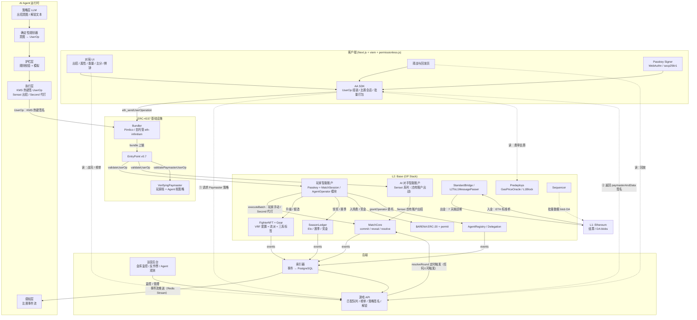
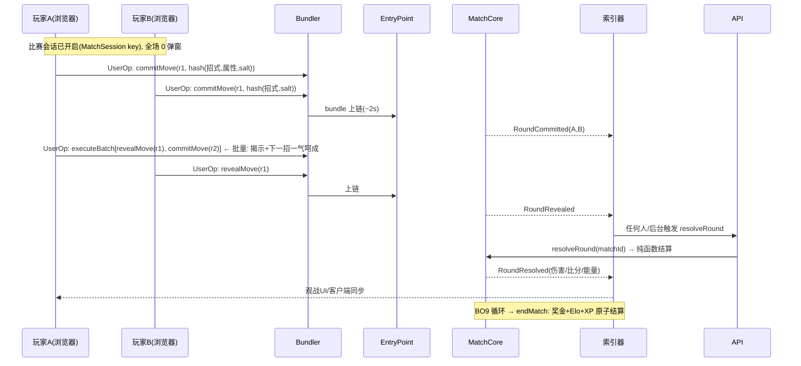
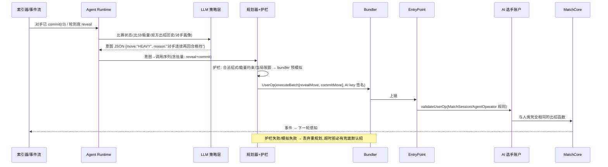

# ChainArena「链斗」技术设计文档

> 版本：v0.4.0（拆分自《MVP 设计方案》v0.3.3）
> 位置：`chainarena/docs/tech-design.md`
> 状态：待评审
> 语言：中文 ｜ [English](./tech-design.en.md)
> 配套文档：产品设计文档（`chainarena/docs/product-design.md`）——定位、玩法规则、经济设计、玩家体验与 AI 角色的产品语义均以产品设计文档为准
>
> **本文档变更记录**
> - v0.4.0：文档拆分。本文档收录：总体架构（§1）、技术选型（§2）、智能合约（§3）、ERC-4337 落地（§4）、L2 落地（§5）、AI Agent 子系统技术设计（§6，原 §8.2/8.3/8.7–8.9）、客户端技术设计（§7）、索引器与后端（§8）、安全与风控（§9）、测试与 CI（§10）、里程碑计划（§11）、运行成本（§12）、技术风险（§13）、附录（§14）。原 §7.3 乐观 UI、§9.2/9.3、§14.2 移入产品设计文档 §3。历史变更记录见 `mvp-design.md`（归档）。

---

## 目录

1. [总体架构](#1-总体架构)
2. [技术选型决策](#2-技术选型决策)
3. [智能合约设计](#3-智能合约设计)
4. [ERC-4337 特性落地](#4-erc-4337-特性落地)
5. [L2 特性落地](#5-l2-特性落地)
6. [AI Agent 子系统技术设计](#6-ai-agent-子系统技术设计)
7. [客户端技术设计](#7-客户端技术设计)
8. [索引器与后端](#8-索引器与后端)
9. [安全与风控](#9-安全与风控)
10. [测试与 CI](#10-测试与-ci)
11. [里程碑计划](#11-里程碑计划)
12. [成本估算](#12-成本估算)
13. [技术风险与开放问题](#13-技术风险与开放问题)
14. [附录](#14-附录)

---

## 1. 总体架构

### 1.1 架构图



> 关键点：AI 选手与人类玩家**走完全相同的通道**——同样经 Bundler 提交 UserOp、同样被 EntryPoint 验证、同样受 Paymaster 策略约束、同样按出招规则打 commit-reveal。**AI 没有任何后门**，这正是"AI 是正式选手而非外挂"的可验证证明。
>
> 出招通道区分：**Sensei（AI 对手）用自己的智能账户出战**（附录 A-3）；**Second（AI 代打）以玩家账户为 sender、用 operator key 签名**（附录 A-2）——两条通道都经过 Bundler/EntryPoint/Paymaster，无特权路径。

### 1.2 一个回合的链上生命周期（人类对人类）



> 玩家侧的交互体验（乐观 UI、回执等待、0 弹窗）见产品设计文档 §3。

### 1.3 AI 选手的一回合（Agent 视角）



---

## 2. 技术选型决策

### 2.1 L2 选型：**Base（OP Stack）**

| 候选 | 优点 | 缺点 | 结论 |
|---|---|---|---|
| **Base (OP Stack)** | 费用最低档、bundler/paymaster 生态成熟（Pimlico/Alchemy）、**RIP-7212 secp256r1 预编译已启用**、EIP-4844 blob DA、2s 出块（**棋钟机制的前提**） | Sequencer 中心化、提款 7 天 | ✅ **MVP 选择** |
| Arbitrum One | 生态大 | 出块节奏/预编译支持不如 OP 系直接 | 备选 |
| OP Mainnet | 同 OP Stack | 游戏用户量小于 Base | 备选 |
| zkSync Era | 原生 AA 但非 ERC-4337 标准 EntryPoint | 工具链割裂 | ❌ |
| 自建 OP Stack Orbit | 可控、自定义 Gas 币 | 运维成本高 | V2 评估 |

**开发环境**：`anvil` 本地链 + EntryPoint 部署；集成用 **Base Sepolia**；自托管 OP devnet 验证桥与 predeploy。

### 2.2 账户栈：**Safe（4337 模块）+ Passkey 模块 + MatchSession/AgentOperator 模块**

| 方案 | 说明 | 取舍 |
|---|---|---|
| **A. Safe + 模块化（选择）** | Safe 智能账户挂载 ① WebAuthn Passkey 验证（RIP-7212）② MatchSession/AgentOperator 模块（比赛会话密钥 + AI 委托密钥，同一合约实现）③ Social Recovery | 审计成熟、模块生态全、v0.7 EntryPoint；**人类与 AI 同构，天然支持"AI 即选手"** |
| B. SimpleAccount + 托管 EOA | 实现最快 | Passkey 只保护云端 EOA，没吃满 4337 |
| C. ERC-7579 MSA | 最前沿 | 生态尚早期 |

> EntryPoint 采用 **v0.7**（0x0000000071727De22E5E9d8BAf0edAc6f37da032）；抽象 `IEntryPoint` 接口，v0.8 升级只动部署脚本。

### 2.3 AI Agent 技术选型

| 组件 | 选择 | 理由 |
|---|---|---|
| Agent Runtime | **Node.js (TypeScript) 自研**主循环 | 感知→决策→规划→护栏→执行，简单可控可审计；不引入重框架 |
| LLM 接入 | **Vercel AI SDK**（provider 无关：Claude/GPT/DeepSeek 热切换） | 与全栈同语言；换模型不影响下游 |
| 策略分层 | **LLM 出意图 + 规则引擎兜底** | 对手/代打的常规出招走规则版（零 LLM、零延迟、可复现），LLM 处理高阶读招；解说文本才纯 LLM |
| AI 签名 | 云 **KMS** 热钥（每 AI 选手一把，可轮换） | 快、可审计；V2 评估 TEE |
| 记忆 | PostgreSQL（对手出招统计/画像） | 从事件流可重建 |

### 2.4 其他选型

| 组件 | 选择 | 理由 |
|---|---|---|
| Bundler/Paymaster | **Pimlico** 起步，接口兼容自托管 eth-infinitism | Paymaster 合约自研（VerifyingPaymaster 模式） |
| AA SDK | **permissionless.js + viem** | 无 vendor lock-in |
| 合约框架 | **Foundry** | 不变量测试成熟（对裁决函数尤其重要） |
| 索引器 | **Ponder** + PostgreSQL | 事件驱动；**同时是观战直播流与 AI 感知源** |
| 前端 | Next.js 14 + wagmi/viem + permissionless.js | SSR 榜单 SEO |
| 随机数 | Fighter 配置铸造用 **VRF**（Base 有 Chainlink）+ 对局内 **commit-reveal** | 铸造公平性 + 对局不可预测性，双场景 |
| 钱包兼容 | 支持 MetaMask EOA 作为 owner 挂入 Safe | 不排斥存量用户 |

---

## 3. 智能合约设计

### 3.1 合约清单

```
contracts/
├── account/                  # 账户层
│   ├── WebAuthnValidator.sol     # secp256r1 passkey 验证（RIP-7212 precompile 0x100，fallback solidity）
│   ├── MatchSessionValidator.sol # 比赛会话/Agent 委托模块（核心自研，一套规则两类签名者）
│   └── RecoveryModule.sol        # 社交恢复
├── arena/
│   ├── MatchCore.sol            # 对局状态机: create/commit/reveal/resolve/end
│   ├── FighterNFT.sol           # ERC-721 + VRF 招式配置
│   ├── Gear.sol                 # ERC-1155 装备（W10+）
│   └── SeasonLedger.sol         # Elo/赛季快照/奖金申领（混合模式）
├── agent/                   # AI 选手层
│   ├── AgentRegistry.sol        # AI 选手注册表（档位/质押/活跃位/标识）
│   └── Delegation.sol           # 玩家↔AI 代打授权账本（周费/召回/收益打折）
├── infra/
│   ├── VerifyingPaymaster.sol   # 玩家档/Agent 档策略执行
│   └── BatchOraclePriceFeed.sol # Token 代付汇率（V2）
└── test/ ...
```

### 3.2 MatchCore 状态布局（省 Gas 优先，裁决函数是核心资产）

```solidity
struct Match {                  // 打包 3 slots / 局
    address p0; address p1;     // 双方账户
    uint64  stake;              // 托管入场费($ARENA, 0=休闲局)
    uint32  score0; uint32  score1;
    uint32  hp0; uint32  hp1;         // 100 起
    uint32  energy0; uint32 energy1;  // 3 起步
    uint16  round; uint8  status;     // Commit/Reveal/Resolved/Ended
    uint64  roundDeadline;            // 块高度棋钟
    uint16  f0; uint16 f1;            // 双方 Fighter id
}
mapping(uint256 => Match) matches;
mapping(uint256 => mapping(uint8 player => mapping(uint16 round => bytes32))) commits;  // 承诺哈希
mapping(uint256 => mapping(uint16 round => uint8[2] movesRevealed));                    // 揭示缓存 (move|element 打包)

// Elo / 战绩在 SeasonLedger（每玩家 1 slot）:
struct Rating { uint32 elo; uint32 wins; uint32 losses; uint32 seasonId; uint64 updatedAt; }
```

- **裁决纯函数**：`resolveRound` 只读 `Match` + 双方 `Fighter` 配置 + 揭示的招式 → 更新状态 + 发事件。无外部调用、无私有数据、可形式化验证——**这是全游戏最重的测试/审计对象**（§10）。
- **棋钟**：`roundDeadline` 以 L2 块高计（2s/块），commit/reveal 各 30 块；`resolveRound` 里检查超时并判负——无需任何链下裁判。
- 招式与流派数值（伤害/克制系数/流派被动与必杀特效）放 `game-config.json` + 链上 `configHash`（客户端与 AI 决策输入同源，防喂假配置）。

### 3.3 关键函数与事件

```solidity
contract MatchCore {
    // ---- 对局 ----
    function createMatch(uint8 mode, uint64 stake, uint16 fighterId) external returns (uint256 matchId); // 托管入场费
    function acceptMatch(uint256 matchId, uint16 fighterId) external;   // 排位: 后手入局并锁局
    function cancelMatch(uint256 matchId) external;      // 挂单未被接受, 撤回托管
    function commitMove(uint256 matchId, uint16 round, bytes32 commitHash) external;   // 招式+属性=salt 哈希隐藏
    function revealMove(uint256 matchId, uint16 round, uint8 move, uint8 element, bytes32 salt) external;
    function resolveRound(uint256 matchId) external;    // 任何人可触发(后台/玩家/bot), 纯函数裁决+超时判负
    function forfeit(uint256 matchId) external;         // 认输(可选, 省时间)

    // ---- 修炼 ----
    function levelUp(uint16 fighterId) external;         // XP→等级, Lv5 解锁必杀
    function craft(uint16 gearId) external;              // 锻造装备

    // ---- 事件(观战/回放/解说/AI感知 的唯一数据源) ----
    event MatchCreated(uint256 indexed matchId, address indexed p0, uint8 mode, uint64 stake);
    event MatchAccepted(uint256 indexed matchId, address indexed p1);
    event RoundCommitted(uint256 indexed matchId, uint16 round, address indexed player);
    event RoundRevealed(uint256 indexed matchId, uint16 round, address indexed player, uint8 move, uint8 element);
    event RoundResolved(uint256 indexed matchId, uint16 round,
        uint8[2] moves, uint32 dmg0, uint32 dmg1, uint32 hp0, uint32 hp1, uint32 score0, uint32 score1);
    event MatchEnded(uint256 indexed matchId, address winner, uint64 payout, uint32 eloDelta0, uint32 eloDelta1);
    event FighterMinted(uint16 indexed fighterId, address indexed owner, uint8 kitSeed);
}
```

> `RoundResolved` 事件冗余全部结算结果——观战端与回放端零模拟直接渲染；**AI 感知层读同一事件流**（人与 AI 信息对称，AI 无法偷看）。

### 3.4 MatchSessionValidator（核心自研模块：比赛会话 + AI 委托）

同一套规则服务两类签名者：**玩家本地比赛会话密钥**与**受雇 AI 代打的 operator key**。

```solidity
struct SessionRule {
    uint48  expiresAt;         // 比赛会话: 单局+缓冲; AI 委托: 周雇佣期
    uint32  maxOps;            // 会话/委托期内最多 UserOp 数
    uint128 maxGasPerOp;       // 单笔 gas 上限(出招类 ~200k 足够)
    address target;            // 只能打 MatchCore / SeasonLedger / FighterNFT
    bytes4  selectorMask;      // 白名单: commit/reveal/resolve/forfeit/levelUp...
    uint16  agentId;           // 0=玩家会话; >0=AgentRegistry 注册的 AI 代打
}
mapping(bytes20 sessionKey => SessionRule) rules;

function validateUserOp(UserOperation calldata op, ...) returns (uint256) {
    // 1. 签名者匹配规则密钥
    // 2. target+selector 匹配位图
    // 3. AI 委托额外校验:
    //    a. AgentRegistry.isActive(agentId)
    //    b. Delegation.isActive(farmer→agentId) 且未过期
    //    c. resolve 的 match 双方含该玩家(不可替别人出招)
    // 4. 过期/次数/gas 上限 → 0 通过 / 其余拒绝
}
```

**产品语义**：

- 玩家：开局一次 passkey 签名"开启比赛会话（本局 + 30 分钟缓冲 / 60 招上限）"→ **整局 0 弹窗**。
- AI 代打：`Delegation.hire` 时自动生成更窄规则（只许出招类 selector、gas 更低、按周计期），随时 passkey 召回。
- 敏感操作（铸造 Fighter、领赛季奖金、转账、桥）**永远 passkey**，与人/机无关。

### 3.5 VerifyingPaymaster（策略在链下、执行在链上）

```solidity
contract VerifyingPaymaster is BasePaymaster {
    address public signer;   // 后端策略服务

    function validatePaymasterUserOp(UserOperation calldata op, ...)
        external returns (bytes memory context, uint256 deadline) {
        // 验策略签名: 玩家档(§4.4) / Agent 档(§6.3), 链上只做无状态验签
    }
    function postOp(...) { /* $ARENA 代付模式: 此处扣款; 赞助模式: 无操作 */ }
}
```

---

## 4. ERC-4337 特性落地

### 4.1 特性 → 场景映射总表

| ERC-4337 特性 | 人类玩家场景 | AI 选手场景 | 价值 |
|---|---|---|---|
| Smart Account | 选手身份：段位/战绩/奖金挂账户 | **AI 选手自己的账户**：全部出招历史公开可审计 | "我的账号就是我的选手生涯"；"AI 装不装人一查便知" |
| Passkey | 注册/铸造/领奖用 Face ID | —（AI 用 KMS 热钥） | 无助记词入场 |
| Bundler | 所有出招走 UserOp | AI 出招同一管道——同人同费率同审查 | AI 无后门 |
| **Paymaster 赞助** | 新手前 50 局免费（含出招 Gas） | AI 对手档独立预算（垫场服务成本） | 零 Gas 入场 |
| **Token 代付** | 排位费内含 Gas：postOp 扣 $ARENA | 同 | 永不需买 ETH |
| **Session Key / AgentOperator** | 比赛会话：整局十几招 **0 弹窗** | 玩家把受限出招权授予 AI 代打 | **格斗游戏能玩的前提**（每招弹窗=劝退） |
| **Batch** | "揭示本回合 + 提交下回合"一笔完成；赛后"领奖+升级+再排"一笔完成 | AI 决策爆发同享批量 | 出招节奏丝滑 |
| ERC-1271 | 账户签名登录 | AI 选手签署"比赛宣言/战绩自述"可验签 | 无密码登录；AI 可信发言 |
| Social Recovery | guardians 找回账户与 Fighter | 召回代打不需恢复流程 | 资产安全 |
| 并行 nonce | 观战/聊天与比赛互不阻塞 | **AI 代打与玩家手动出招并行**（nonceKey 隔离） | 互不抢 nonce |
| Aggregator（V2） | BLS 聚合 | 观赛高峰期聚合一撮人的操作 | 留接口 |

### 4.2 智能账户 = 选手（人类与 AI 同构）

- **人类**：CREATE2 先算地址，惰性部署；首次 UserOp = 部署账户 + 领取新手 Fighter + 免费匹配，一笔原子完成（产品设计 §3.1）。
- **AI**：每个 AI 选手（三档对手、代打引擎、表演赛选手）各一个 Safe + KMS 热钥，注册于 AgentRegistry，地址公开。
- 账户地址 = 段位主体 = 奖金归属 = ERC-1271 签名身份。

### 4.3 Passkey（WebAuthn / secp256r1）

- `navigator.credentials.create()` 生成；验证走 **RIP-7212 预编译（0x100）**，~3.5k gas/次（fallback solidity ~300k）。
- 铸造、领赛季奖、召回代打、桥操作等价值操作走 passkey。

### 4.4 Paymaster 玩家档策略

| 策略 | 规则 | 防滥用 |
|---|---|---|
| **新手赞助** | 前 50 局或 7 天内全部出招 Gas 免费 | 仅赞助 MatchCore 白名单 selector；每账户每日 ≤ 3 局休闲赞助；金库日预算熔断 |
| **排位自付** | 排位入场费含 Gas：postOp 按 $ARENA 汇率扣（10% 缓冲） | 汇率链上校验新鲜度 |
| **每日首胜赞助** | 每日第一胜的对局 Gas 半价 | 按日刷新 |
| 拒绝名单 | 女巫/作弊账户不签 | 账户年龄 + 行为分 + 设备指纹 |

> 成本直觉：一局 ~18 笔 UserOp × < $0.005 ≈ **<$0.10/局**；50 局新手赞助 ≈ **<$5/玩家全周期**——L2 让"赞助一个玩家的整个新手期"成为买量级别的开销。

### 4.5 Session Key / AgentOperator 实现细节

- 授权：开局一次 passkey `grantSession(key, rule)`；AI 代打 = `Delegation.hire` 自动 `grantSession(operatorKey, narrowRule)`。
- 撤销：随时 passkey `revokeSession` / `dismiss`；单局结束/雇佣到期自动失效。
- 风险面：比赛会话密钥只能出招/认输/领奖，**不能转账、不能铸造、不能领赛季奖金**——密钥泄露最大损失=一局的入场费。
- 存储：会话密钥 `IndexedDB`；AI 热钥仅服务端 KMS；passkey 仅硬件安全区。

### 4.6 批量与原子性

```ts
// 出招节奏的标配: 揭示 + 预提交 打成一笔
const userOp = encodeUserOp({
  calls: [
    { target: MATCH_CORE, callData: encode('revealMove(uint256,uint16,uint8,uint8,bytes32)', [matchId, r, myMove, myElement, salt]) },
    { target: MATCH_CORE, callData: encode('commitMove(uint256,uint16,bytes32)', [matchId, r + 1, nextCommit]) },
  ],
  nonceKey: matchSessionId,          // 比赛会话独立 nonce 空间
  paymasterAndData,                  // 策略签名
});

// 赛后: 领奖 + 升级 + 再排 也是一笔
// [levelUp(fighter), createMatch(mode, stake, fighter)]
```

- 原子性价值：`reveal+commit` 打包**消除"揭示后忘提交"被抢节奏的窗口**；赛后批量无中间态。

### 4.7 ERC-1271 登录与签署

- 登录：后端 nonce → 账户签名 → `isValidSignature` → JWT。
- AI 选手对"战绩自述/宣言"做 ERC-1271 签名，客户端可验——**链上战绩 + 账户签名 = AI 的可信发言**（解说/营销用）。

---

## 5. L2 特性落地

### 5.1 特性 → 场景映射总表

| L2 特性 | 场景 | 价值 |
|---|---|---|
| **超低 Gas**（L2 执行 + 4844 blob DA） | 一局 9 回合 × 每回合 5 笔链上调用（2 commit+2 reveal+1 resolve），L1 上单局成本 >$50 不可行，L2 **<$0.10** | **逐招上链的格斗在 L1 不存在，这是 L2 独占玩法** |
| **2 秒出块 + 软确认** | 回合节奏（出招→揭示→裁决 ≈ 10–20s/回合）；**链上棋钟（块高计的回合超时）** | 接近实时对战体感；无需链下裁判 |
| **事件即直播** | 观战/回放/解说/数据分析全部从事件流构建 | 停服可重建客户端；AI 感知同人同源 |
| **RIP-7212 预编译** | passkey 验签 ~3.5k gas | passkey 账户免费化 |
| **L1↔L2 标准桥** | ETH 出入金；赛季奖金金库周归集 | 出入金主通道 |
| **Predeploys**（GasPriceOracle/L1Block） | 出招前精确估费；AI 护栏成本上限判定 | 费用透明 |
| **EIP-1559** | 观战高峰/排位关键局用高 priority fee，普通出招低费 | 玩家无感 |
| **软确认 vs L1 终局** | 出招信软确认（2s）；赛季奖金发放等 L1 finality | 分级信任 |
| **alt-mempool** | 出招 UserOp 走 bundler 私有 mempool，**对手无法从公共 mempool 偷看你的 commit 之外的任何信息**（commit 本身就是哈希） | 公平性基础设施 |
| Superchain Interop（V2） | 跨 OP 链赛季 | 未来 |

> 玩家侧由 2s 软确认驱动的"乐观 UI"交互体验见产品设计文档 §3.3。

### 5.2 成本结构（Base 主网量级，以实时为准）

| 动作 | gas | 成本 |
|---|---|---|
| commitMove / revealMove（单笔） | ~100k–140k | ~$0.002–0.005 |
| resolveRound（后台批量触发，摊薄后） | ~60k | ~$0.001 |
| **单局全流程（玩家侧 ~18 笔 UserOp，含批量打包优化）** | — | **~$0.03–0.08** |
| 新手首局（部署账户+领 Fighter+对局） | ~600k | ~$0.02–0.05 |
| mint Fighter（VRF 配置） | ~250k | ~$0.005 |
| AI 对手单局（运营侧） | ~18 笔 | ~$0.05/局 |

> 对比：同样的逐招上链在 L1 单局 > $50，**在 L1 这个游戏不存在**——"用满 L2"不是营销话术，是玩法可行性边界。

### 5.3 事件驱动索引

- 合约只写状态 + 发事件；观战/回放/榜单/任务全由索引器从事件流计算。
- `RoundResolved`/`MatchEnded` 携带全部结果 → 索引器零模拟。
- 索引器同时向 AI Runtime 推送事件流（感知层）。

### 5.4 L1↔L2 出入金设计

| 方向 | 通道 | 体验 | 说明 |
|---|---|---|---|
| L1 → L2 | 官方桥（ETH） | 2–5 min | 可选，不充也能玩 |
| L2 → L1 | 标准桥 | **7 天挑战期** | UI 进度条 + 帮助文档 |
| 奖金金库归集 | 每周标准桥回 L1 多签 | 7 天 | 财务流程 |
| 快速提现（V2） | 第三方 LP 桥 | 分钟级 | 后置 |

- 游戏资产（$ARENA/Fighter/装备）L2 内循环；MVP 关闭 $ARENA 出口。

### 5.5 随机数：两个场景两种方案

| 场景 | 方案 | 理由 |
|---|---|---|
| **Fighter 配置铸造**（一次性、高价值） | **Chainlink VRF**（Base 已部署） | 配置决定强度，必须不可预测不可操纵 |
| **对局出招**（每回合、高频） | **commit-reveal**（协议内建） | 同时出招的公平性本身就是 commit-reveal；VRF 每回合调用太贵且不解决"双方同时"问题 |

---

## 6. AI Agent 子系统技术设计

> Sensei / Second / Echo 三类 AI 角色的产品定位、经济与透明性规则见产品设计文档 §4；本章只覆盖技术实现。

### 6.1 为什么 ERC-4337 是 AI 选手的最佳载体

1. **AI 无法点弹窗**：智能账户模块让 AI 的 KMS 密钥成为合法签名者。
2. **最小权限委托**：代打只能出招，不能碰钱/资产。
3. **链上身份 = 可审计生涯**：AI 是不是 AI、战绩真假、有没有偷看，地址一查便知。
4. **同人同管道**：AI 走同一 Bundler/EntryPoint/Paymaster，无特权后门——"AI 是正式选手"是可验证的，不是口号。
5. **并行不冲突**：nonceKey 让代打与玩家手动操作互不阻塞。

### 6.2 Agent Runtime 架构

```
services/agent/  (TypeScript, 每 AI 选手一个角色配置)
┌────────────────────────────────────────────────────────┐
│  感知 Perception                                       │
│   · 订阅比赛事件流(RoundCommitted/Revealed/Resolved)    │
│   · 维护比赛状态 + 对手出招统计画像                      │
├────────────────────────────────────────────────────────┤
│  策略 Brain                                            │
│   · 规则引擎(默认): 纳什均衡混合策略 + 能量管理          │
│   · LLM(高阶): 读对手习惯/诱招/心理战, 产出意图 JSON     │
│   · 解说: 纯 LLM 生成逐回合文本                         │
├────────────────────────────────────────────────────────┤
│  规划 Planner (确定性, 零 LLM)                          │
│   · 意图 → commit/reveal/resolve 调用序列(批量打包)     │
├────────────────────────────────────────────────────────┤
│  护栏 Guard                                            │
│   · 合法招式/能量约束/当局限额/委托有效期/Registry 活跃  │
│   · 超时兜底: 棋钟剩余 <20% 时强制规则引擎出招           │
│   · bundler 模拟失败即丢弃告警                          │
├────────────────────────────────────────────────────────┤
│  执行 Action                                           │
│   · KMS 热钥签 UserOp → Bundler → EntryPoint            │
│   · 回执 → 记忆 → 下一轮感知                            │
└────────────────────────────────────────────────────────┘
```

**铁律**：LLM 只产出意图与文本，签名权在规划器+护栏之后；护栏以「bundler 模拟 + 回执」双确认；**棋钟剩余不足时直接规则引擎出招**——AI 永不超时、永不因模型抽风损失玩家资产。

### 6.3 Paymaster Agent 档策略

| 规则 | 说明 |
|---|---|
| 资格 | 仅 AgentRegistry 注册 + 质押 $ARENA 的 AI（可罚没） |
| 预算 | **AI 档独立预算池**（Sensei 垫场费用 = 运营市场预算；Second 费用部分来自代打费分成） |
| 上限 | 每 AI 每日 Gas 上限；代打每玩家每日局数上限 |
| selector | 只赞助 MatchCore 出招类操作 |
| 熔断 | 异常速率/失败率 → Registry 置 inactive → 模块与 Paymaster 双重拒签 |

### 6.4 L2 × Agent 的乘数效应（小结）

| L2 特性 | 对 AI 的意义 |
|---|---|
| 亚分级费用 | AI 对手 7×24 垫场、代打持续在线的成本可控（~$0.05/局） |
| 2s 软确认 + 块高棋钟 | AI 回合响应 <10s；超时兜底有确定的时间基准 |
| 事件即直播 | 感知层与观战同源，AI 与人信息对称 |
| 4844 blob | 高频出招的 L1 数据费被摊薄 |
| nonceKey 并行 | 代打与玩家并行操作同一账户 |

### 6.5 Agent 可观测性

- 索引器按 `sender ∈ AgentRegistry` 打标 → `agent_actions` 表（出招分布/胜率/决策延迟/护栏拦截）
- 看板：AI 局占比、Sensei 各档胜率曲线（难度调参依据）、Second 委托履约率、Echo 解说生成成本
- 决策日志（意图+理由+护栏结果）留存 90 天

---

## 7. 客户端技术设计

> 新玩家 60 秒路径与签名/弹窗策略的产品定义见产品设计文档 §3.1/§3.2。

### 7.1 技术栈与结构

```
apps/web/
├── app/
│   ├── (arena)/            # 匹配大厅/对局界面(出招盘/能量条/比分/棋钟)
│   ├── watch/              # 观战列表 + 实时战况 + 回放播放器(事件流驱动)
│   ├── (agent)/            # Sensei 介绍/代打雇佣与日志/Echo 复盘页
│   ├── leaderboard/        # 天梯/赛季榜(含 AI 选手标记)
│   └── onboarding/         # 60 秒新手路径(首局 vs Sensei-青铜)
├── lib/
│   ├── aa/                 # permissionless.js 封装: 建号/UserOp/批量/重试
│   ├── session/            # 比赛会话生命周期(开局授权/倒计时/自动续局询问)
│   ├── optimistic/         # 乐观状态机: pending → confirmed / reverted
│   └── config/             # game-config.json + configHash 校验
└── hooks/
```

### 7.2 错误与重试

- Bundler 错误映射：`AA2x-3x` → "会话过期，请重新授权"；`AA4x` → "Gas 赞助额度用尽（明日刷新或打排位）"；`AA10x` → 网络重试。
- UserOp 卡 pending >30s：取消重发（nonceKey 隔离，不影响后续招）。
- **棋钟防御**：客户端本地倒计时（基于最新块高），剩余 <25% 时 UI 强提示 + 预提交默认招选项。
- 多 tab/观战与对战页并行：nonceKey 分离。

---

## 8. 索引器与后端

### 8.1 索引器（Ponder）

- 订阅 MatchCore / FighterNFT / SeasonLedger / AgentRegistry / Delegation 全部事件 → PostgreSQL：
  - `matches` / `rounds`（完整对局流水——回放即查询）
  - `ratings`（Elo 时序 + 快照）
  - `players`（账户/ Fighter / 会话状态 / 风控分 / 当前代打）
  - `agent_actions`（AI 出招统计、委托履约）
  - `leaderboards`（物化视图：天梯/赛季榜，AI 标记）
- 观战页 & 回放器直接读 `rounds` 流水；**Hydration**：首屏 API 快照 + ws 增量事件。
- **AI 感知出口**：Redis Stream 推送给 Agent Runtime。

### 8.2 游戏 API（Node.js + tRPC）

- 匹配队列（休闲即撮即打；排位按 Elo 区间撮合，**撮合只排序不裁决**）、榜单、配置、ERC-1271 登录、Paymaster 策略签名、任务资格签名、Echo 解说端点（LLM 代理 + 审核）。

### 8.3 链上/链下混合判定（赛季奖金）

1. 赛季结束：索引器按链上快照计算最终榜单 → 运营多签批准 → **Merkle root 上链**（SeasonLedger）
2. 玩家 `claimSeasonReward(proof)` 链上验证发放——**判定链下锚定、发放链上非托管**

### 8.4 运营后台

- Paymaster 双池（玩家/AI）监控与熔断、女巫标记、赛季结算流、Agent 管理（Registry 上下架/难度参数/委托审计）、Sensei 让位策略调参

---

## 9. 安全与风控

### 9.1 威胁模型与对策

| 威胁 | 对策 |
|---|---|
| **裁决合约漏洞（最高危）** | `resolveRound` 纯函数化 + Foundry fuzz/不变量测试（伤害公式性质、能量守恒、比分单调）+ 主网前外部审计 + 漏洞赏金 |
| 出招 commit 阶段被抢跑/窥探 | commit 是哈希，mempool 无信息量；reveal 阶段后无再出招权 |
| commit 后拒不 reveal（拖延） | 块高棋钟：reveal 超时判负当回合，连续两回合判负整局 |
| Elo 刷分（小号互喂） | 排位需账户年龄 + 行为分；同资金源/设备聚类标记；撮合器回避高关联对局；异常 Elo 波动回溯审计 |
| Paymaster 被薅 | 白名单 selector + 局数/日上限 + 双池熔断 + 拒绝名单 |
| 会话/代打密钥泄露 | 规则封顶（只能出招，损失 ≤ 一局入场费）；随时撤销 |
| **LLM 幻觉** | 意图 schema 校验 + 规则引擎兜底 + 棋钟强制默认招；LLM 无签名权 |
| **提示注入（解说/代打）** | Echo 纯读无权限；Second 输入仅结构化比赛状态，不消费自由文本；配置经 configHash 锚定 |
| AI 密钥被盗 | KMS + 轮换 + Registry 熔断 + 规则限额 |
| VRF 操纵（铸造洗配置） | Chainlink VRF；配置结果事件可独立复核 |
| Sequencer 停机/回滚 | 棋钟以块高为基准自动顺延；奖金等 L1 finality；前端显示 sequencer 健康 |
| 合约升级风险 | MatchCore **不可升级**（裁决即信任根）；修 bug 走新合约 + 迁移赛制，老对局原地终结 |
| 账户丢失 | Social Recovery（第二 passkey + 邮箱 + 运营托管） |

### 9.2 权限分级总览

```
L0  只读（观战/回放/榜单/Echo 感知）
L1  MatchSession key: 比赛内出招/认输/触发裁决
L1' AgentOperator key: 代打的更窄动作集(无铸造/无领奖/局数上限)
L2  Passkey: 会话管理、雇佣/召回、铸造、领赛季奖、桥、恢复
L3  多签: Merkle root 上链、Registry 上下架、configHash 升级、金库参数
```

---

## 10. 测试与 CI

| 层级 | 工具 | 覆盖 |
|---|---|---|
| 单元测试 | forge | 伤害/克制公式全枚举、**流派被动与必杀特效全枚举**、能量守恒、Elo 计算 |
| 不变量/模糊测试 | forge invariant | **任意招式序列下 HP/能量/比分守恒；棋钟超时路径全枚举；resolveRound 可重入/重复触发安全** |
| 账户栈测试 | forge + @account-abstraction | v0.7 交互、比赛会话/代打规则边界（过期/超限/替他人出招被拒） |
| Paymaster 测试 | anvil + 自托管 bundler | 双档拒签、熔断、代付汇率 |
| **对局仿真（新增重点）** | TS 仿真器：随机/贪心/均衡策略 × 5 流派两两对打 10⁶ 局 | 先手/后手无系统性优势；**五行两两组合（相克 5 对 / 相生 5 对 / 同属性）胜率 ±3% 内**；**流派两两胜率 ±3% 内**；KO/回合分/判定/平局四类终局占比回归基线（平衡性守门） |
| **Agent 回放测试** | 录制事件流 → 离线重放 Runtime | 策略回归；护栏负路径全覆盖（LLM 试图越权/超时前兜底） |
| 集成测试 | docker: op-geth + bundler + indexer + agent | 端到端：建号→首局 vs AI→结算→榜单 |
| E2E | Playwright | 60 秒路径、整局 0 弹窗、观战/回放 |
| 测试网冒烟 | Base Sepolia 定时 | 核心脚本 + 回合延迟/费用采样（P95 < 5s） |

---

## 11. 里程碑计划（8 周核心 + 3 周 AI）

### 核心 MVP（W1–W8）

| 周 | 里程碑 | 交付物 |
|---|---|---|
| W1 | 对局引擎 | MatchCore commit/reveal/resolve + forge 全枚举测试，anvil 可打完一局 |
| W2 | Fighter/赛季 | FighterNFT(VRF 配置 = 流派 + 三系标签) + SeasonLedger(Elo) + 对局仿真器初版（流派 × 五行平衡性报告） |
| W3 | 账户栈 | Safe+WebAuthn 建号、EntryPoint v0.7 首笔 UserOp（自托管 bundler） |
| W4 | Paymaster | VerifyingPaymaster + 策略后端 + 双池熔断；新手赞助全流程 |
| W5 | 比赛会话 + 批量 | MatchSessionValidator 测试网；整局 0 弹窗 + reveal&commit 打包 |
| W6 | 观战与回放 | Ponder 索引 → 观战页/回放器/天梯（验证纯事件重建） |
| W7 | 桥 + VRF 铸造 | Base Sepolia 出入金全流程；Chainlink VRF 铸造接入 |
| W8 | Beta | E2E、费率/延迟监控、压测（200 并发对局）、主网 checklist |

### AI 阶段（W9–W11）

| 周 | 里程碑 | 交付物 |
|---|---|---|
| W9 | Agent 地基 | AgentRegistry/Delegation 合约 + Runtime 骨架（devnet 完整打一局 vs 规则 AI） |
| W10 | Sensei + Second | 三档 AI 对手上线（匹配垫场）；代打雇佣闭环 + 履约审计；Agent 档 Paymaster |
| W11 | Echo + 观测 | 逐回合解说/赛后复盘；AI 看板（局占比/胜率/延迟/成本）；回放与 LLM 负路径测试进 CI |

> 人员：2 全栈 + 1 合约 + 0.5 算法/提示工程；审计覆盖 MatchCore + 验证器 + Paymaster + Agent 合约组。

---

## 12. 成本估算

### 12.1 主网运行成本（量级估算）

| 项 | 假设 | 月成本 |
|---|---|---|
| Paymaster 玩家档 | 1k DAU × 3 局/天 × $0.06 | ~$5.4k |
| **Sensei 垫场（AI 档）** | 冷启动期 60% 局为 AI 局，逐步降至 20% | ~$1–3k |
| LLM API | Second 高阶决策 + Echo 解说（Sensei 常规局走规则引擎，零 LLM） | ~$200–800 |
| Bundler/Paymaster SaaS | Pimlico 免费档起步 | $0 → 按量 |
| 索引器/API/Runtime | 2 台 4C8G | ~$200 |
| KMS | 每 AI 一把 + 轮换 | ~$10 |
| 审计（一次性） | MatchCore + 账户模块 + Paymaster + Agent 合约 | $50–120k |

> 对冲项：排位入场费含 Gas（Token 代付）、代打费分成、rake 销毁前的 10% 中划拨部分进 Gas 预算——**重度玩家自付、轻度玩家赞助**的成本结构。

> 玩家侧费用感知（新手免费、排位费内含 Gas、无需理解 ETH/Gas）见产品设计文档 §3.5。

---

## 13. 技术风险与开放问题

| # | 风险/问题 | 状态 |
|---|---|---|
| R1 | EntryPoint v0.7→v0.8 生态跟进 | 已抽象接口，观察 |
| R2 | Pimlico 锁定 | 自托管 bundler 灾备，W4 演练 |
| R5 | 女巫刷分/刷赞助 | 账户年龄+行为分+聚类+质押罚没；W8/W11 压测熔断 |
| R6 | LLM 成本随 Second/Echo 规模放大 | 常规局规则引擎兜底，LLM 仅高阶场景；意图缓存 |
| Q1 | 匹配器是否去中心化（现为中心化撮合，仅排序不裁决） | MVP 接受；V2 评估链上撮合/承诺池 |
| Q2 | passkey 低端安卓可用率 | W3 设备矩阵测试，fallback 邮箱验证器 |
| Q4 | Agent 热钥 TEE 化 | V2 评估 |

> 产品类风险（对局节奏、博弈深度、AI 代打观感、观赛社交层）见产品设计文档 §6。

---

## 14. 附录

### 附录 A：典型 UserOp 字段

**A-1 玩家出招（reveal + 预提交打包）：**

```jsonc
{
  "sender": "0x<玩家Safe地址>",
  "nonce": "0x...",                     // nonceKey = matchSessionId
  "initCode": "0x",                     // 首局则为 部署账户+领Fighter+开局 组合
  "callData": "0x<executeBatch: revealMove(r)|commitMove(r+1)>",
  "callGasLimit": "350000",
  "verificationGasLimit": "150000",     // MatchSession key 验证
  "preVerificationGas": "55000",
  "maxFeePerGas": "0x...", "maxPriorityFeePerGas": "0x...",
  "paymasterAndData": "0x<PM地址><过期><策略签名-玩家档>",
  "signature": "0x<match session key 签名>"
}
```

**A-2 AI 代打出招：**

```jsonc
{
  "sender": "0x<玩家Safe地址>",          // 仍是玩家账户
  "nonce": "0x...",                     // nonceKey = agentSessionId（与玩家手动出招并行）
  "callData": "0x<executeBatch: revealMove|commitMove>",
  "verificationGasLimit": "160000",     // AgentOperator 验证(Registry+委托+规则)
  "paymasterAndData": "0x<PM地址><过期><策略签名-Agent档>",
  "signature": "0x<Second operator key(KMS) 签名>"
}
```

**A-3 AI 选手（Sensei）自己出招：**

```jsonc
{
  "sender": "0x<Sensei-Bronze 的 Safe 地址>",  // AI 自己的账户, Registry 可查
  "nonce": "0x...",
  "callData": "0x<executeBatch: commitMove(r)>",
  "paymasterAndData": "0x<...策略签名-Agent档>",
  "signature": "0x<Sensei KMS 热钥签名>"
}
```

### 附录 B：代码仓库规划

```
chainarena/
├── docs/                    # 设计文档（产品设计 / 技术设计 / ADR）
├── contracts/               # Foundry 项目（§3.1）
├── apps/web/                # Next.js 客户端（§7.1）
├── services/
│   ├── policy/              # Paymaster 策略签名服务（玩家档/Agent 档）
│   ├── indexer/             # Ponder 索引器（观战/回放/感知同源）
│   ├── agent/               # Agent Runtime（Sensei/Second/Echo）
│   ├── simulator/           # 对局仿真器（平衡性回归）
│   └── api/                 # 游戏 API（匹配/榜单/解说端点）
├── infra/                   # docker-compose: anvil/op-devnet/bundler/ponder/pg/redis
└── game-design/             # 数值配置表(configHash 源文件) + Agent 策略文档
```

### 附录 C：术语速查

| 术语 | 一句话解释 |
|---|---|
| ERC-4337 / UserOp | 账户抽象标准；交易包一层"用户操作"，由 Bundler 代发 |
| EntryPoint | 4337 全局单例合约，协调账户/签名者/Paymaster 的验证与执行 |
| Paymaster | 替用户付 Gas 的合约（赞助 / ERC-20 代付） |
| Bundler | 从私有 mempool 收 UserOp、验证后代为上链的节点 |
| MatchSession / AgentOperator | 比赛会话密钥 / 授予 AI 代打的受限密钥（同一模块实现） |
| commit-reveal | 先提交哈希承诺、后揭示内容，保证"同时出招"公平性 |
| 棋钟（round deadline） | 以 L2 块高计的回合超时，超时判负，链上自动执行 |
| 流派（Archetype） | Fighter 本命属性映射的构筑定位（金锋刃/木生息/水流转/火烈焰/土磐岩），只改数值/特效/被动，不改招式集 |
| Elo | 天梯评分：胜负后按对手分差加减分 |
| AgentRegistry / Delegation | AI 选手注册表（质押/标记）/ 玩家↔AI 代打授权账本 |
| RIP-7212 | secp256r1 预编译，passkey 链上验签只要 ~3.5k gas |
| OP Stack / Base | Optimism 系 L2 技术栈；Base 是其上的公共链 |
| 软确认 / L1 终局性 | L2 sequencer 秒级出块确认 / 最终依赖 L1（提现等 7 天挑战期） |
| EIP-4844 blob | L2 批量数据以 blob 发 L1，显著降低 L2 数据费 |
| 意图 JSON | LLM 的受限输出格式，经确定性规划器转换为链上调用 |
