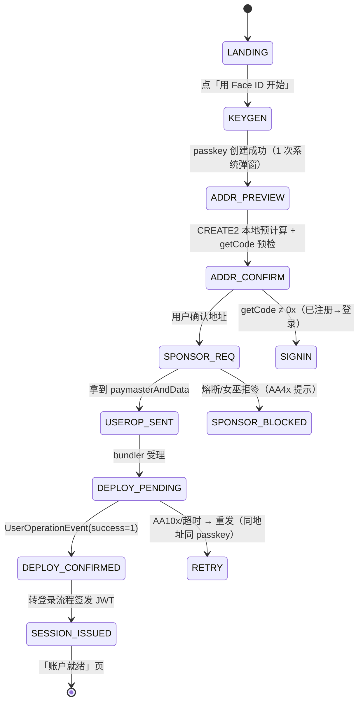
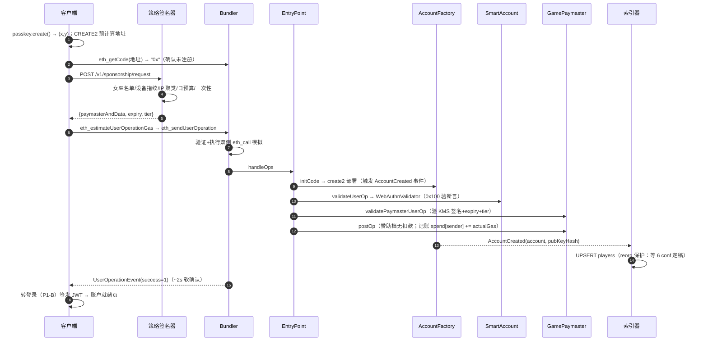

# 技术详设 P1-A：注册（Signup）

> 版本：v0.4.0 ｜ 状态：待评审
> 上游：[用例 01](../usecases/01-signup.md) ｜ [分期计划 §3.4](../development-phases.md) ｜ [架构 §2/§3](../architecture.md) ｜ [技术设计 §4](../tech-design.md)
> 范围：**P1 建号 = 部署智能账户**（1 弹窗 / 0 Gas / p95 ≤ 15s / 地址确定性可中断续跑）。P2 扩展点在 §12 标注。

## 1. 组件与职责

| 组件 | 本 story 职责 |
|---|---|
| 客户端 `@arena/core` | passkey 创建、CREATE2 预计算、UserOp 组装与签名、乐观 UI |
| Auth 服务 | 建号成功后签发首个 JWT（转登录流程） |
| Paymaster 策略签名器（KMS） | 女巫预检 + 签发 `paymasterAndData` |
| Bundler | 模拟、打包、上链、回执 |
| EntryPoint v0.7 | 标准入口：create2 部署 + 双重验证 + 执行 |
| AccountFactory / SmartAccount / WebAuthnValidator | 确定性部署、RIP-7212 验签 |
| GamePaymaster（新手档） | 赞助执行与记账、per-account 一次性 |
| 索引器 | `AccountCreated` → `players` 读模型 |

### 1.1 策略签名器：链下门卫，链上锁

一个持有 KMS 密钥的链下后端服务，职责只有一个：**决定「谁有资格享受 Gas 赞助」，并把决定签发成 `paymasterAndData`**。它是 VerifyingPaymaster 模式（技术设计 §3.5）的链下半边——策略在链下、执行在链上：

```
客户端 ──请求──→ 策略签名器（链下）           GamePaymaster（链上）
                ① 女巫黑名单？                  ④ 验 KMS 签名真伪
                ② 设备指纹聚类超限？      →      ⑤ expiry 未过期？
                ③ IP 限流 / 日预算？             ⑥ nonceHash 未用过？
       签发 paymasterAndData                    ⑦ selector 白名单？
                                                ⑧ per-account 一次性？
                                                ⑨ 日熔断？
```

| 放链下（策略签名器） | 放链上（GamePaymaster） |
|---|---|
| 女巫检测、指纹聚类、预算熔断——**规则要频繁调、数据要保密**（指纹特征上链 = 公开反女巫手段） | 验签、白名单、一次性——**必须不可绕过、人人可审计** |
| 拒绝一个请求 = 不签名，零成本 | 链上强制 = 即使链下被绕过/作恶，损失也被硬顶住 |

**安全属性**：策略签名器**只能「拒绝服务」，不能「错误放行」**——它签的每一笔都受链上白名单与 per-account 一次性约束；KMS 密钥泄露损失上限 = 单档日预算（熔断止血，架构 §6.2）。一句话：**策略签名器是赞助预算的门卫，GamePaymaster 是金库的锁**。

### 1.2 AccountFactory：为什么必须引入

一个小型部署合约，全局唯一，专门「按确定性公式铸造玩家账户」：

```solidity
function createAccount(bytes32 x, bytes32 y, uint256 salt);  // 部署代理并初始化 owner
function getAddress(bytes32 x, bytes32 y, uint256 salt) view; // 只算地址、不部署
```

```
AccountFactory（全游戏唯一）
   │  CREATE2: addr = keccak(0xff ‖ factory ‖ salt ‖ keccak(initCode))[12:]
   ├──→ SmartAccount 0xAbC…（代理，owner = 玩家 A 的 passkey）
   ├──→ SmartAccount 0xDeF…（代理，owner = 玩家 B 的 passkey）
   └──→ … 每玩家一个轻代理，全部指向同一份「P1 冻结」的实现代码
```

**理由①：先知道地址，后部署（counterfactual 惰性部署）**。CREATE2 地址只由 `factory + salt + initCode` 决定，与谁部署/何时部署无关：
- **中断续跑**：中途关页链上零状态；重开时同 passkey → 同 salt → **同地址**无缝继续（普通 CREATE 地址取决于部署者 nonce，中断即漂移）
- **地址可预览**：花任何 gas 前用户即可核对地址（Step 3）
- **未部署也能收资产**：counterfactual 地址天然可收款（P1 不用，架构免费获得）

**理由②：ERC-4337 的标准部署通道就是工厂**。UserOp.initCode = factory + 部署调用，EntryPoint 在验证前先执行 initCode 完成部署再立刻 validateUserOp。没有工厂 → 账户无法随首笔 UserOp 部署 → 只能先发独立交易部署：① 破坏首笔原子性（部署与第一笔操作两笔两个中间态；P2 的 executeBatch[部署+claimStarter+createMatch] 一笔完成全靠此机制，用例 01 §6）；② 新玩家无 ETH，谁付部署 gas？——工厂 + UserOp 让部署与首笔操作共用同一 Paymaster 赞助。

**理由③：Gas 与实现管理**。工厂只部署最小代理（~150–300k gas），百万玩家共享同一份实现；配合「账户实现 P1 冻结」（分期计划 §1），后续扩展全部通过「启用已部署模块」完成，存量用户零迁移。

**一句话**：AccountFactory = 地址确定性的来源 + EntryPoint 的标准部署入口 + 首笔原子性的前提。

## 2. 关键数据结构

### 2.1 密钥与盐

```
passkey：secp256r1 公钥
challenge = keccak256(UserOpHash)                          ← EntryPoint 标准
userSalt  = 0（默认；换 salt = 换地址，仅高级设置开放）
salt      = keccak256(pubKeyX ‖ pubKeyY ‖ userSalt)
地址      = CREATE2(factory, salt, keccak(账号 initCode))    ← 纯本地可算，永不变
```

### 2.2 UserOp 字段（EntryPoint v0.7 结构，P1 建号取值）

| 字段 | 取值 | 说明 |
|---|---|---|
| sender | CREATE2 预计算地址 | `eth_getCode == "0x"` 时才走注册 |
| nonce | 0 | 首笔 |
| initCode | `factory ‖ abi.encodeCall(createAccount,(x,y,salt))` | 部署即触发 |
| callData | `0x` | P1 空调用；P2 在此 append（§12） |
| accountGasLimits | verification ≈ 45k（RIP-7212 路径）/ call ≈ 2k | 估gas走 bundler RPC |
| gasFees | bundler 建议 ×1.2 缓冲 | 观战高峰退让策略（P2 调优） |
| preVerificationGas | bundler 估算 | — |
| paymasterAndData | §2.4 | 策略签名注入 |
| signature | §2.3 | WebAuthn 断言 |

### 2.3 signature 编码（WebAuthn 断言）

```solidity
signature = abi.encode(
    bytes authenticatorData,   // rpIdHash ‖ flags ‖ signCount
    string clientDataJSON,     // {type:"webauthn.get", challenge:hex(UserOpHash), origin}
    bytes  derSignature        // P-256 ECDSA(authenticatorData ‖ sha256(clientDataJSON))
)
// 链上验证：RIP-7212 precompile 0x100（Base 原生），失败即拒；严格 DER 解析防 malleability
```

### 2.4 paymasterAndData 编码

```
paymasterAndData = paymaster地址 ‖ expiry(uint64) ‖ tier(uint8) ‖ nonceHash(bytes32) ‖ KMS签名(65)
// KMS 签名内容 = keccak(sender ‖ nonce ‖ keccak(initCode) ‖ keccak(callData) ‖ expiry ‖ tier ‖ nonceHash)
// ——不含 paymasterAndData 自身（避免自引用）；链上 validatePaymasterUserOp 从 UserOp 字段重算同一哈希再验签
// nonceHash 绑定单笔：链上 used(nonceHash) 一次性，策略签名不可重放
```

## 3. 客户端状态机



## 4. 端到端时序（详细叙述）



### 4.1 步骤总览

| Step | 动作 | 执行主体 | 网络 | 典型耗时 |
|---|---|---|---|---|
| 1 | 触发与前置检查 | 客户端 UI | — | 0s |
| 2 | passkey 创建 | 设备 TEE | — | 1–2s（含生物识别） |
| 3 | CREATE2 地址预计算 | 客户端 | — | <10ms |
| 4 | 重复注册预检 | 客户端→Bundler RPC | JSON-RPC | ~100ms |
| 5 | 赞助请求 | 客户端→策略签名器 | HTTPS | ~300ms |
| 6 | 策略校验与 KMS 签发 | 策略签名器 | — | <50ms |
| 7 | gas 估算与 UserOp 组装 | 客户端→Bundler RPC | JSON-RPC | ~200ms |
| 8 | UserOp 签名 | 设备 passkey.get | — | ~1s（含生物识别） |
| 9 | 提交与模拟 | Bundler | — | ~200ms |
| 10 | 打包上链 handleOps | Bundler→L2 | L2 tx | 1–2s |
| 11 | create2 部署账户 | EntryPoint→Factory | 链上 | ~150k gas |
| 12 | validateUserOp 账户验签 | EntryPoint→WebAuthnValidator | 链上 | ~45k gas |
| 13 | validatePaymasterUserOp 复核 | EntryPoint→GamePaymaster | 链上 | ~10k gas |
| 14 | 执行 callData + postOp | EntryPoint | 链上 | ~5k gas |
| 15 | 事件回执确认 | 客户端 WS | WS 订阅 | ~200ms |
| 16 | 索引器入库 | 索引器 | — | 秒级（异步） |
| 17 | 转登录签发 JWT | 客户端 + Auth 服务 | HTTPS | 2–3s |

### 4.2 每步详设

#### Step 1 ｜ 触发与前置检查（客户端 UI）
- **输入**：落地页/分享链接（含 `ref` 归因参数，P1 仅埋点）
- **处理**：渲染「用 Face ID 开始」；环境检测：`window.PublicKeyCredential` 存在性、HTTPS、rpId 与域名一致性；预加载 AddressRegistry（factory/entryPoint/paymaster 地址，启动时校验，防钓鱼域注入）
- **输出**：前置检查通过，进入 Step 2
- **失败**：WebAuthn 不可用 → `KEYGEN_UNSUP` → 邮箱 fallback 引导（排期项）

#### Step 2 ｜ passkey 创建（设备 TEE，唯一一次创建弹窗）
- **输入**：`rpId=当前域名`、`challenge=本地随机 32B`、`user={id: uuid}`、`pubKeyCredParams=[ES256(P-256)]`
- **处理**：`navigator.credentials.create()` → 系统生物识别；从 attestationObject 解出 COSE 公钥坐标；`credentialId` 存 IndexedDB（本设备复用）。P1 决策：**不校验 attestation**（硬件证明不上链不后传；影响仅为「软钱包也可注册」，可接受）
- **输出**：`x, y`（各 32B）、`credentialId`
- **失败**：用户取消/NotAllowedError 超时 → 原地重试，无副作用

#### Step 3 ｜ CREATE2 地址预计算（纯本地）
- **输入**：`(x, y)`、`userSalt=0`、factory 地址、账户初始化代码
- **处理**：`salt = keccak256(x‖y‖userSalt)` → `addr = keccak256(0xff ‖ factory ‖ salt ‖ keccak(initCode))[12:]`
- **输出**：确定性地址 + 地址预览 UI（供用户核对）；重装/换浏览器（passkey 云同步）地址不变——**中断续跑的根基**
- **失败**：无（纯哈希计算）

#### Step 4 ｜ 重复注册预检（Bundler RPC）
- **输入**：`eth_getCode(addr, "latest")`
- **处理**：返回 `"0x"` → 未部署，继续；非空 → 已注册
- **输出**：继续注册 / 自动转登录（P1-B）
- **失败**：RPC 超时 → 多提供商故障转移重试 ×3；把「重复注册」拦在花钱之前

#### Step 5 ｜ 赞助请求（HTTPS）
- **输入**：
```json
{"counterfactualAddress":"0xAbC…","intent":"account-deploy",
 "deviceFingerprint":"h:9f2e…","clientVersion":"1.0.3","ref":"opt"}
```
- **处理**：客户端发送（校验在 Step 6 服务侧）
- **输出**：见 Step 6
- **失败**：网络错误 → 重试 ×2（请求幂等，后端以指纹+地址去重）

#### Step 6 ｜ 策略校验与 KMS 签发（策略签名器）
- **处理**（短路求值，最便宜最先）：① 女巫黑名单 → ② 设备指纹聚类（同指纹当日新地址 ≤ N）→ ③ IP 限流 3/min → ④ 日预算余量 → ⑤ 全过 → KMS 签发（expiry=now+10min，nonceHash 后端生成）
- **输出**：
```json
{"paymasterAndData":"0x<addr><expiry><tier><nonceHash><sig>",
 "expiry":1735689600,"tier":0}
```
- **失败**：`SPN_SYBIL / SPN_RATE / SPN_BUDGET`（文案映射 §9）
- **分层语义**：链下预检负责**省钱**（坏请求连 gas 模拟都不跑）；链上 `deploySponsored` 映射负责**兜底**（绕过链下也只能薅一次）

#### Step 7 ｜ gas 估算与 UserOp 组装（Bundler RPC）
- **输入**：半成品 UserOp（缺 gas 与签名）
- **处理**：`eth_estimateUserOperationGas` → `accountGasLimits +20%` 余量；`gasFees = bundler 建议 ×1.2`；`nonce=0`；字段取值见 §2.2
- **输出**：完整待签 UserOp（verificationGasLimit ≈ 45k，RIP-7212 路径；整笔成本 ≈ $0.005–0.01）
- **失败**：`AA23/AA25` → 降级重估一次后报错

#### Step 8 ｜ UserOp 签名（设备，第二次生物识别）
- **输入**：`UserOpHash = keccak256(abi.encode(sender, nonce, keccak(initCode), keccak(callData), accountGasLimits, gasFees, pvg, keccak(paymasterAndData), entryPoint, chainId))`（v0.7：动态字段取哈希防扩容攻击）
- **处理**：`passkey.get()`，断言编码按 §2.3；`clientDataJSON.challenge = hex(UserOpHash)`；P1 全程第 2 次系统交互
- **输出**：`signature = abi.encode(authenticatorData, clientDataJSON, derSig)`
- **失败**：用户取消 → 返回本步重试（Op 不变，UserOpHash 不变）

#### Step 9 ｜ 提交与模拟（Bundler）
- **输入**：`eth_sendUserOperation(op, entryPoint)`
- **处理**：格式校验 → `simulateHandleOp` 双侧模拟（验证段：存储访问规则/gas 上限；执行段：revert 预检）→ 声誉/配额 → 入打包队列
- **输出**：`userOpHash` 受理凭据（客户端轮询/订阅用）
- **失败**：`AA2x/3x` 立即回错（本地 bug，不重试，上报诊断包）；`AA10x` 内部错 → 重试

#### Step 10 ｜ 打包上链（Bundler → L2）
- **处理**：聚合多笔 UserOp 成 bundle；bundler 以自有 ETH 发 `handleOps`；priority fee 竞价（高峰退让策略 P2 调优）
- **输出**：交易进块（L2 软确认 ~2s）
- **失败**：stuck > 30s → 客户端同 nonce 重发（地址/密钥/Op 均不变）

#### Step 11 ｜ create2 部署账户（EntryPoint → Factory）
- **输入**：`initCode = factory ‖ createAccount(x,y,salt)`
- **处理**：CREATE2 部署最小代理；初始化 `owner = WebAuthnValidator(pubkey)`；默认引导挂 RecoveryModule；MatchSessionValidator 部署但未启用
- **输出**：事件 `AccountCreated(account, pubKeyHash)`
- **失败**：同地址已存在 → 整笔 `AA13`（Step 4 预检已拦，此为兜底；并发注册窗口内后到者触发）

#### Step 12 ｜ validateUserOp 账户验签（WebAuthnValidator）
- **输入**：Step 8 的 signature
- **处理**（四校验链）：DER 严格解析（防 malleability，低-s 归一）→ `challenge == UserOpHash`？ → `rpIdHash/origin` 匹配？ → **RIP-7212 预编译 0x100** 恢复公钥 == 注册 `(x,y)`？（~3.5k gas）→ `nonce=0` 校验
- **输出**：`validationData = 0`（通过）
- **失败**：任一不匹配 → `AA23/24`（正常在 Step 9 模拟期即拦截，几乎不上链）

#### Step 13 ｜ validatePaymasterUserOp 链上复核（GamePaymaster）
- **处理**（七校验链）：从 UserOp 字段**重算**哈希（§2.4，避免自引用）→ `ecrecover == KMS 公钥`？ → `expiry > now`？ → `used(nonceHash) == false`？ → tier/selector 白名单（本笔=部署意图）？ → `deploySponsored[sender] == false`？ → `dailySpend < cap`？
- **输出**：`context = (tier, 记账数据)`；`used[nonceHash] = true`（链上一次性）
- **失败**：`AA30–33`；过期 → 客户端重新请求策略签名（刷新 expiry）
- **前提**：GamePaymaster 预存 ETH 于 EntryPoint（运营补款，架构 §3.6）

#### Step 14 ｜ 执行 callData + postOp 结算（EntryPoint）
- **处理**：`callData = 0x` 空调用直接成功（P2 在此 append `claimStarter/createMatch`，见 §11）；postOp：`spend[sender/day] += actualGas`、`deploySponsored[sender] = true`；**不向玩家扣款**；bundler 垫付由 EntryPoint 从 paymaster 存款结算回收
- **输出**：`UserOperationEvent(success=1)` 与 `AccountCreated` 同块落链
- **失败**：postOp revert → `AA4x`（赞助档不向玩家追偿，由合约存款兜底）

#### Step 15 ｜ 事件回执确认（客户端 WS）
- **处理**：订阅 EntryPoint `UserOperationEvent`（按 userOpHash 过滤）；`success=1` → 解锁乐观 UI → 「账户已就绪」；客户端以软确认（~2s）为准继续，不等 6 conf
- **失败**：`success=0` → 读 revert data 映射文案；30s 未到 → Step 10 重发

#### Step 16 ｜ 索引器入库（后端异步）
- **处理**：`AccountCreated` 软确认即写**临时行**（玩家立刻可在 API 查到）；6 conf 后定稿 UPSERT `players`；`paymaster_spend` 同步记账；`(factory, salt)` 幂等去重
- **输出**：`players` 新行（address, pubkey_hash, risk 初值）；熔断仪表盘数据
- **失败**：reorg → 删临时行；客户端因地址确定性可重发同构 UserOp

#### Step 17 ｜ 转登录签发 JWT（客户端 + Auth 服务，第三次生物识别）
- **处理**：`GET /auth/nonce` → `passkey.get()` 断言 → `POST /auth/verify` → `eth_call isValidSignature == 0x1626ba7e` → 签发
- **输出**：`accessToken(15min) + refreshToken(30d)` → 「账户就绪」页
- **失败**：见 P1-B §6；P1 全程共 3 次生物识别（创建/签 Op/登录断言），第 3 次在 P2 被会话密钥复用路径消除（P1-B §10）

### 4.3 失败分支矩阵（按 Step 对应）

| Step | 失败 | 码 | 客户端动作 |
|---|---|---|---|
| 1 | 设备不支持 passkey | KEYGEN_UNSUP | 邮箱 fallback 引导（排期项） |
| 2 | 用户取消/超时 | — | 原地重试，无副作用 |
| 4 | 地址已部署 | — | 自动转登录，0 损失 |
| 5–6 | 熔断/女巫/IP 限流 | SPN_xxx / AA4x | 文案 + 次日重试 |
| 7 | 估 gas 失败 | AA23/25 | 降级重估一次后报错 |
| 8 | 用户取消断言 | — | 同 Op 重试（UserOpHash 不变） |
| 9 | bundler 模拟拒绝 | AA2x/3x | 上报诊断包，不重试（本地 bug） |
| 10 | 上链失败/卡住 | AA10x | 30s 未回执 → 同 nonce 重发 |
| 11 | 部署冲突（并发注册） | AA13 | 转登录 |
| 12 | 验签不匹配 | AA23/24 | 正常在 Step 9 模拟期拦截 |
| 13 | paymaster 拒签/过期 | AA30–33 | 重新请求策略签名（刷新 expiry） |
| 14 | postOp revert | AA4x | 由合约存款兜底，玩家不追偿 |
| 15–16 | reorg 回滚 | — | 索引器删临时行；客户端重发同构 UserOp |
| 任意 | 用户中途关页 | — | 无损：地址/passkey 本地留存，重开续跑（Step 3 确定性） |

### 4.4 计时预算（p95 ≤ 15s 的分解）

| 阶段（Step 区间） | 典型 | p95 余量 |
|---|---|---|
| ① 本地 Step 1–4（含 1 次生物识别） | 2.3s | 4s |
| ② 策略签名 Step 5–6 | 0.35s | 1s |
| ③ 组装+断言+提交 Step 7–9（含 1 次生物识别） | 1.4s | 3s |
| ④ 上链软确认 Step 10–14 | 2s | 5s（高峰退让） |
| ⑤ 确认+登录 Step 15–17（含 1 次生物识别） | 2.9s | 2s |
| **合计** | **~9s** | **≤15s** ✅ |

## 5. 后端 API

| 端点 | 请求 | 响应 | 限流 |
|---|---|---|---|
| POST `/v1/sponsorship/request` | `{counterfactualAddress, intent:"account-deploy", deviceFingerprint, clientVersion}` | `{paymasterAndData, expiry, tier}` 或 `{error:"SPN_xxx"}` | 3/IP/min；设备指纹聚类日上限；全局日预算熔断 |
| GET `/v1/accounts/{address}` | — | `{deployed:bool, createdAt?, hasActiveRecovery?}` | 公开只读 |

- 策略签名有效期 10min、绑定 UserOpHash、一次性
- 熔断时返回降级建议文案（明日刷新 / 已注册用户转登录）

## 6. 合约侧细节

| 项 | 设计 |
|---|---|
| Factory | `createAccount` 仅做 CREATE2 + 代理部署 + 初始化 owner；gas 预算 ≤ 300k |
| 初始化 | owner = WebAuthnValidator(passkey)；RecoveryModule 默认引导挂载（guardians 稍后配）；MatchSessionValidator 已部署未启用 |
| GamePaymaster 链上强制 | `mapping(address=>bool) deploySponsored`：per-account 一次性在**链上**兜底（不信任链下判断）；selector 白名单 = {factory 部署, RecoveryModule.*}；`dailySpendCap` 超限即拒 |
| 验签 gas | RIP-7212 ~3.5k；测试网走 solidity fallback ~300k（仅非 Base 链） |

## 7. 索引器与读模型

```sql
players(address PK, pubkey_hash, deployed_at, salt_hint,
        risk_score, guardian_count, recovery_status, created_ts)
paymaster_spend(paymaster, day, wei_spent, ops_count)   -- 熔断仪表盘
```

- reorg 策略：事件等 6 个确认后定稿；软确认先行推送 UI（乐观）、定稿修正
- 幂等：`AccountCreated` 以 `(factory, salt)` 去重

## 8. 安全设计

| 威胁 | 对策 |
|---|---|
| 批量注册薅赞助 | 设备指纹 + IP 聚类（链下拒签）+ per-account 链上一次性 + 日预算熔断 |
| 策略签名重放 | 签名绑定 UserOpHash + expiry 10min |
| 签名 malleability | WebAuthn DER 严格解析；P-256 低-s 归一化 |
| 假 factory/假 paymaster 注入 | 地址来自客户端内置 AddressRegistry（启动时校验，架构 §9.1） |
| 中途弃号 | 零成本：无链上状态；本地 passkey 可弃，同设备重来地址不变 |

## 9. 错误码与文案

| 码 | 来源 | 用户文案 |
|---|---|---|
| AA13 | EntryPoint | 「账户似乎已存在，为你切换到登录」 |
| AA1x/10x | 网络 | 自动重试（地址不变） |
| AA4x | Paymaster | 「今日免费名额已满，明日再来 / 先登录已有账户」 |
| SPN_SYBIL | 策略器 | 「检测到异常环境，请更换设备重试」 |
| KEYGEN_UNSUP | 客户端 | 引导邮箱 fallback（P1 排期项） |

## 10. 测试矩阵（摘要）

1. 主路径：全平台矩阵（iOS Safari/Chrome、Android、桌面）p95 计时
2. 中断续跑：每个状态点强杀 App → 重开续跑 → 地址一致
3. 重复注册：同 passkey 二次进入 → 自动转登录
4. 并发：双设备同 passkey 同时发 UserOp → 后者 AA13 → 转登录
5. 熔断：灌满日预算 → 拒签文案 → 次日恢复
6. 策略签名重放/篡改/expiry 过期 → 全部拒
7. reorg 演练：3 块回滚 → 索引器回退、客户端状态修正

## 11. P2 扩展点（前向兼容冻结项）

- callData append：`executeBatch[claimStarter(), createMatch(casual)]`——P1 批结构不变
- 第 2 次签名（比赛会话授权）发生在首局前，不在本 story
- GamePaymaster 扩休闲/首胜档：仅加 tier 与白名单，UUPS 升级

## 12. 规格待定项

1. gasFees 缓冲系数与高峰退让曲线
2. 设备指纹算法与隐私合规边界（不采集 PII）
3. 邮箱 fallback 验证器排期（P1 内 or P2）
4. `salt_hint` 是否入读模型（客服排障用）

## 13. 关联文档

[用例 01](../usecases/01-signup.md) · [P1-B 登录](./02-signin.md) · [P1-C 找回](./03-recover.md) · [分期计划](../development-phases.md) · [架构](../architecture.md)
