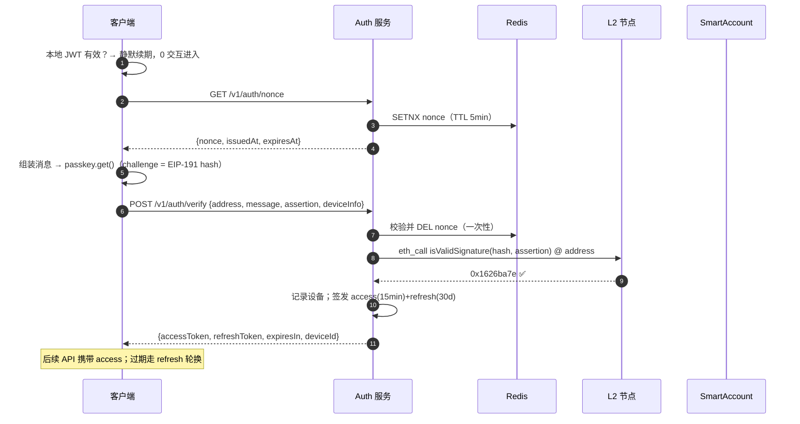

# 技术详设 P1-B：登录（Signin）

> 版本：v0.4.0 ｜ 状态：待评审
> 上游：[用例 02](../usecases/02-signin.md) ｜ [分期计划 §3.5](../development-phases.md) ｜ [技术设计 §4.7（ERC-1271）](../tech-design.md)
> 范围：**P1 登录 = nonce + ERC-1271 断言 + JWT**（0 链上写入 / 0 Gas / 0 钱包弹窗）。P2 的「会话密钥复用登录」路径在 §11 预留。

## 1. 凭证与会话模型

```
本地（IndexedDB）
├── passkey 引用（credentialId）
├── refreshToken（30d，httpOnly 由客户端持有）
└── accessToken（15min，内存）

服务端
├── nonce 存储（Redis：单次有效，TTL 5min）
├── sessions 表（账户 × 设备 × JWT jti）
└── players 设备清单（登录历史/登出管理）

信任链：passkey 断言 → 合约 isValidSignature（ERC-1271）→ JWT
JWT 只授 API 能力（读/撮合/资格签名请求），永远不代表链上权限
```

## 2. 签名消息格式（SIWE 风格，EIP-191）

```
chainarena.wantyou to sign in with your account:
0xABC...DEF

URI: https://arena.example
Version: 1
Chain-ID: 8453
Nonce: 9f3c...（服务端一次性）
Issued-At: 2025-01-01T00:00:00Z
Expiration-Time: 2025-01-01T00:05:00Z
```

- `hash = keccak256(EIP-191(message))`；断言 challenge = hash（与 UserOp 验签同一编码管线，客户端 `signer/` 模块复用）
- Expiration 与 nonce TTL 对齐（5min）

## 3. 验签路径（关键设计）

| 情形 | 路径 | 说明 |
|---|---|---|
| 账户已部署（常规） | `eth_call isValidSignature(hash, assertion) @ 账户地址` | 节点模拟执行真实合约代码——**后端无法冒签** |
| 账户未部署（注册中途放弃） | ① state-override 模拟：override 账户地址 code = 工厂部署后 runtime code，再 `eth_call`；② 或直接引导回注册（P1-A） | 依赖支持 `eth_call` stateOverride 的节点（自建/付费 RPC） |
| 断言属于其他账户 | 返回 ≠ `0x1626ba7e` → 拒绝并提示「切换账户」 | — |

## 4. 端到端时序



## 5. 后端 API

| 端点 | 请求 | 响应 | 备注 |
|---|---|---|---|
| GET `/v1/auth/nonce` | — | `{nonce, issuedAt, expiresAt}` | 限流 10/IP/min |
| POST `/v1/auth/verify` | `{address, message, assertion, deviceInfo}` | `{accessToken, refreshToken, expiresIn, deviceId}` | 断言链上验证 |
| POST `/v1/auth/refresh` | `{refreshToken}` | 新 token 对 | **轮换 + 重用检测**：旧 refresh 再现 → 视为泄露，吊销该账户全部会话 |
| POST `/v1/auth/logout` | `{deviceId?}` | — | 缺省登出当前设备 |
| GET `/v1/auth/sessions` | Bearer | 设备列表 | 管理多端 |

JWT claims：`sub=账户地址, did=deviceId, tier, iat, exp, jti`；不含任何链上权限语义。

## 6. 异常与边界

| 情形 | 处理 |
|---|---|
| nonce 重放 | Redis 单次 DEL；同 nonce 二次提交 401 |
| 跨账户断言 | 合约返回非 magic → 401 + 「切换账户」文案 |
| 时钟偏移 | 服务端 ±30s 容差；客户端过期以服务端 issuedAt 为准 |
| Auth 服务作恶 | 验签在合约/节点模拟完成，无法给非签名者发 JWT；JWT 亦无链上权力 |
| refresh 泄露 | 轮换重用检测 → 全会话吊销 → 强制 passkey 重登 |
| 账户被恢复/轮换（P1-C） | 索引器收到 `PasskeyRotated/RecoveryCompleted` → 删除该账户全部 sessions → 全端登出 |
| 进行中对局（P2 起） | JWT 过期不影响出招（走会话密钥）；观战走公开 API |

## 7. 安全设计

| 面 | 机制 |
|---|---|
| 防冒签 | ERC-1271 合约级判定；后端零自由裁量 |
| 防重放 | 一次性 nonce + 消息含域名/链 ID/过期时间 |
| 防钓鱼 | 消息首行域名可读；rpId 绑定（跨域 passkey 不可用） |
| 防会话劫持 | access 15min 内存态；refresh 轮换+重用检测；全端登出事件由索引器驱动 |
| 隐私 | deviceInfo 只存指纹哈希与 UA 摘要，不存 PII |

## 8. 性能预算

| 路径 | 目标 |
|---|---|
| 静默续期 | < 100ms（纯本地） |
| nonce+断言+验签 | p95 ≤ 3s（eth_call ~200ms 占大头） |
| 节点容错 | 多 RPC 提供商故障转移；验签调用幂等可重试 |

## 9. 测试矩阵（摘要）

1. 主路径三端计时；断网重试
2. nonce 重放 / 过期 / 双花 → 全拒
3. 跨账户 passkey / 伪造断言 → 全拒
4. refresh 轮换重用攻击 → 全会话吊销
5. 账户轮换后旧 JWT 即时失效（事件驱动登出）
6. 未部署账户 state-override 模拟路径（依赖节点能力矩阵测试）

## 10. P2 预留

- 「会话密钥复用登录」：本地仍有有效会话密钥时，直接用它签登录 nonce（L1 级静默），管线不变仅换签名者
- 登录与匹配解耦：JWT 过期不阻塞出招（会话密钥自治）

## 11. 规格待定项

1. accessToken/refreshToken 时长终值（15min/30d 起评）
2. 会话密钥可否签登录 nonce 的安全评审（扩大 L1 密钥用途面）
3. state-override 验签的节点依赖（自建 vs 商用 RPC 能力矩阵）
4. 多因素（新设备首次登录是否强制邮箱二次确认）

## 12. 关联文档

[用例 02](../usecases/02-signin.md) · [P1-A 注册](./01-signup.md) · [P1-C 找回](./03-recover.md) · [分期计划](../development-phases.md) · [技术设计 §4.7](../tech-design.md)
