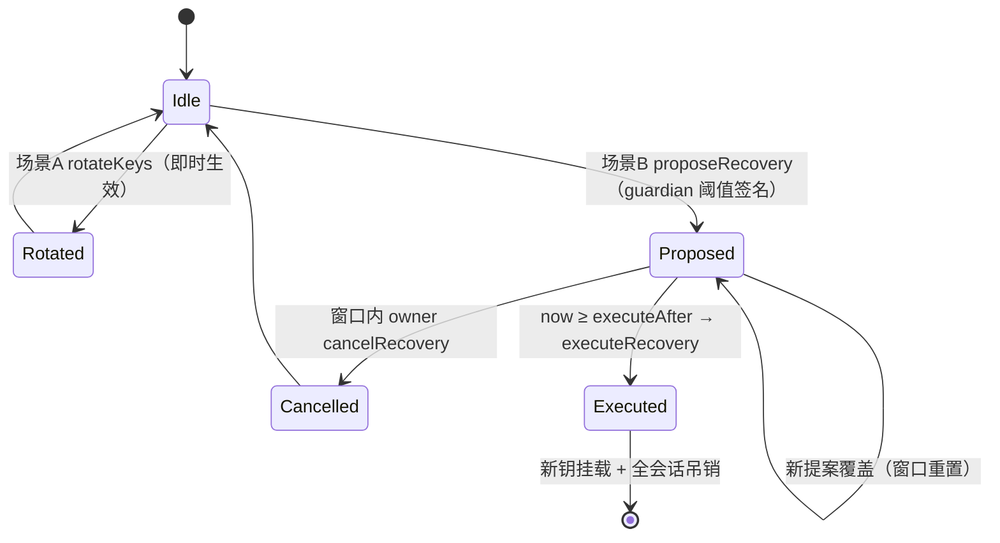
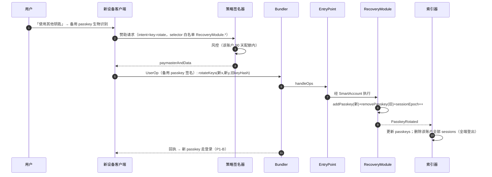
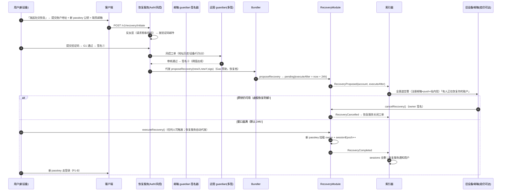

# 技术详设 P1-C：找回（Recover）

> 版本：v0.4.0 ｜ 状态：待评审
> 上游：[用例 03](../usecases/03-recover.md) ｜ [分期计划 §3.6](../development-phases.md) ｜ [架构 §3.2](../architecture.md)
> 范围：**P1 找回 = 场景 A 备用 passkey 即时轮换 + 场景 B 社交恢复（guardians + 延时窗口）**。`revokeAllSessions` 在 P1 作用域为空但语义冻结（P2 起吊销会话/代打密钥）。

## 1. 核心模型回顾

**换钥匙不换房子**：账户 = 链上 Safe 合约，passkey 只是钥匙之一。段位/Fighter/奖金/$ARENA 全挂账户地址。恢复 = 轮换钥匙，资产零移动。

| 场景 | 条件 | 时长 | 签名 |
|---|---|---|---|
| A 备用钥匙轮换 | 仍持有**任意一把**已注册 passkey（含备用） | ~1 分钟 | 1 次（owner 级） |
| B 社交恢复 | 自有 passkey 全丢 | guardian 阈值 + 延时窗口（默认 24h） | guardians 聚合签名 |

## 2. RecoveryModule 链上设计

### 2.1 状态与存储

```solidity
contract RecoveryModule {
    // ---- passkey 管理（owner 级，任意一把可操作）----
    mapping(address => bytes32[]) passkeys;            // 账户 → 公钥哈希列表（1 主 + N 备）
    uint256 public sessionEpoch;                        // 轮换即 +1；P2 会话密钥校验 epoch（即 revokeAllSessions 的实现锚）

    // ---- guardians（on-chain N-of-M，默认 2/2）----
    mapping(address => address[]) guardians;            // 默认 = [emailGuardianSigner, opsMultisig]
    mapping(address => uint256) guardianThreshold;      // 默认 2

    // ---- 社交恢复窗口 ----
    struct Pending { bytes32 newKeyX; bytes32 newKeyY; uint64 executeAfter; }
    mapping(address => Pending) pending;                // 同账户新提案覆盖旧提案并重置窗口
}
```

### 2.2 函数与权限矩阵

| 函数 | 谁能调 | 语义 |
|---|---|---|
| `addPasskey(x,y)` / `removePasskey(hash)` | 任意已注册 passkey（L2 签名） | 钥匙增删 |
| `rotateKeys(newX,newY,oldHash)` | 任意已注册 passkey | **场景 A**：add 新 + remove 旧 + `sessionEpoch++`（= revokeAllSessions），一笔原子 |
| `revokeAllSessions()` | 任意已注册 passkey | 仅 `sessionEpoch++` |
| `addGuardian/removeGuardian` | 任意已注册 passkey | guardian 集变更（可加亲友地址），事件透明 |
| `proposeRecovery(newX,newY,bytes sigs)` | 任何人（携带 M-of-N guardian ECDSA 签名） | **场景 B 入口**：验阈值签名 → 写 `pending`，`executeAfter = now + window` |
| `cancelRecovery()` | 任意已注册 passkey | **窗口内紧急叫停**（原钥被盗恢复防御），清空 `pending` |
| `executeRecovery()` | 任何人 | `now ≥ executeAfter` → 新 passkey 挂载 owner + `sessionEpoch++` |



### 2.3 guardian 签名聚合格式

```
sigs = abi.encodePacked(
    r1,s1,v1, guardianAddr1,   // 邮箱 guardian（后端 KMS 验证码通过后签）
    r2,s2,v2, guardianAddr2,   // 运营托管 guardian（多签风控通过后签）
    ...
)
// 每签名覆盖内容 = keccak(account, newX, newY, executeAfterBucket)
// bucket = 提案小时窗口 → 防旧签名对新提案重放
```

**guardian 体系**（对齐用例 03「第二 passkey / 邮箱 / 运营托管」）：

| guardian | 链上形态 | 验证什么 |
|---|---|---|
| 备用 passkey | 即 owner 级钥匙（走场景 A，不进 guardian 集） | 直接生物识别 |
| 邮箱 guardian | 后端 `emailGuardianSigner`（KMS 地址） | 邮件验证码 = 「是本人在申请」 |
| 运营托管 guardian | 运营多签 | 独立风控（设备指纹/行为分）=「不像抢账户」 |
| （可选）亲友地址 | 用户自加 | 用户自主扩展 |

默认 `threshold = 2`（邮箱 + 运营）——两渠道独立，串通需同时攻破后端风控与运营多签。

## 3. 场景 A：备用钥匙轮换（时序）



## 4. 场景 B：社交恢复（时序）



## 5. 恢复服务 API

| 端点 | 请求 | 响应/动作 |
|---|---|---|
| POST `/v1/recovery/initiate` | `{account, newPubKey, contactEmail}` | 发验证码；限流 3/账户/天 |
| POST `/v1/recovery/email/verify` | `{account, code}` | 通过 → guardian 签名①入工单 |
| GET `/v1/recovery/{account}/status` | — | `{state: none|proposed, executeAfter?, guardianProgress}` |
| （运营台）POST `/v1/ops/recovery/{id}/approve|reject` | 多签操作员 | 签名②或拒绝（拒绝理由入审计） |
| 内部 cron | — | 窗口届满自动代发 `executeRecovery`；卡死工单告警 |

## 6. 事件与索引器

| 事件 | 索引器动作 |
|---|---|
| `PasskeyRotated` | 更新 `players.passkeys`；删除该账户全部 sessions（驱动全端登出） |
| `GuardiansChanged` | 更新 guardian 清单（客服可见） |
| `RecoveryProposed` | `recovery_events` 落库 + 推送告警 + 窗口倒计时任务 |
| `RecoveryCancelled` | 关闭工单、停倒计时 |
| `RecoveryCompleted` | 钥匙替换、sessions 全删、通知用户新钥可登录 |

## 7. 安全分析

| 攻击路径 | 防线 |
|---|---|
| 攻击者用受害者邮箱发起恢复 | ① 邮箱验证码只证明「邮箱可达」，不证明身份 → ② 运营 guardian 独立风控（设备指纹/行为分/账户历史）→ ③ 24h 窗口内**原钥可 `cancelRecovery` 叫停** |
| guardians 串通 | 邮箱（后端）与运营（多签）渠道隔离；用户可自加亲友 guardian；全部事件链上可审计 |
| 旧签名重放到新提案 | 签名覆盖 `executeAfterBucket`（小时窗），新提案使旧签名失效 |
| 提案轰炸（反复 propose 重置窗口 DoS） | 每账户 pending 唯一，覆盖即重置；发起侧限流 3/账户/天；窗口重置对真实丢失者同样有利 |
| 窗口内旧钥恶意转走资产 | **明示语义**：窗口内原 owner 保留全部权限（含转账）——这是被盗者的资产自救通道；若用户仍持有钥匙且怀疑泄露，应走场景 A 即时轮换而非等待窗口 |
| 恢复后旧钥重放 | `sessionEpoch++` 使 P2 起所有会话/代打密钥失效；旧 passkey 已从合约移除，任何 UserOp 验签即拒 |
| 服务端作恶（伪造 guardian） | guardian 签名验证在链上；后端只能「拒绝服务」不能「错误放行」 |
| 邮箱也丢 | 运营托管 guardian 人工申诉通道（KYC 级慢路径，用例 03 §5） |

## 8. 异常与边界

| 情形 | 处理 |
|---|---|
| 恢复期间有进行中对局（P2 起） | 棋钟不暂停；损失上限 = 一局入场费（技术 §9.1）；代打 Second 在 `executeRecovery` 前仍可应战（护盘），风控需确认非攻击者委托 |
| `executeRecovery` 竞态（多人同时触发） | 幂等：pending 清空后二次调用 revert，无副作用 |
| reorg 回滚了 propose | 索引器 6 conf 定稿；恢复服务以链上状态为准推进工单 |
| 提案后用户找回旧钥 | 直接 `cancelRecovery` 或干脆走场景 A 轮换（新提案 pending 被覆盖语义不影响） |
| Gas 承担 | 恢复全程赞助（恢复档配额 1 次/账户/90 天）；用户不能「卡死在门外」 |
| 多次轮换（换机频繁） | 场景 A 无次数限制（owner 自主权）；赞助配额限制的是「免费」，超额可 Token 代付（P3） |

## 9. 测试矩阵（摘要）

1. 场景 A 全链路 ≤ 60s；轮换后旧钥签任何 UserOp 全拒（含旁路构造）
2. 场景 B：guardian 2/2 缺一 → propose revert；阈值达成 → propose 成功
3. 窗口内 `cancelRecovery` 叫停 → `RecoveryCompleted` 不可达
4. 虚假恢复演练：攻击者持邮箱发起 → 风控拒绝路径；风控误放行 → 原钥叫停路径
5. 旧 guardian 签名对新提案重放 → revert（bucket 失效）
6. 提案覆盖与窗口重置语义；executeRecovery 幂等
7. `PasskeyRotated` → 全端 JWT 即时失效（P1-B §6 联动）
8. `sessionEpoch` 前向兼容：P2 会话密钥忽略 epoch 的负测试（应拒绝）

## 10. 规格待定项

1. 窗口时长终值（建议 24h；可按风控分动态 12–48h）
2. guardian 阈值默认 2/2 是否放开用户自选（1/2 会弱化串通防线）
3. 运营 guardian 风控 SLA（工单时效承诺，影响真实丢失者的总恢复时长）
4. 恢复赞助配额（1 次/90 天）与 Token 代付衔接
5. 「窗口内旧钥全权限」的 UX 文案与风险提示定稿

## 11. 关联文档

[用例 03](../usecases/03-recover.md) · [P1-A 注册](./01-signup.md) · [P1-B 登录](./02-signin.md) · [分期计划](../development-phases.md) · [架构 §3.2](../architecture.md)
