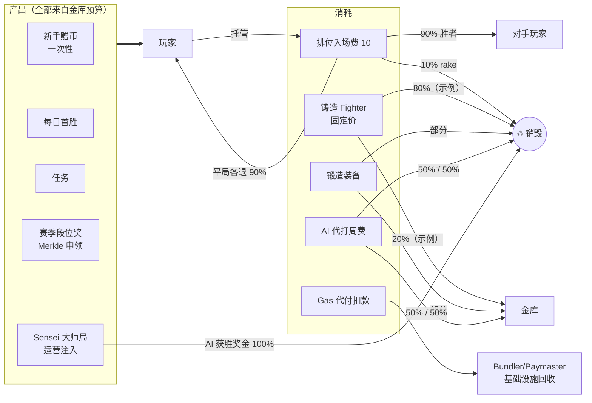

# $ARENA 代币经济设计（Tokenomics）

> 版本：v0.4.0 ｜ 状态：草案待评审
> 上游文档：[产品设计](./product-design.md) §2.6 / §4.2 / §4.3 ｜ [技术设计](./tech-design.md) §3 / §4.4 / §5.4 / §8.3
> 本文范围：$ARENA 的供给与分配、产出与消耗闭环、赛季预算、隐式价格锚、防女巫与风险。合约接口与实现以技术设计为准；本文给参数与机制。

## 1. 设计目标与原则

| # | 原则 | 含义 |
|---|---|---|
| P1 | **游戏内货币优先，投机后置** | MVP 阶段 $ARENA 内部闭环、不可提现（产品 §2.6），先证明「产出—消耗」的循环成立，再谈开放交易 |
| P2 | **每一枚产出都有预算来源** | 无无源增发：所有发放来自预分配的金库池，链上可对账 |
| P3 | **每一处消耗尽量带销毁** | rake / 锻造 / 代打费 / AI 获胜奖金 → burn，对冲产出通胀 |
| P4 | **可验证会计** | 产出、销毁、金库流转全部链上事件，任何人可重建账本（与对局「事件即真相」同理念） |
| P5 | **防女巫优先于拉新** | 产出侧全部限速限次；空投式薅羊毛在机制层不可行 |
| P6 | **不做庞氏** | 玩家收益来自真实对手的入场费与运营注入（Sensei 局），不承诺回报 |

## 2. 代币参数

| 项 | 值 | 说明 |
|---|---|---|
| 标准 | **ERC-20 + EIP-2612 permit** | permit 支持无 Gas 授权（技术 §2 架构图）；Gas 代付扣款走 postOp |
| 网络 | Base（L2） | 与全游戏同链，L2 内循环 |
| 精度 | 18 | — |
| 总量 | **固定总量，一次性铸造**（示例 10 亿，§3） | 部署时全额铸入金库子账户；**合约无后续 mint 权**——增发风险从代码层消除 |
| 可升级性 | 不可升级、无 owner 铸造后门 | 金库 = 普通多签地址，只能转出已持有量，链上完全可审计 |
| 出口 | MVP **不可提现**（无桥、无 DEX）；V2 按条件开启（§9） | 产品 §2.6 / 技术 §5.4 |

> **为什么固定总量而非可铸造**：可铸造 ERC-20 的 mint 权限本身就是中心化信任点；「一次性铸造 + 金库转移式发放」让发放曲线 100% 链上可审计，与 P2/P4 一致。代价是金库热钱包安全要求高（§8）。

## 3. 分配与释放（示例参数，数值待定）

| 池 | 比例 | 数额（按 10 亿） | 释放 | 用途 |
|---|---|---|---|---|
| **游戏激励池** | 40% | 4.0 亿 | 按赛季线性释放（示例 24 个赛季 ≈ 2 年），每赛季预算硬顶 | 赛季段位奖 / 每日首胜 / 任务 / 新手赠币 |
| **生态与市场池** | 20% | 2.0 亿 | 12–24 个月线性 | Sensei 局奖池注入 / Paymaster 赞助预算 / 买量（技术 §4.4 成本 <$5/玩家全周期） |
| **团队与顾问** | 20% | 2.0 亿 | 12 个月 cliff + 36 个月线性 | — |
| **投资人** | 15% | 1.5 亿 | 12 个月 cliff + 24–36 个月线性 | — |
| **社区与流动性** | 5% | 0.5 亿 | V2 上线时按条件解锁 | 空投（反女巫）/ DEX 流动性（§9） |

- 每个池 = 一个公开标签的多签地址；激励池对 SeasonLedger / 任务发放合约做额度 approve，链上可见余量
- 团队/投资人池 MVP 期间天然冻结（无出口可卖），V2 开放交易前公开解锁时间表

## 4. 产出与消耗闭环（核心）



### 4.1 产出表（限速即防女巫）

| 来源 | 频率/上限 | 单次额度（示例） | 预算池 | 链上动作 |
|---|---|---|---|---|
| 新手赠币 | 1 次/账户（链上 per-account 硬限） | 50 $ARENA ≈ 5 局排位学费 | 激励池 | 注册批内发放（用例 01） |
| 每日首胜 | 1 次/账户/日 | 2–5 | 激励池 | endMatch 内含 |
| 任务 | 每任务 1 次，日/周上限 | 1–10 | 激励池 | 链下资格签名 + 链上发放（技术 §8.2） |
| 赛季段位奖 | 1 次/赛季，按段位档 | 见 §5 | 激励池（赛季硬顶内） | `claimSeasonReward(proof)`（技术 §8.3） |
| Sensei 大师局注入 | 按局，运营预算熔断 | 大师局奖池增量 | 生态池 | 注入事件透明可审计 |

### 4.2 消耗表（去向分解）

| 消耗 | 规则 | 销毁 | 金库 | 回到玩家 | 说明 |
|---|---|---|---|---|---|
| 排位入场费 | 10/局托管 | **rake 10%**（=2/局） | — | 胜者 18（90%） | 平局各退 9，共销毁 2（产品 §2.3） |
| 铸造 Fighter | 固定价（运营参数） | 80%（示例） | 20%（示例） | — | 旧 Fighter 不回收 → 重铸即净 sink（用例 04） |
| 锻造装备 | craft 费 | 固定比例（示例 50%） | 余下 | — | 产品 §2.6；掉落装备免费但随机（用例 07） |
| AI 代打周费 | hire 转入 | 50% | 50% | — | 产品 §4.3；代打奖金 70% 计入防躺赢 |
| Gas 代付 | postOp 按汇率扣 | — | — | — | 离场给基础设施；汇率 10% 缓冲 + 预言机新鲜度校验（技术 §4.4） |
| Sensei 入场费 | 大师局更贵 | AI 获胜奖金 **100%** | — | 玩家胜 = 拿注入奖池 | 打爆官方 AI = 白拿预算（产品 §4.2） |
| Agent 质押罚没 | 违规 AI 罚没 | **100%（建议）** | — | — | AgentRegistry 质押可罚没（技术 §6） |

### 4.3 流通恒等式与监控

```
Δ流通量 = 产出(金库流出) − 销毁(rake/铸造/锻造/代打/AI 奖金/罚没) − 金库回流(铸造/锻造/代打的金库份额)
净回收率 = (销毁 + 金库回流) / 产出
```

| 指标 | 目标（示例） | 动作 |
|---|---|---|
| 净回收率 | MVP ≥ 50%，V2 开放交易前 ≥ 100% | 不达标 → 降产出参数优先于加新 sink |
| 单局经济 | 排位 rake 2/局 恒定 | 数值不动合约，赛季调参 |
| Sensei 注入/日 | 熔断线（生态池预算/UI 可见） | 超限自动停注入，AI 局让位真人 |

## 5. 赛季预算模型

- 赛季 = 4 周（产品 §2.6）；**每赛季激励预算 = 激励池 ÷ 释放赛季数**（示例：4 亿 ÷ 24 ≈ **1,667 万/赛季硬顶**）
- 赛季内分解（示例）：段位奖 60% ｜ 每日首胜 + 任务 30% ｜ 储备 10%（超发对局量备用）
- 段位奖按榜位档位递减（如前 1%/5%/20%/50% 四档），Merkle root 上链、玩家自领（技术 §8.3）——**判定链下锚定、发放链上非托管**
- 预算未用完部分滚入下赛季储备，**不加速释放**

## 6. 隐式价格锚（MVP 无市场阶段）

MVP 没有交易场所，$ARENA 的「价格」由三个官方固定价隐式锚定：

```
新手赠币 50 = 5 局排位学费        （保证免费玩家可入场）
排位入场费 10/局 → 胜者净赚 +8    （胜率 50% 时期望 −2/局 = 时间成本）
铸造 Fighter 固定价 P            （P 与「打 N 局的期望成本」联动定价，防止铸造套利）
```

- 锚定三角（赠币 ↔ 入场费 ↔ 铸造价）由运营参数统一维护，单一参数变动须走经济仿真回归（技术 §10 扩展 token 曲线）
- **铸造价 P 与地板价 M 的三态治理**（防「一级→二级」套利，套利利润 π = M(1−f) − P − g，f=市场费，g≈gas）：

| 状态 | 判断 | 后果 | 干预 |
|---|---|---|---|
| M > P 持续（需求过热） | π > 0，mint→卖套利自启，卖压将 M 压回 P(1+f) 附近 | 每轮 burn 80%×P，但 (M−P) 价值让给套利者 + NFT 增发稀释存量 | 上调 P，把需求收进 burn/金库 |
| **P ≥ M（健康带）** | π ≤ 0，**无铸造套利** | 市场为便宜通道，mint 为「便利 + 配置抽奖」通道 | 不动 |
| M ≪ P（地板跌破铸造价） | π < 0，但 mint 通道死亡 | 80%-burn 大额 sink 停摆；隐式锚失真（宣称 1 Fighter ≈ P，市场只认 M）；供过于求信号 | 下调 P 至略高于 M(1+费用)，链上事件透明 |

- P 兼任**自动执行的价格天花板**：M > P 时套利自发收敛，无需盯盘；严格无套利条件是 P ≥ E[随机配置市场价值]（floor 只定价最差配置），由 ±3% 回归门（无神配置）+ 每次重铸 80% burn 兜底（用例 04「洗配置」）
- MVP 计价不对称（$ARENA 无市场、NFT 以 ETH 计价）：mint 价按「水龙头币需攒 N 天」定价，堵「赠币→铸→卖 ETH」抽取（§7 女巫兜底）

## 7. 防女巫与滥用

| 面 | 机制 |
|---|---|
| 新手赠币 | 链上 per-account 一次性（合约层硬限，非链下判断） |
| 每日首胜/任务 | 按日刷新 + 任务资格链下签名防刷（技术 §8.2） |
| 赛季奖 | 段位 = Elo 真实对局成本；Merkle 名单阶段剔除女巫标记账户 |
| Paymaster | 拒绝名单（账户年龄 + 行为分 + 设备指纹，技术 §4.4）；赞助预算日熔断 |
| Sensei 局 | 大师局奖池注入预算熔断；AI 局占比随真人密度让位 |
| 掉落薅羊毛 | 休闲掉率 ≥95% 不掉 + 每日掉落上限（用例 07 §6） |
| 代打躺赢 | 代打收益 70% 计入 + 周费销毁分流（产品 §4.3） |

## 8. 会计与可验证性

- 金库地址全部公开打标签（激励/生态/团队/投资人/社区五池），余额与流转链上可查
- 产出 = 金库转出事件；销毁 = `Transfer(to=0x0)`；季度透明报告由索引器从事件流自动生成（技术 §8.1）
- 金库热钱包（激励池发放地址）安全基线：多签 + 操作员限额 + 提款延时；大额异常可被任何人从链上发现并告警

## 9. MVP → V2 分期

| 项 | MVP | V2 |
|---|---|---|
| 出口/提现 | ❌ 关闭（内部闭环） | 条件达成后开放：净回收率 ≥100% + 解锁时间表公开 |
| 交易 | ❌ 无 DEX | 社区池 5% 建 DEX 流动性；Fighter/装备 NFT 市场照常 |
| 价格 | 隐式锚（§6） | 市场价 + 官方参数（铸造价等）动态跟价 |
| 质押 | Agent 质押（准入+罚没） | 玩家质押 / 治理（待定） |
| Gas 代付 | 汇率 + 10% 缓冲 | BatchOraclePriceFeed 正式版（技术 §3.1） |
| 增发 | 无（固定总量） | 需治理决策 + 社区公示，默认无 |

## 10. 风险与缓解

| 风险 | 缓解 |
|---|---|
| 产出 > 消耗 → 通胀螺旋 | 净回收率监控（§4.3）+ 赛季预算硬顶 + 降产出优先 |
| Sensei 注入被职业羊毛党套利 | 注入熔断 + AI 局奖励降档 + 女巫名单联动 Paymaster |
| 铸造价 vs NFT 地板价倒挂套利 | 铸造价动态参数 + 仿真回归（§6） |
| 团队/投资人解锁砸盘 | MVP 无出口天然隔离；V2 前公开 vesting 合约地址 |
| Gas 代付汇率操纵 | 预言机新鲜度链上校验 + 10% 缓冲（技术 §4.4） |
| 金库热钱包被盗 | 多签 + 限额 + 延时；激励池单池风险敞口受限（§8） |
| 固定总量 vs 长期需求增长 | 激励池储备跨赛季滚存机制预留；必要时 V2 治理议增发（默认反对） |

## 11. 规格待定项

1. 总量与五池比例的最终数值（需经济仿真：活跃玩家 × 局数 × 净回收率三因子模型）
2. 铸造/锻造费的销毁-金库分成比例
3. 赛季段位奖档位表与各档数额
4. 新手赠币数额与「可玩局数」承诺（与入场费、Paymaster 赞助 50 局的衔接）
5. Agent 质押罚没的最终去向（本文建议 100% 销毁）
6. V2 开放交易的具体触发条件与流动性方案

## 12. 关联文档

[产品设计](./product-design.md) §2.3 / §2.6 / §4.2 / §4.3 ｜ [技术设计](./tech-design.md) §3.1 / §4.4 / §5.4 / §8.2 / §8.3 ｜ [用例集](./usecases/README.md)（01 注册·赠币 / 04 铸造 / 05 对局·rake / 06 锻造 / 07 掉落）
