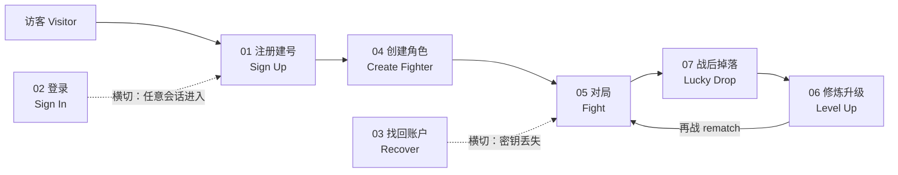

# 用例集：玩家生命周期（User Lifecycle Use Cases）

> 版本：v0.4.0 ｜ 状态：待评审
> 上游文档：[产品设计](../product-design.md) · [技术设计](../tech-design.md) · [代币经济](../tokenomics.md) · [架构设计](../architecture.md) · [分期开发（P1 详设）](../development-phases.md)
> 本目录将「玩家生命周期」拆分为独立用例文档，每个用例遵循统一模板：触发与入口 → 主流程 → 状态变化 → 体验要点（弹窗/等待/费用）→ 异常与边界 → 权限与安全 → 关联文档。

## 生命周期总览

## 用例索引

| # | 用例 | 文件 | 触发 | 关键链上动作 | 签名层级 | Paymaster 档 |
|---|---|---|---|---|---|---|
| 01 | 注册建号（60 秒首局） | [01-signup.md](./01-signup.md) | 访客点开链接 | 部署 Safe + `claimStarter` + `createMatch`（一笔原子） | L2 passkey | 新手赞助（$0） |
| 02 | 登录 | [02-signin.md](./02-signin.md) | 回访玩家打开站点 | 纯链下（ERC-1271 验签） | L1/L2 | 无 Gas |
| 03 | 找回账户/密钥 | [03-recover.md](./03-recover.md) | passkey 丢失/换机 | RecoveryModule 轮换密钥 | L2（备用 passkey / guardians） | 待定 |
| 04 | 创建角色（铸造 Fighter，ERC-721） | [04-create-fighter.md](./04-create-fighter.md) | 新手领取 / 商城购买 / 市场购入 | `claimStarter` / `mint`（VRF 定配置）/ `transfer` | L2 passkey | 赞助 / Token 代付 |
| 05 | 对局（匹配→终局） | [05-fight.md](./05-fight.md) | 大厅点「排位/休闲」 | `create/accept/commit/reveal/resolve/end` | L1 会话密钥（开局授权 1 次 L2） | 排位自付 / 休闲赞助 / Agent 档 |
| — | 单回合深入演算 | [round-walkthrough.md](./round-walkthrough.md) | （05 的子文档） | 一个回合的完整数值推演 | — | — |
| 06 | 修炼升级 | [06-levelup.md](./06-levelup.md) | XP 达标 / 赛后批量 | `levelUp` / `craft` | L1（levelUp）/ L2（craft） | Token 代付 |
| 07 | 战后掉落（武器/护甲） | [07-lucky-drop.md](./07-lucky-drop.md) | endMatch 结算批内自动 roll | lootSeed 掉落判定 + `Gear._mint`（ERC-1155） | 无签名（被动到账） | 无 Gas（并入结算） |

> **命名说明**：本游戏没有传统 MMO 意义的"角色"——**选手身份 = 智能账户，游戏角色 = Fighter（ERC-721 NFT）**，武器/护甲装备 = ERC-1155（用例 07）。"create role" 对应 04 的 Fighter 铸造。

## 后续可扩展用例（未拆分）

- 雇佣/召回 AI 代打（Second，产品 §4.3）
- 赛季奖励申领（`claimSeasonReward`，Merkle 混合模式）
- 掉落装备的合成/分解与赛季限定池（用例 07 §7 待定项）
- L1↔L2 出入金（桥）
- 观战与回放（纯读）
